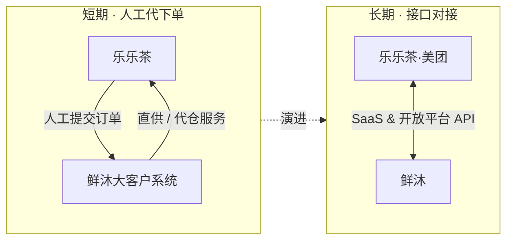
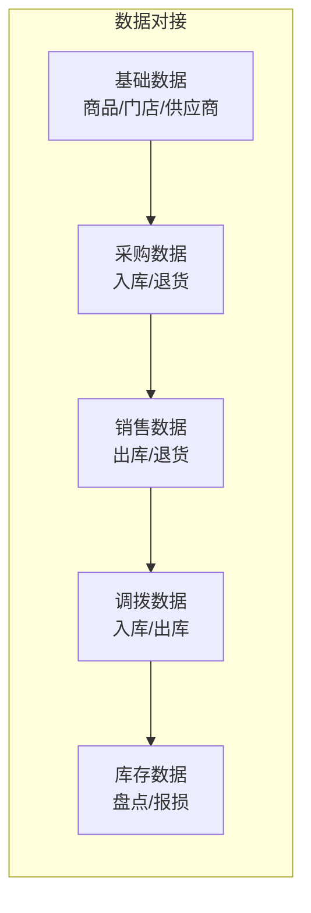

## 一、产品架构

## 二、商务样例

四份对外方案：从合作汇报、合作方案到报价，按需切换查看，不展开成整页长图。

  

    <button type="button" class="deck-tab is-active" data-deck-tab="xicha">喜茶 × 鲜沐合作汇报 · 34 页</button>
    <button type="button" class="deck-tab" data-deck-tab="naixue">奈雪的茶 × 鲜沐合作方案 · 20 页</button>
    <button type="button" class="deck-tab" data-deck-tab="chayan">茶颜悦色 × 鲜沐合作方案 · 15 页</button>
    <button type="button" class="deck-tab" data-deck-tab="leyecha">乐乐茶 × 鲜沐合作报价 · 6 页</button>
  

  

    
  

  

    <button type="button" class="deck-nav" data-deck-prev aria-label="上一页">‹</button>
    1 / 34
    <button type="button" class="deck-nav" data-deck-next aria-label="下一页">›</button>
    喜茶 × 鲜沐 · 合作汇报
  

  
点标签切换方案；点画面左右两侧、或用下面箭头 / 键盘 ← → 翻页

## 三、对接方案

> **一句话总览**：短期用鲜沐大客户系统**人工代下单**跑通直供、代仓；长期切换到 **SaaS & 开放平台接口对接**。本文档按「品牌接入 → 五类数据对接 → 接口目录 → 功能清单」梳理，全部流程图与字段规则保留原图原表。

| 阅读指引 | 说明 |
| --- | --- |
| **下发** | 美团（乐乐茶）→ 鲜沐 |
| **回传** | 鲜沐→美团（乐乐茶） |
| **备注** | 原文档评论区中的讨论与待确认点 |

### 方案总览：两大阶段

### 一、品牌接入

#### 1.1 业务背景

| 合作要素 | 内容 |
| --- | --- |
| **合作业务** | 货品：直供 + 代仓；门店：直营 + 加盟 |
| **合作区域** | 浙江外区 + 杭州送仓；江苏外区（不含南通、苏州等苏南区域）+ 南京送仓；重庆外区（年后暂定华东代仓业务及其他外区门店） |
| **合作仓库** | 嘉兴总仓、南京总仓、华西总仓、重庆总仓、长沙总仓（1月7日暂时终止合作），附件：《乐乐茶合作门店对应仓库信息0108.xlsx》 |
| **合作品类** | 直供：目前仅鲜果（未来可能会有标品）；代仓：鲜果、标品均有可能 |
| **交易履约** | 门店下单后随平台配送周期履约；日配区域日期双号下单，非日配区域在配送日前下单，附件：《乐乐茶合作门店-配送周期.xlsx》 |

#### 1.2 租户入驻

> 系统对接前，需先完成**品牌租户入驻**，才能支撑直供、代仓两大业务场景。

| 入驻环节 | 动作 | 货权归属 |
| --- | --- | --- |
| **新建品牌** | 人工在 SaaS 线下建立，获取租户 ID、appKey、appSecret | — |
| **商品报价（直供）** | 商品在 SaaS 进行报价，实现乐乐茶采购 | 鲜沐 |
| **商品代仓** | 货品在 SaaS 进行代仓申请/管理，实现乐乐茶采购/管理 | 乐乐茶 |

### 二、数据对接

> 共 **5 类数据**：基础数据、采购数据、销售数据、调拨数据、库存数据。除直供商品档案走线下映射外，其余均通过**接口方案**实现。

#### 2.1 基础数据

> 基础数据包含：**商品档案、门店档案、供应商档案**

| 档案 | 覆盖范围 | 实现方式 |
| --- | --- | --- |
| 商品档案 | 按直供/代仓分两类 | 直供：**线下商品映射**；代仓：**接口对接** |
| 门店档案 | 与鲜沐合作的乐乐茶门店 | 接口对接 |
| 供应商档案 | 代仓商品的供应商信息 | 接口对接 |

##### 1.1 商品映射（直供）

直供商品货权在鲜沐，仓储、库存管理及定价权均在鲜沐，需满足乐乐茶线上采购。该类商品档案**不需要接口创建/修改**，由人工线下维护三方编码。

> **备注**（余涛）：根据实际情况，目前是否只需要**新增/修改**场景——删除场景可以通过线下完成，发生概率不高。

##### 1.2 商品同步（代仓）

代仓商品货权在乐乐茶，仓储、库存管理及定价权均在乐乐茶，需满足乐乐茶线下管理仓储、库存及线上采购。该类商品档案**通过接口创建/修改**，系统维护三方编码。

| 序号 | 字段 | 规则 |
| --- | --- | --- |
| 1 | 商品编码 | 需要以**外部商品编码**为准，不关注鲜沐商品编码 |
| 2 | 规格单位 | 满足美团**多级规格**及转换比例下发，即规格单位、换算比例支持多级；库存单位、售后单位均以**最小规格单位**为准 |

##### 1.3 门店同步

直供/代仓商品均需支持乐乐茶合作门店下单，该类合作门店档案通过接口形式创建/修改，**需要人工审核**。

| 序号 | 字段 | 规则 |
| --- | --- | --- |
| 1 | 门店编码 | 需要以**外部门店编码**为准，不关注鲜沐门店编码 |

##### 1.4 供应商同步

代仓商品需要在鲜沐进行仓储、库存管理动作，需提供供应商信息，该类供应商档案通过接口形式创建/修改。

| 序号 | 字段 | 规则 |
| --- | --- | --- |
| 1 | 供应商编码 | 需要以**外部供应商编码**为准，不关注鲜沐供应商编码 |

#### 2.2 采购数据

> 采购数据包含：**采购入库单据、采购出库（退货）单据**，均含「下发 / 取消 / 回传」三类场景，通过接口方案实现。

##### 2.2.1 采购入库

代仓商品货权在乐乐茶，乐乐茶完全把控采购入库环节，**指定鲜沐某仓库**完成相关动作，鲜沐跟随乐乐茶线上指令配合，并将收货入库结果进行**部分回传**。

**采购入库下发**

| 序号 | 字段 | 规则 |
| --- | --- | --- |
| 1 | 采购单号 | 需要以**外部采购单号**为准，不关注鲜沐采购单号 |
| 2 | 仓库编号 | 所有合作仓库编码和名称，线下梳理后提供给美团 |
| 3 | 商品编码 | 需要以**外部商品编码**为准，不关注鲜沐商品编码 |
| 4 | 规格单位 | 需要对方按照**最小规格单位**进行 |
| 5 | 供应商编码 | 需要以**外部供应商编码**为准，不关注鲜沐供应商编码 |

**采购入库回传**

| 序号 | 字段 | 规则 |
| --- | --- | --- |
| 1 | 采购单号 | 需要以**外部采购单号**为准 |
| 2 | 仓库编号 | 合作仓库编码/名称，线下梳理后提供给美团 |
| 3 | 商品编码 | 需要以**外部商品编码**为准 |
| 4 | 规格单位 | 按最小规格单位进行 |
| 5 | 批次信息 | 回传时要求回传**批次（生产日期）、数量** |
| 6 | 入库时间 | 需要有明确的**入库时间**回传 |

**采购入库取消**

| 序号 | 字段 | 规则 |
| --- | --- | --- |
| 1 | 采购单号 | 需要以**外部采购单号**为准 |
| 2 | 仓库编号 | 合作仓库编码/名称，线下梳理后提供给美团 |

##### 2.2.2 采购出库（退货）

代仓商品货权在乐乐茶，乐乐茶完全把控采购出库环节，指定鲜沐某仓库完成相关动作，鲜沐跟随乐乐茶线上指令配合，并将退货出库结果进行回传。

**采购退货下发**

| 序号 | 字段 | 规则 |
| --- | --- | --- |
| 1 | 采购单号 | 需要以**外部采购单号**为准，不关注鲜沐采购单号 |
| 2 | 退货单号 | 需要以**外部采购退货单号**为准，不关注鲜沐采购退货单号 |
| 3 | 仓库编号 | 合作仓库编码/名称，线下梳理后提供给美团，**接口调用时需传参** |
| 4 | 商品编码 | 需要以**外部商品编码**为准 |
| 5 | 规格单位 | 按最小规格单位进行 |

**采购退货回传**

| 序号 | 字段 | 规则 |
| --- | --- | --- |
| 1 | 采购单号 | 需要以**外部采购单号**为准 |
| 2 | 退货单号 | 需要以**外部采购退货单号**为准 |
| 3 | 仓库编号 | 合作仓库编码/名称，接口调用时需传参 |
| 4 | 商品编码 | 需要以**外部商品编码**为准 |
| 5 | 规格单位 | 按最小规格单位进行 |
| 6 | 批次信息 | 回传时要求回传**批次（生产日期）、数量** |
| 7 | 出库时间 | 需要有明确的**出库时间**回传 |

**采购退货取消**

| 序号 | 字段 | 规则 |
| --- | --- | --- |
| 1 | 退货单号 | 需要以**外部采购退货单号**为准 |
| 2 | 仓库编号 | 合作仓库编码/名称，接口调用时需传参 |

#### 2.3 销售数据

> 销售数据包含：**销售出库单据、销售入库（退货）单据**，均含「下发 / 取消 / 回传」三类场景，通过接口方案实现。

##### 2.3.1 销售出库

乐乐茶门店线上生成直供/代仓商品**进货单**，鲜沐负责接收（需进行**库存、履约范围**等校验，返回成功失败结果，美团同步进行订单响应）后进行履约反馈出库结果。整体履约周期遵循**鲜沐规则、计划**。

**销售出库下发（进货单下发）**

| 序号 | 字段 | 规则 |
| --- | --- | --- |
| 1 | 进货单号 | 需要以**外部进货单号**为准，不关注鲜沐进货单号 |
| 2 | 门店编码 | 需要以**外部门店编码**为准，不关注鲜沐门店编码 |
| 3 | 商品编码 | 需要以**外部商品编码**为准 |
| 4 | 规格单位 | 按最小规格单位进行 |

**销售出库回传（进货单发货回传）**

| 序号 | 字段 | 规则 |
| --- | --- | --- |
| 1 | 进货单号 | 需要以**外部进货单号**为准 |
| 2 | 门店编码 | 需要以**外部门店编码**为准 |
| 3 | 仓库编号 | 合作仓库编码/名称，线下梳理后提供给美团 |
| 4 | 商品编码 | 需要以**外部商品编码**为准 |
| 5 | 规格单位 | 按最小规格单位进行 |
| 6 | 批次信息 | 回传时要求回传**批次（生产日期）、数量** |
| 7 | 出库时间 | 需要有明确的**出库时间**回传 |

**销售出库取消（进货单取消）**

| 序号 | 字段 | 规则 |
| --- | --- | --- |
| 1 | 进货单号 | 需要以**外部进货单号**为准 |
| 2 | 门店编码 | 需要以**外部门店编码**为准 |

> **备注**（余涛，2月2日讨论）：
> - 销售出入库回传需要有**批次信息** —— 已补充；
> - 需要**指定仓库发货**，否则会导致发货仓库不一致 —— 使用鲜沐规则，回传时告知仓库；
> - 销售出库（进货单）会包含**多个商品**，可能同时存在直供/代仓商品；
> - 乐乐茶期望：可以有销售出库的**预计出库时间** —— 暂不支持。

##### 2.3.2 销售入库（退货）

乐乐茶门店线上生成直供/代仓商品**售后单**，鲜沐负责接收（需进行**售后审核**，返回成功失败结果，美团同步进行订单响应）后进行回收反馈入库结果。整体售后规则遵循**鲜沐规则、计划**。

**销售退货下发（售后单下发）**

| 序号 | 字段 | 规则 |
| --- | --- | --- |
| 1 | 进货单号 | 需要以**外部进货单号**为准，不关注鲜沐进货单号 |
| 2 | 售后单号 | 需要以**外部售后单号**为准，不关注鲜沐售后单号 |
| 3 | 门店编码 | 需要以**外部门店编码**为准 |
| 4 | 商品编码 | 需要以**外部商品编码**为准 |
| 5 | 规格单位 | 按最小规格单位进行 |

**销售退货审核回传（售后单结果回传）**

| 序号 | 字段 | 规则 |
| --- | --- | --- |
| 1 | 售后单号 | 需要以**外部售后单号**为准 |
| 2 | 门店编码 | 需要以**外部门店编码**为准 |
| 3 | 商品编码 | 需要以**外部商品编码**为准 |
| 4 | 规格单位 | 按最小规格单位进行 |

**销售退货回传（售后退货回传）—— 仅代仓商品回传**

| 序号 | 字段 | 规则 |
| --- | --- | --- |
| 1 | 进货单号 | 需要以**外部进货单号**为准 |
| 2 | 售后单号 | 需要以**外部售后单号**为准 |
| 3 | 仓库编号 | 合作仓库编码/名称，线下梳理后提供给美团 |
| 4 | 商品编码 | 需要以**外部商品编码**为准 |
| 5 | 规格单位 | 按最小规格单位进行 |
| 6 | 批次信息 | 回传时要求回传**批次（生产日期）、数量** |
| 7 | 入库时间 | 需要有明确的**入库时间**回传 |

**销售退货取消（售后单取消）**

| 序号 | 字段 | 规则 |
| --- | --- | --- |
| 1 | 售后单号 | 需要以**外部售后单号**为准 |
| 2 | 门店编码 | 需要以**外部门店编码**为准 |

#### 2.4 调拨数据

> 调拨数据包含：**调拨入库单据、调拨出库单据**，均含「下发 / 取消 / 回传」三类场景，通过接口方案实现。

##### 2.4.1 调拨入库

代仓商品货权在乐乐茶，乐乐茶完全把控**调拨（移库）入库**环节，指定鲜沐某仓库完成相关动作，鲜沐跟随乐乐茶线上指令配合，并将收货入库结果进行**部分回传**。

**调拨入库下发**

| 序号 | 字段 | 规则 |
| --- | --- | --- |
| 1 | 调拨单号 | 需要以**外部调拨单号**为准，不关注鲜沐调拨单号 |
| 2 | 仓库编号 | 合作仓库编码/名称，线下梳理后提供给美团 |
| 3 | 商品编码 | 需要以**外部商品编码**为准 |
| 4 | 规格单位 | 按最小规格单位进行 |

**调拨入库回传**

| 序号 | 字段 | 规则 |
| --- | --- | --- |
| 1 | 调拨单号 | 需要以**外部调拨单号**为准 |
| 2 | 仓库编号 | 合作仓库编码/名称，线下梳理后提供给美团 |
| 3 | 商品编码 | 需要以**外部商品编码**为准 |
| 4 | 规格单位 | 按最小规格单位进行 |
| 5 | 批次信息 | 回传时要求回传**批次（生产日期）、数量** |
| 6 | 入库时间 | 需要有明确的**入库时间**回传 |

**调拨入库取消**

| 序号 | 字段 | 规则 |
| --- | --- | --- |
| 1 | 调拨单号 | 需要以**外部调拨单号**为准 |
| 2 | 仓库编号 | 合作仓库编码/名称，线下梳理后提供给美团 |

##### 2.4.2 调拨出库

**调拨出库下发**

| 序号 | 字段 | 规则 |
| --- | --- | --- |
| 1 | 调拨单号 | 需要以**外部调拨单号**为准，不关注鲜沐调拨单号 |
| 2 | 仓库编号 | 合作仓库编码/名称，线下梳理后提供给美团，**接口调用时需传参** |
| 3 | 商品编码 | 需要以**外部商品编码**为准 |
| 4 | 规格单位 | 按最小规格单位进行 |

**调拨出库回传**

| 序号 | 字段 | 规则 |
| --- | --- | --- |
| 1 | 调拨单号 | 需要以**外部调拨单号**为准 |
| 2 | 仓库编号 | 合作仓库编码/名称，线下梳理后提供给美团 |
| 3 | 商品编码 | 需要以**外部商品编码**为准 |
| 4 | 规格单位 | 按最小规格单位进行 |
| 5 | 批次信息 | 回传时要求回传**批次（生产日期）、数量** |
| 6 | 出库时间 | 需要有明确的**出库时间**回传 |

**调拨出库取消**

| 序号 | 字段 | 规则 |
| --- | --- | --- |
| 1 | 调拨单号 | 需要以**外部调拨单号**为准 |
| 2 | 仓库编号 | 合作仓库编码/名称，线下梳理后提供给美团 |

#### 2.5 库存数据

> 库存数据包含：**盘点单据、报损单据**，通过接口方案实现。

##### 2.5.1 盘点

代仓商品货权在乐乐茶。鲜沐仓内盘点有两类场景：① 乐乐茶**线下告知**鲜沐进行盘点；② 鲜沐**日常盘点**——均需将盘点结果回传至美团（区分**盘盈、盘亏**）。

**盘点结果回传**

| 序号 | 字段 | 规则 |
| --- | --- | --- |
| 1 | 盘点单号 | 以**鲜沐盘点单号**为准 |
| 2 | 仓库编号 | 合作仓库编码/名称，线下梳理后提供给美团 |
| 3 | 商品编码 | 需要以**外部商品编码**为准 |
| 4 | 规格单位 | 需要按照最小规格单位进行 |
| 5 | 系统库存 | 即当前系统**盘点前**的库存 |
| 6 | 盘点库存 | 即当前系统**盘点后**的库存 |
| 7 | 批次信息 | 回传时要求回传**批次（生产日期）、数量** |
| 8 | 时间字段 | 需要有明确的时间回传（原文写「出库时间」） |

##### 2.5.2 货损（报损）

代仓商品货权在乐乐茶，乐乐茶有要求鲜沐可**主动发起报损单**，需鲜沐将报损结果回传至美团。

**货损结果回传**

| 序号 | 字段 | 规则 |
| --- | --- | --- |
| 1 | 报损单号 | 以**鲜沐报损单号**为准 |
| 2 | 仓库编号 | 合作仓库编码/名称，线下梳理后提供给美团 |
| 3 | 商品编码 | 需要以**外部商品编码**为准 |
| 4 | 规格单位 | 需要按照最小规格单位进行 |
| 5 | 批次信息 | 回传时要求回传**批次（生产日期）、数量** |
| 6 | 出库时间 | 需要有明确的**出库时间**回传 |

### 三、接口目录（共 24 个）

> **注：所有下发的单据，均支持撤销后，以同样的业务单据号进行推送。**

| 序号 | 模块 | 具体接口 | 接口方向 | 备注 |
| --- | --- | --- | --- | --- |
| 1 | 基础数据 | 商品下发 | 美团→鲜沐 | |
| 2 | 基础数据 | 门店下发 | 美团→鲜沐 | |
| 3 | 基础数据 | 供应商下发 | 美团→鲜沐 | |
| 4 | 采购数据 | 采购入库下发 | 美团→鲜沐 | |
| 5 | 采购数据 | 采购入库回传 | 鲜沐→美团 | **部分结果**回传接口 |
| 6 | 采购数据 | 采购入库取消 | 美团→鲜沐 | |
| 7 | 采购数据 | 采购退货下发 | 美团→鲜沐 | |
| 8 | 采购数据 | 采购退货回传 | 鲜沐→美团 | **最终结果**回传接口 |
| 9 | 采购数据 | 采购退货取消 | 美团→鲜沐 | |
| 10 | 销售数据 | 销售出库下发 | 美团→鲜沐 | 即「进货单下发」接口 |
| 11 | 销售数据 | 销售出库回传 | 鲜沐→美团 | 即「进货单发货回传」接口 |
| 12 | 销售数据 | 销售出库取消 | 美团→鲜沐 | 即「进货单取消」接口 |
| 13 | 销售数据 | 销售退货下发 | 美团→鲜沐 | 即「售后下发」接口；售后类型只有「配送后售后」，售后服务类型只有「退款录入账单」「退货退款录入账单」 |
| 14 | 销售数据 | 销售退货审核回传 | 鲜沐→美团 | 即「售后结果回传」接口 |
| 15 | 销售数据 | 销售退货回传 | 鲜沐→美团 | **新增接口** |
| 16 | 销售数据 | 销售退货取消 | 美团→鲜沐 | **新增接口** |
| 17 | 调拨数据 | 调拨入库下发 | 美团→鲜沐 | **新增接口** |
| 18 | 调拨数据 | 调拨入库回传 | 鲜沐→美团 | **新增接口** |
| 19 | 调拨数据 | 调拨入库取消 | 美团→鲜沐 | **新增接口** |
| 20 | 调拨数据 | 调拨出库下发 | 美团→鲜沐 | **新增接口** |
| 21 | 调拨数据 | 调拨出库回传 | 鲜沐→美团 | **新增接口** |
| 22 | 调拨数据 | 调拨出库取消 | 美团→鲜沐 | **新增接口** |
| 23 | 库存数据 | 盘点结果回传 | 鲜沐→美团 | **新增接口** |
| 24 | 库存数据 | 货损结果回传 | 鲜沐→美团 | **新增接口** |

> 接口方向汇总：**下发 12 个**（美团→鲜沐）+ **回传 7 个 + 取消随下发**；其中 15~24 号共 **10 个为新增接口**。

### 四、功能清单

> 先以**最全的信息**作为评估，即需要：**批次、效期、数量、出入库时间**。

| 评估维度 | 说明 |
| --- | --- |
| 批次 | 回传单据需带批次（生产日期）+ 数量 |
| 效期 | 按最全口径评估 |
| 数量 | 按最小规格单位 |
| 出入库时间 | 各回传单据需有明确的出库/入库时间 |

> **待确认**：销售出库回传口径——原文档评论「乐乐茶是销售出库回传么？之前本来不该有『销售配送回传』，这个能保持一致么？需要确认下。」

#### 统一接口规则速查

| # | 通用规则 | 适用范围 |
| --- | --- | --- |
| 1 | 单据编码一律以**外部（乐乐茶/美团）编码**为准，不关注鲜沐编码 | 全部下发/回传 |
| 2 | 规格单位一律按**最小规格单位**进行 | 全部单据 |
| 3 | 仓库编码/名称**线下梳理后提供给美团**，部分接口调用时需传参 | 涉及仓库的单据 |
| 4 | 回传需带**批次（生产日期）+ 数量 + 明确出入库时间** | 全部回传 |
| 5 | 所有下发单据支持**撤销后以同单号重推** | 全部下发 |
| 6 | 审核类动作（门店建档、代仓审核、售后审核）由**鲜沐人工审核** | 基础数据/销售退货 |

