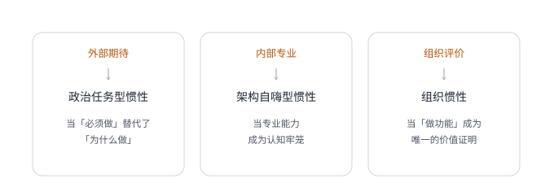
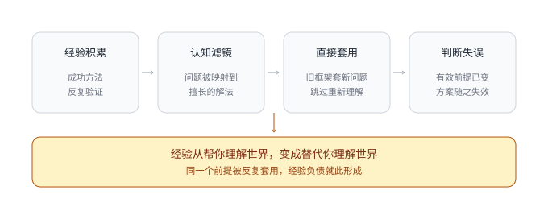
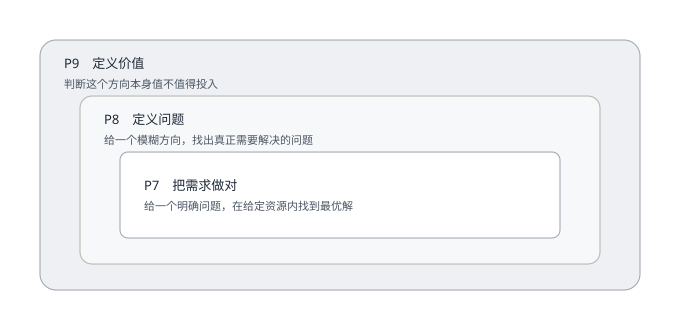

# 第 1 章 · 认知困局——产品经理的思维陷阱

## 引言

我刚入行时，以为产品经理的核心竞争力是会画原型、写 PRD、做竞品分析、跑数据。后来我见过画原型比我快的人，做出的产品一塌糊涂；也见过连 Axure 都用不明白的负责人，却带着团队跑出漂亮的增长曲线。这种落差让我想明白一件事：**产品经理的专业能力，不在怎么做，而在为什么要做**。多数人遇到的瓶颈不是技能触顶，而是判断力触顶。3 个月能教会一个人写 PRD，3 年未必教会他判断一件事值不值得做。这一章就从「产品经理的专业能力到底是什么」出发：当技能不再稀缺，我们手里还剩什么？

## 1.1 识别惯性——为什么越资深越难跳出做功能

你有没有过这样的时刻：一个功能做了好几个月，上线后数据没涨，用户没反馈，团队也没人提，它就那样安静地躺在系统里，像一个没人记得为什么要生下来的孩子。你想把它下掉，却没有胆量先开口，因为当初立项的时候，好像所有人都说这个必须做，却没有人说清楚为什么必须做、做完之后还要补充什么、做到什么程度才算值得。如果你有过，那你已经掉入了产品经理最常见的思维陷阱：执行惯性。所谓执行惯性，不是你不想思考，而是你太久没有机会思考了，你被一个个需求、一次次迭代推着走。专业能力越强、交付越快，组织就越依赖你继续交付，你也越来越习惯「接到需求→分析需求→设计方案→推动上线」这条流水线，你成了一个高效的「需求翻译机」，却再也想不起来问自己：这个需求真的需要做吗？

这个问题听起来很简单，但做了 5～10 年产品之后，它反而越来越难问出口，因为你的专业能力本身就是双刃剑：功能做得越好，越难停下手。越资深还有另一层难处：你是核心成员，当着老板的面、当着下属的面，已经不方便开口质疑了。

2017 年我在一家新零售电商平台，那阵子平台日活稳步在涨，团队士气很高。一次战略会上，运营提出要做社区：打造一个机友圈，让用户在买完手机之后还能留下来交流、分享、吐槽，形成一个高粘性的内容社区。这个想法听起来很合理，那时候几乎所有互联网产品都在做社区，我们自己的流量里有相当一部分就来自各大手机论坛，所有产品方法论都在讲「内容+社交=留存」。于是我带着产品团队做了详细的市场分析、用户分层、功能设计，规划了发帖、评论、点赞、关注、话题广场、精华推荐等一整套功能。设计开发 2 个月，小范围试跑 1 个月，论坛正式上线了。数据一开始确实好看，日活涨了，用户在论坛里很活跃，发帖量、互动量都在往上走，团队觉得做对了，我也觉得做对了。

但 2 个月后，奇怪的事情发生了：平台整体留存率开始下滑。我们拉了大量数据做分析，发现访问过论坛的用户，流失率反而高于没访问过的。更让人不安的是，论坛里开始出现粉丝互攻和品牌歧视，买 A 品牌的人嘲讽买 B 品牌的人，不同阵营的用户在话题下吵得不可开交。论坛不但没成为机友圈，反倒成了一个情绪垃圾场。我们把数据拉出来反复看了 3 天，最后做了一个痛苦的决定：下掉论坛。花了 3 个月，做出一个功能板块，又亲手把它杀死。真正让我停下来反思的，不是做错了，而是整个过程里我从来没有认真问过自己一句：用户真的需要一个买手机的地方有论坛吗？我做的市场分析、用户分层、功能设计，全都建立在「这个功能要做」这个前提上，没有回到原点去追问那个最根本的问题。**我的专业能力让我能把一个没经过充分验证的想法执行得很完整，也正是这种能力，让我对这个想法本身成不成立失去了警觉**。一个从根上就不该做的功能，设计得越好，死得越彻底。后来这类事在我工作经历里并不少见，直到近些年我开始系统地回头看，才意识到自己陷在一种困局里，我把它叫作政治任务型惯性，它是执行惯性的第一种形态。

**政治任务型惯性：当「必须做」替代了「为什么做」**

政治任务不一定是老板拍脑袋的决定，更多时候它是弥漫在组织空气里的一种共识：大家都觉得应该做，行业里都在做，不做就落后了。你大概经历过这种场景：业务沟通会上有人提出一个想法，在场所有人都认同，不是因为每个人都认真想过，而是因为它听起来很对。做社区、做直播、做私域、做 AI，每一个热词背后，都有无数产品团队正在开足马力做功能。但你问一句「我们的用户真的需要这个吗」，回答往往是「先做了再说」，你想把问题拉回原点，对方很可能会说「得先上功能，这样才能谈未来」。

当一个团队习惯了用做功能来证明自己的价值，不做就成了一种不可接受的状态。你必须永远在规划、在设计、在迭代，周报上必须写满「本周完成 XX 功能设计」「推进 XX 需求上线」。你停下来思考，周报就显得空，而空的周报，在大多数组织里意味着你没干活。这种情况不只发生在小团队，行业里反复出现过类似的现象：一个项目因为战略上看起来必须做，因为竞品也在做，因为某个热词正在风口上，于是资源、排期、组织注意力迅速聚拢，大家开始讨论系统架构、功能清单、上线节奏，却很少有人继续追问，这个场景里用户是不是真的需要它？商家是不是真的愿意改变原来的工作方式？它解决的是业务的真实问题，还是只是在回应组织的焦虑？

这类项目的每个局部决策往往都能自洽：战略需要、资源到位、团队强大、方案完整。唯一缺的，是最初那些问题没有被认真回答。问题不是没人敢问：在所有人都觉得必须做的氛围里，它根本不会被提上议程。这些案例的共同点是什么？**不是团队不努力，不是能力不够，恰恰相反，是太努力了、能力太强了**。当一个组织把做功能等同于创造价值，它就会陷入一个自我强化的循环：做更多功能，就需要更多人来维护；更多人来维护，就需要做更多功能来证明这些人有价值。直到有一天，产品变成了一个所有人都不知道怎么用、但所有人都害怕删掉任何一个功能的庞然大物。很多团队负责的项目，就是在这个过程中慢慢变重的。

**架构自嗨型惯性：当专业能力成为认知牢笼**

政治任务型惯性的驱动力来自外部：组织的期待、行业的共识、KPI 的压力。第二种更隐蔽，驱动力来自内部，这是产品经理最容易踩的坑，越资深越容易踩到，而且你踩进去的时候完全意识不到，因为它披着专业的外衣。

2017 年我差点也掉进架构自嗨这个坑里，当时我们这个新零售平台的平台端基本成型，公司计划为线下 300 多家实体店[^1]做一套门店端。这时候我的架构脑开始活跃：是不是应该做一套完整的门店管理系统，把订单、库存、会员、营销、对账全部纳入一个统一的架构体系？这个想法在技术层面极其优雅，一个入口，一套流程，把所有问题都收进来。启动前我逼自己去做了情境调研，我们没有急着发问卷、做数据分析，而是跑到门店，站在店员旁边看他怎么工作。我看到的是这样：店员早上九点到店，打开电脑登录企业网银，打开 POS 机，再拿出自己的手机打开个人微信和支付宝。用户到店买一台手机，可能用银行卡付一部分、花呗分期付一部分、微信付尾款，店员就得分别在 POS 机、个人微信、企业网银和运营商系统里各操作一遍。一个流程下来，用户要等近 1 小时，并且在下班之后，店员还要花 1～2 个小时对账，把各个渠道的收款和订单一笔一笔对上。

这才是真实的问题：不是架构不优雅，不是系统没打通，而是店员每天在多个工具之间疲于奔命，用户因为等太久直接放弃了购买。如果我当时去做那个宏大的系统，很可能花半年做出一个架构优美的东西，却解决不了店员今天晚上就要面对的对账问题。后来我把「做一个完整系统」压缩成了一个具体的产品决策：先做聚合支付，支持一码多扫、多码一扫，款项直接进公司账户；同时解决订单对账，让每一笔款项都能和订单对应上。最终对账从 1～2 小时变成不需要对账，用户等待时间从 1 小时降到 0.5 小时以内。这件事也让我赢得了绝大部分门店店长和店员的信任，为后来线上线下结合打下了信任基础。

这才是产品经理该做的事：让用户痛苦的那个问题被解决，而不是做一个让自己满意的架构。但必须承认，架构自嗨的诱惑力巨大。**它满足的不是用户的需求，而是产品经理自己对系统秩序、对完整感的那种成就感**。越资深，这种冲动越强，因为你看过足够多的系统，脑子里有足够多的最佳实践，天然就想把一切都纳入一个优雅的框架。但用户不在乎你的架构，用户只在乎自己的问题有没有被解决。

2024 年我所在的团队接到老板给的课题：做一套大平台。公司有过很多条业务线，每新增一条，做法都是把某条成熟业务线的全套系统复制一份，改一改、调一调、兼容一下，所以老板总能听到重复的抱怨：这个功能在这个系统要做一遍，在那个系统也要做一遍；这个功能不适配新的业务模式，得改；这个系统定制化太重，只能硬编码。恰好那时候，公司开始引入一批有大型平台经验的技术和产品负责人，其中不乏对中台化有认知的人。中台化这个概念一提出，瞬间击中了老板多年的痛点，仿佛找到了多业务线统一管理的终局解法。项目就这么启动了，起初的出发点是提炼几个系统里最核心的板块来做中台化，比如商品中心、价格中心、订单中心。但作为全公司最顶层的超级大项目，各方领导虽然不直接下场，却开始提出各种诉求。产品和技术负责人的关注点不再局限于几个核心板块的中台化，而是放大到对所有业务系统做整合性重构，开始陷入架构自嗨，想在这套最新的大平台上呈现最佳实践。

这个项目前后投入了 1 年多，完整版本上线后开始向各条业务线切换。切换过程阻碍重重：一线业务同学不想切、不敢切，生怕影响业绩；已经切过去的业务线，系统确实好用不少，兼容能力增强不少，数据也更清晰，但实际业绩没有明显提升，用户感受也没有明显提升，内部褒贬不一。

架构可以更先进，后台可以更统一，平台可以更像未来。但如果它没有改变一线业务的关键成本，没有改善用户的核心体验，没有让组织用更少的代价做出更好的决策，那它最多只能证明我们做了一个更大的系统，证明不了我们做了一个更有价值的产品。当你把做功能当成证明专业能力的方式，你就已经开始偏离产品经理该回答的那个问题了。**专业的能力不是能把功能做得多好，而是能判断什么功能不该做**。

**组织惯性：当「做功能」成为唯一的价值证明**

政治任务型和架构自嗨型这两种惯性，多少都能归结到产品经理个人的认知局限上，但还有第三种惯性不属于个人，它烙在整个组织的运作方式里。在一个习惯了用功能产出衡量价值的体系里，不做是很难被看见的工作。工程师的产出可量化，设计师的产出可量化，产品经理却很难量化地展示「我思考了三周，最后决定不做任何功能」。于是「做了多少功能」成了最方便、最直观的度量方式，但它本身就在鼓励一个错误判断：做得越多，价值越大。**产品经理的价值常常恰恰在于不做：砍掉一个有害的功能，叫停一个没有真实需求的项目，拒绝一个看似紧急、实则不重要的需求**。一个产品经理越忠实于为用户创造价值这个职责，在组织的常规评价体系里反而越容易被低估。

论坛案例就是这样，团队里所有人都投了赞成票，理由不是判断力不够：在那个场景里，做社区是个安全的决策，符合行业趋势，还能填满下个季度的迭代计划。不做社区则是个危险的决策：你拿什么填下个季度？不做的风险是个人承担的，做的风险是团队和系统分摊的。我自己花了好几年才学会在组织里体面地不做：评审会上不说「这个需求我们排一下」，而是说「这个需求对应的用户问题是什么，有没有更轻的方式去验证」；周报里没有功能产出的时候，就写下「本周做了 5 个用户访谈，发现一个被忽视的场景」。每一次这样的小追问，都是在拆掉组织惯性的一块砖。如果组织的评价氛围始终改不了，离开也是一种选择，但在那之前，至少你已经改变了自己对不做的理解，判断力是你唯一能带走的东西。

**图 1-1　三种惯性的来源**　外部期待、内部专业、组织评价，是三种惯性各自的驱动力；越资深，越难停下来。

**为什么越资深越危险**

按这个逻辑，资深产品经理比新人更容易犯错，而且犯的错更贵。初级产品经理犯的错，通常是这个按钮放左边还是右边、这个流程能不能少一步，影响范围小，改起来也快。资深产品经理犯的错，往往是我们要不要做这个新业务、这个方向值不值得投入。这个量级的决策一旦出错，搭进去的是几十人甚至上百人几个月的时间，几百万甚至上千万的预算。更可怕的是，资深产品经理犯错的概率并不比新人低：新人犯的是无知之错，因为不知道而做错，这类错误会随着经验积累自然减少；资深产品经理犯的是认知之错，因为太知道而做错。你的知识结构、方法论框架、成功经验，共同构成了一个强大的认知滤镜，你看到的所有问题，都会被自动映射到你擅长的解决方案上。你擅长增长，看到的所有问题都是流量不够；你擅长架构，看到的所有问题都是系统没打通；你擅长用户体验，看到的所有问题都是交互不流畅。**锤子眼里全是钉子，而你手里的锤子越重，砸下去的时候越自信**。

打破执行惯性的第一刀，不是砍向某个具体的功能，而是砍向你自己，砍掉那种「我必须做点什么来证明我有价值」的焦虑。作为产品经理，你的价值从来不在于做了多少功能，而在于帮用户解决了多少真问题。要找到真问题，你得先停下来，把手从键盘上拿开，走到用户身边，去看、去听、去问。不是带着「我要做什么功能」的前提去调研，而是带着「我不知道答案」的空杯心态去寻找。这不是技术问题，是认知问题，而认知问题比技术问题难解决得多，因为它要求你主动放弃最引以为傲的东西：你的专业直觉，你的成功经验，你那种「我一看就知道该怎么做」的自信。

## 1.2 看清负债——过往成功如何变成未来的绊脚石

2019 年我遇到过一个微妙的转折点，在那之前，我参与过从 0 到 1 的新零售平台，做过日均流水两千万[^1]的聚合支付工具，也操盘过用户千万量级的增长项目。我脑子里已经初步有了一套方法论：用户分层怎么做、漏斗分析怎么拆、增长策略怎么设计。每次接一个新业务，我的第一反应都是，这套方法论能不能复用？这种自信在那年被打破了。

我接手一个社交电商平台的 C 端产品工作，当时主要的销售模式是拼团。我带着一套熟练的增长策略和方法论进场，觉得只要把用户获取、激活、留存、变现、传播这套标准流程重新跑一遍，数据一定会提升。结果我们的尝试几乎没有任何效果：我做的用户分层没用，因为这个平台的用户根本不是传统意义上的 C 端消费者，他们是一群微商和淘客，行为模式、决策逻辑、使用场景完全不在我原来那套框架的覆盖范围内；我做的漏斗分析找不到关键流失点，因为用户流失的根因不是某个转化环节有问题，而是整个商业模型和目标用户就不匹配；我做的裂变方案更是南辕北辙，微商人群自己就是做裂变的专家，我们的裂变机制在他们眼里过于粗糙。

我意识到过去帮我打了几场胜仗的经验，在新场景里不但帮不了我，反而成了我理解新问题的障碍。因为我一上来就拿旧框架去套新问题，而不是先去理解新问题本身。这就是经验负债：**你过去积累的一切，正在悄悄变成你理解新世界的成本**。

**图 1-2　经验负债是怎么形成的**　问题变了而没察觉，帮你解决问题的经验，就成了理解新问题的成本。

经验负债这个概念听起来有点反常识，我们不是一直说经验是宝贵的财富吗，怎么突然就变成负债了？关键区别在于：经验帮你解决的是同类问题，而负债产生的条件是问题变了，你没意识到。移动互联网红利期，增长是一个相对确定的游戏：流量便宜，用户对新 App 的接受度高，社交传播的边际成本也低。那个阶段，增长黑客那套方法论确实好用，A/B 测试快速验证、裂变机制低成本拉新、漏斗分析定位转化瓶颈，这些方法帮无数产品完成了从 0 到 1 的用户积累。但后来游戏规则变了，流量红利消退，获客成本上升，用户对营销套路产生了抗体。一个裂变活动放在早几年可能带来可观的新增，放到今天可能连成本都收不回来。这不是方法论本身的问题，是场景变了，还在用过去的手段解决今天的问题，你不是在用经验，你是在背负债。

照搬一套曾经有效的裂变机制，前期数据看起来不错，新增用户上来了，活动页热闹了，报表也好看了。但等到再看留存、复购、投诉和补贴成本，才发现来的不是目标用户，是一群只对奖励敏感的人。这件事的悲剧之处在于，同样的策略如果放在更早的流量环境里，可能是有效的。但团队没意识到，用户变了，市场变了，薅补贴的产业链也变了。他们把「过去有效」当成了「永远有效」，经验就变成了陷阱。我自己在 2019 年的经历也是如此，我不是没有方法，是方法太多，多到我忘了第一步应该是清空自己、重新理解这个业务，而不是翻开方法论工具箱，看看哪个工具能用。

**两位老同事：经验滤镜的两种翻车**

我有个老同事，做了 8 年电商产品，从商品到订单再到营销，每个模块都做过，行业里叫得出名字的电商平台他至少深度研究过一半。他有个习惯：接到任何需求，都能很快给你画出一个标准做法，「你看某平台是这么做的，我们照着来就行」。这个习惯帮他高效交付了无数需求，但也让他在一次关键决策上翻了车。当时公司要做一套面向经销商的订货系统，他花三天拿出了一套对标主流电商后台的完整方案，功能齐全、流程规范、架构合理。评审的时候所有人都觉得没问题，但上线之后，经销商几乎没人用。为什么？因为经销商不是运营人员，他们不关心功能全不全，只关心能不能在 5 分钟内下完 1 单。他设计的系统要 7 步操作才能完成一次订货，每一步还要填写多个字段，经销商的原话是「我用电话下单只要 30 秒，你让我用这个系统要 5 分钟」。

另一个老同事是做 C 端用户增长的，在一家大型互联网公司待过 4 年，经手的活动累计带来过千万级 GMV 。加入我们项目后，他做的第一个增长方案，是签到、任务、积分、兑换的组合，逻辑严密，设计精美，但上线之后效果平平。问题出在哪？他的增长经验全部建立在「平台有海量流量可以分配」这个前提上，在大厂的时候，任何一个活动入口都能带来百万级曝光，转化率哪怕只有千分之几，绝对值也很可观。但当时我们面对的只是一家中型企业的创新项目，DAU 只有 10 万出头[^1]。在这个量级下，他设计的那套签到、任务、积分体系，需要用户连续七天打卡才能兑换奖品，以我们的用户规模，最终只有几百人走完了整个流程[^1]，而这几百人的行为数据，放在任何漏斗分析里都形同噪声。

两位老同事都是带着自己的经验滤镜，在看一个完全不同的战场。一个人用电商后台的标准做法，替代了对经销商真实场景的思考；另一个人把大厂「流量摊薄固定成本」的前提，当成了放之四海皆准的真理。他们的成功经验告诉他们方案有效，却没告诉他们，方案有效是有前提的。讲这两个故事是想说明一个道理：**经验的价值不是让你下次照搬，而是让你下次更快地识别出这次不一样**。如果你识别不出这个不一样，经验就是一剂麻醉药，它让你感觉自己很专业，同时让你失去对新问题的敏感。

**数据不会说谎，但人会骗自己**

经验负债还有另一种更隐蔽的形态，它藏在数据里。产品经理大概是整个互联网行业里最迷信数据的一群人：我们相信数据不会说谎，相信指标能度量一切。但做了 10 多年产品之后，我越来越觉得，**数据从来不说谎，是人会选择性地让数据说他想听的话**。

2022 年我带领的产品团队在组织结构上做了较大调整，由一位半路出家的副总裁负责统筹。新官上任三把火，他在对业务和数据都还没有认知的情况下，就启动了几个战略产品项目。其中一个是对原内容板块做一次大升级，原因很简单：抖音电商发展太快，其他电商平台都感到了危机，于是大家都觉得，凡是做内容的板块都该升级成短视频 Feed 流。没有调研，没有论证，决策做得又急又草率，历经近一个月高强度的赶工，这个战略项目上马了。接下来产品和数据团队开始按日常节奏观测数据、产出报告。我在数据报告里总结：PV 从曝光到下单的转化率均值 0.42%，相比原模式的 7.2% 有较大差距；用户人均停留时长 13s，相比原模式的 21s 也存在较大差距[^1]。于是在项目周期性汇报会上，我们如实反馈，副总裁眉头紧锁，当场指责在场所有的产品和数据同学：「这不是我要的数据，这个项目非常重要，把数据结论调成它应该有的样子」。

迫于压力，产品和数据同学不得不改数据报告。于是在后来的公司战略复盘会上，同样的数据被表述成了这样：PV 从曝光到下单的转化实现质的飞跃，实现 0 的突破，模式得到用户认可；用户人均停留时长环比上周提升 23.81%，内容质量大幅提升。一样的原始数据，截然不同的结论。这个项目运作了几个月之后还是被叫停了，中间消耗的人力财力已经追不回来。数据没有说谎，问题在于人选择了哪些数据、又故意忽略了哪些。这就是经验负债在数据层面的表现：**越资深的人越懂得怎么用数据讲故事，也就越容易用数据骗过自己**。

经验负债的最高级形态，我称之为「专家」。这个头衔本身没有问题，我从 2021 年开始就是产品专家岗，总体上还是觉得这个词是褒义的；出问题的是这些年我屡屡看到，一些人一旦被冠以专家之名，就会下意识地认为自己已经懂了。而「已经懂了」，是产品经理这个职业最危险的认知状态。

很多资深产品经理聊起方法论头头是道，第一性原理、用户心智、价值主张、北极星指标，哪一个都能讲。但让他真的去跟 10 个用户聊半小时，他未必知道该问什么。他习惯了在会议室里用白板推演用户需求，而不是走到一线去看用户真正在干什么。这不是某个人的问题，而是一种很容易被职级、分工和日程共同放大的职业病：职位越高，离用户越远；会议越多，离现场越远；越擅长抽象，越容易把抽象当成事实。

问题不只出现在大厂，创业公司的专家病同样致命，只是表现形式不同。创业公司的产品负责人往往是公司里最懂产品的人，因为其他人更不懂。这种相对专家的地位会带来一种危险的自信：你是团队里唯一能看到全貌的人，你的判断就是最终判断。

我自己在前面那个论坛案例里就犯过这种病，有人提出做社区的时候，我作为团队里核心的产品负责人，有义务去追问为什么，但我没有。因为我的专家直觉告诉我这个方向是对的，内容加社交等于留存，这套公式在行业里被验证过无数次。我被自己的专家判断说服了，跳过验证环节，直接进入执行阶段。后来我总结了一条原则，我认为产品经理应该牢牢记住：**当「我觉得」三个字出现在你脑子里的那一刻，先把它当成危险信号，而不是决策依据**。

我给自己定的办法是定期「卸载」成功经验，卸载经验不是说要抛弃经验，把过去积累的一切都扔掉，那不叫成长，那叫失忆。我指的是：不让经验成为你接触新问题时的第一反应。

- **每进入一个新领域，先做三天新手**：不画架构图，不写方案，不引用过去的案例，就是去看、去听、去问，去用户工作的地方站一天，去翻投诉记录里被忽略的细节，去和一线客服吃顿饭。很多真正有价值的洞察，就藏在这些看起来琐碎的事情里。
- **给每个成功经验标上有效期和适用条件**：在自己沉淀每一条有效的方法下面都加一行，这个方法有效的前提条件。当把这些前提条件写清楚，下次遇到新场景，第一反应就不再是这个方法能不能用，而是这些前提条件还成立吗？
- **定期找一个完全不懂的领域去「受挫」**：做了多年电商的人去理解社交产品的逻辑，做 C 端的人去做 B 端工具。那些让自己感到不对劲的地方，正是经验盲区，在熟悉的领域里，这些盲区被经验自动填平了，根本意识不到它们存在。

**经验不是负债本身，拒绝更新经验才是**。当你的经验从帮你理解世界，变成了替代你理解世界，它就变成了负债，区分这两者的办法很简单：下次做事之前，问问自己还愿不愿意承认这次我不懂。

## 1.3 完成跃迁——从做产品到定义产品

执行惯性让你停不下来，经验负债让你看不清新问题，看出陷阱之后怎么跳出来，我把这个过程叫「能力嵌套」。线性提升是把同一件事做得更熟练，能力嵌套是把原来的能力放进更高一层的判断里，前者让你做得更快，后者让你做得更对。比如一个前台产品经理，持续打磨功能逻辑、交互细节、数据表现，当然会变成一个更好的执行者；但如果他想继续往上走，就不能只停在把功能做得更好这一层，而要把这些执行能力嵌进「这个问题是否值得解决」的判断里。这不是鼓励产品经理随便跨界换岗，跨领域有门槛，换岗要谨慎；更不是把「向前一步」喊成口号。能力嵌套指向的是：保留原来的专业能力，但不再被原来的能力绑住，不再因为会做，就默认应该做。

2019 年我在一家头部社交电商企业任职，接近年底，我带的电商产品团队整合了社交产品团队，这个团队主要为百万量级的活跃经销商提供工具类产品，教学系统、票务系统、素材工具都在里面。接手后遇到的第一个课题，是构建 B 端用户成长路径。当时公司在港股上市后要做第二增长曲线，衍生出一条全新的业务线，已经有部分头部经销商带着团队转过去了。但产品、数据、运营各方都发现一个事实现象：新业务线的分销模式和经营品类都是全新的，目前小 B 晋升为大 B 的转化率偏低，转化时长偏长。原来负责这个课题的小伙伴凭着对客群的熟悉和自己的产品经验，计划对经销商系统里的商学院板块进行一次彻底升级，参考一些职业课程学习平台，而且已完成向上汇报和立项。

我本能地觉得，这次可能不一样：第一增长曲线对应的原业务已经非常成熟，B 端成长路径除了线上商学院的成熟课程，还有多年积累的线下沙龙、专家讲解、教练支持。而第二增长曲线这条新业务启动还不到半年，整体经营模式虽然和原业务高度相似，品类结构和社群经营方式却有明显差异。于是我在团队内力排众议，主动按下了暂停键。正好公司在筹备一次大型的线下经销商大会，我牵头带着社交产品团队发起了一次 B 端成长路径焦点小组访谈。大家结合已有的用户反馈和数据分析，用一周时间整理出不同焦点小组的主题和访谈内容，又联动各销售大区负责人，在大会会场安排了多间独立会议室，准备把访谈做起来。

会议如期举行，焦点小组的调研很顺利，我们直接感受到了用户面对新业务时的焦虑、无助和真实诉求。所谓商学院改版，并不能直接解决他们当下的问题，或者说时机根本不对。带着这些真实的声音回到公司，我们结合之前的数据分析和用户反馈做了论证，最后没有启动原定的商学院改版，取而代之的是经销商系统的任务节点提醒和素材工具改版。新方案的成本只有原方案的一半左右，落地之后数据开始给正反馈：小 B 晋升为大 B 的转化率提升 20% 以上[^1]，转化时长明显下降。我的企业邮箱里也陆续收到了多封来自当时受访用户的感谢信。

这次焦点小组让我发现了一个所有数据都没告诉我的需求：经销商伙伴们并不需要一个学习路径清晰、体验感十足的商学院，他们当下最需要的，只是在各个关键任务节点上被及时提醒，以及一套场景覆盖更全的素材工具。这就是发现问题和解决问题的区别。我相信，如果一直待在工位上看数据、听汇报、做规划，我会沿着商学院改版那个方向一路迭代下去，功能越来越多，体验越来越好，但小 B 晋升为大 B 的转化率和转化时长不会有明显变化。因为那样解决的是我以为的问题，不是真实存在的问题，这便是一个产品经理的跃迁：**从能熟练地设计一个功能到能准确地定义一个值得解决的问题**。

**砍功能比加功能更难**

还是在同年，我当时还负责这个社交电商平台的 C 端产品工作。平台一开始的定位是拼团模式：用户发起拼团，邀请好友参团，成团后享受低价。逻辑很清楚，市场上也有成功先例，但上线之后效果不好。问题主要出在拉新，没有用户基础，拼团又依赖社交传播，种子用户本身没有传播能力，来的人大多是薅羊毛的。低价吸引来的用户只买拼团商品，客单价极低，也不复购。最致命的是，我们原本期望的 C 端用户转 B 端经销商这条路径完全跑不通。用户注册之后，转化门槛太高，信任度不够，就算转化了，也接不住后续的投入。当时团队面临一个艰难的选择：继续优化拼团，还是砍掉拼团。

- **优化拼团的理由**：过去已经投入近半年开发，功能框架搭好了，供应链也接进来了。放弃就等于承认之前的投入全白费，而且拼团在行业里有现成的成功案例，只要把体验做好、把商品选好、把传播机制调好，说不定能翻盘。
- **砍掉拼团的理由**：目标用户根本不对，拼团的核心用户是 C 端消费者，对价格敏感，追求性价比，社交传播是自然行为。但我们实际触达的是谁？一群微商和淘客，他们不是来买东西的，是来卖东西的。他们要的是一个能帮他们经营生意的平台，要的可能是会员体系、佣金结算、供应链支持，而不是一个拼团工具。

这是定义问题层面的错误，拼团功能设计得并不差，是做拼团这个决策本身错了：定义错了用户，定义错了需求，定义错了产品该创造的价值。最后我们砍掉了拼团，把产品重新定位为会员制社交电商，核心功能变成会员体系和佣金结算，核心服务变成健康品类和供应链支持。第一季度数据就起来了：GMV 突破两亿，注册用户新增五十万，自营订单量突破三十万笔[^1]。

这个过程教会我最重要的一件事：**砍功能最难的从来不在技术上，在心理上**。砍掉一个已经在线上跑着的功能，意味着你承认自己之前判断错了，对资深产品经理来说，这比承认自己不会做某个新技术难得多。新技术是我还没学，砍功能是我学的那些东西在这个决策上没用，但这种承认错误的能力，恰恰是从做产品跃迁到定义产品的必经之路，因为你不可能每次都定义对。定义产品的本质就是做判断，判断一定有对有错，区别在于：做产品的人错了，改一个按钮、调一个流程，成本很低；定义产品的人错了，要改方向、砍业务线，成本很高。所以定义产品的人不需要「每次都判断对」这种超能力，他需要的是错了能快速承认并修正的心理素质。

**定义问题比解决问题重要**

早期短视频产品的迭代中，团队一开始看到的现象是，用户看完一条视频后，还要回到列表重新选下一条，操作路径长，停留时长不理想。按最直接的理解，问题似乎是返回和切换不够顺，解决方案自然就导向按钮位置、交互动效、页面跳转效率这些优化。但后来真正改变产品体验的，并不是把某个按钮打磨得更好，而是重新定义了用户刷短视频时的状态：很多人并不想主动选择下一条，他们更希望待在一个低决策成本的状态里连续消费。这才是真正的问题定义：操作路径并不长，是用户不想主动做选择，需要降低决策成本。这两个定义导出的解决方案完全不同，前者导向优化返回按钮，后者导向沉浸式 Feed 流：用户不用反复做选择，手指上滑就自动进入下一条。这个变化后来成了短视频产品最典型的体验范式之一。

团队里有很多人能把优化返回按钮这件事做到极致，调位置、加动效、优化响应速度，这些都属于做产品的能力。但改变产品命运的，是那个追问用户在刷视频时到底在想什么的人。他的能力不是把功能做得更好，而是定义什么才是需要被解决的问题。这种能力不是靠做更多功能练出来的，它是靠不做练出来的，接到需求的时候不急着画原型，看到数据的时候不急着下结论，在所有人都说「优化一下」的时候停下来问一句：我们优化的真的是对的事情吗？

能力嵌套在现实里长什么样？行业里有个被反复引用、但很少有人认真展开的框架：阿里对 P7、P8、P9 产品经理的能力定义。我在职业生涯中反复对照过它，不去纠结它是不是晋升标准，我只把它当成能力跃迁的三套标准[^2]。三层对应三种动作：P7 把需求做对，P8 定义问题，P9 定义价值。

**图 1-3　能力嵌套的三个层次**　三层是嵌套关系，不是并列：每一层都套在上一层里。

《俞军产品方法论》里有一个判断，精准概括了这三个层次[^3]：产品经理的层级，本质是定义范围的层级，低阶定义怎么做，中阶定义做什么，高阶定义为什么做。从 P7 到 P8，是把怎么做嵌套进做什么的判断里；从 P8 到 P9，是把做什么嵌套进为什么做的判断里。每一层嵌套都是一次自我否定，否定那个「把功能做到极致就有价值」的自己，才能变成定义真正问题的自己；否定那个「解决所有问题就有价值」的自己，才能变成判断什么值得解决的自己。

你可能会问一个很实际的问题：到底怎么判断什么值得做？有没有方法论？我的回答可能让你失望：没有一劳永逸的方法论，但有一些思维习惯，能帮你一点点靠近这个能力。不过在讲这些习惯之前，得先说清楚，从做产品到定义产品这个跃迁，在日常工作里到底意味着什么？它不是某一天你突然开悟，说「从今天起我不做功能了，只做判断」。它是一个渐进的、需要刻意练习的过程，具体表现为三个思维转变：

- **从怎么实现到该不该实现**：初级产品经理接到需求，第一反应是怎么做；资深产品经理的第一反应是该不该做。怎么做是舒适区，有经验、有方法论、有标准答案；该不该是不确定区，可能查不到数据，可能找不到参照，可能需要承认我不知道。
- **从局部最优到全局最优**：执行型产品经理追求「我负责的模块做到最好」；定义型产品经理追求「在所有模块中，当前哪个最值得投入」。资源永远有限，优化 A 就可能牺牲 B，局部最优不等于整体最优。
- **从答案思维到问题思维**：执行型产品经理拿到一个现象，直接找答案，用户流失率高？答案是做召回机制。定义型产品经理先判断：是真的流失了，还是季节性波动？如果是真流失，是被竞品抢走了，还是产品解决的需求本身正在消失？在错误的问题上工作，再好的答案也是徒劳。

从「怎么实现」到「该不该实现」，从「局部最优」到「全局最优」，从「答案思维」到「问题思维」，没有一个能靠做更多功能来完成，它们只能在做更少、想更多的节奏里慢慢内化。对习惯了快节奏交付的产品经理来说，这是个非常痛苦的过程。你得忍受输出减少带来的焦虑，不再像以前那样每天产出原型和文档，周报看起来比以前空，你自己可能都会怀疑是不是变懒了。但熬过这段焦虑期，你会发现一个不一样的东西：你不再需要用产出来证明自己的价值，因为你开始用判断来创造价值。

## 1.4 回到本质——产品经理到底在判断什么

如果产品经理的认知有这么多困局，那我们到底该怎么理解产品经理这个岗位本身？这个问题问出来简单，回答起来极难，不是因为没有答案，而是每个阶段的答案都不一样。刚入行的时候，我觉得产品经理就是画原型、写文档、跟开发沟通的人；做了 3 年之后，我觉得产品经理是理解用户需求、设计解决方案、推动落地的人；做了 6 年之后，我觉得产品经理是发现真正的用户问题、定义产品方向、平衡商业价值的人。现在我反而越来越不确定了，不是退步了，是见过了太多产品经理：有天天写 SQL 做数据分析的，有只管画界面不做用户调研的，有做了多年产品还没跟用户说过一句话的，有做战略做到连原型工具都打不开的。他们都叫产品经理，但做的几乎不是同一份工作。如果你现在问我产品经理的本质是什么，我会先说两件它不是的事。

**产品经理是「需求翻译机」**

这是行业里流传最广、危害最大的一种理解：产品经理就是把业务需求翻译成技术能理解的语言，再把技术限制翻译成业务能理解的语言。这句话听起来很对，以至于很多产品经理把它当成了自己的核心价值：我就是一座桥，连接业务和技术。但如果你真的只做这件事，你不是产品经理，你是一个传话筒。传话筒不需要判断需求的对错，不需要追问需求的来源，不需要思考这个需求解决了用户什么问题，只需要保证 A 说的东西 B 听懂了就行。我刚入行的那 1～2 年，有很长一段时间就是个传话筒。销售说要做个活动页面，我就画个活动页面；运营说要加个数据看板，我就设计个数据看板。我的专业能力越来越强，原型画得越来越快，文档写得越来越清晰，评审会上越来越有说服力。但我从来没有问过：这个活动真的有人参加吗？这个数据看板真的有人看吗？把一个坏需求翻译得再精准，它还是坏需求；把一个不该做的功能设计得再优雅，它还是不该做。**传话筒的价值是不丢失信息，产品经理的价值是增加判断**。如果你只是在传递信息而没有增加判断，你在这条链上的位置，总有一天会被一个更高效的传话筒替代，比如 AI。

**产品经理是「功能经理」**

如果说翻译机是初级产品经理最容易陷进去的误解，那功能经理就是高级产品经理最大的认知陷阱。什么是功能经理？就是你的全部价值感都来自「我做了多少个功能」「我迭代了多少个版本」「我交付了多少个需求」。周报上最重要的数字是「本周完成 X 个需求设计」，而不是「本周为 Y 个用户解决了 Z 个问题」。你衡量自己是不是个好产品经理，看的是产出量，不是产出的用户价值。我见过太多陷在功能经理身份里的产品经理，非常勤奋、专业、高效，但多年后回头看他们经手的几十个功能，一半已经下线，四分之一从未被用户真正用过，剩下那四分之一也只是能用，谈不上好用。如果产品经理的价值就是做功能，那一天能做十个功能的 AI，是不是比你更像一个好产品经理？当然不是。因为产品经理的核心工作从来不是做功能，做功能只是手段，不是目的。目的一直是，也永远是：**为用户创造价值，为业务创造增长**。功能只是实现这个目的的载体之一，而且往往不是最重要的那个。很多情况下，不做一个功能，比做一个功能创造的价值更大；砍掉一个有害的功能，比新增十个功能对用户帮助更大；优化一条已有的流程，比新建一套系统对效率提升更大。但这些工作不会出现在你的功能清单里，如果你用做了多少功能来衡量自己，你就是在鼓励自己做更多不该做的事。

那产品经理到底是什么？以前我会把「产品经理就是发现问题、提出解决方案、最终把解决方案产品化的人」当作一句话定义。但工作多年之后，我发现这句话已经定义不了产品经理了，尤其在面对越来越多的认知困局时。如果你现在一定要我用一句话来定义，我会这样说：**产品经理是在有限的资源下，决定什么问题值得解决、以及用什么方式解决的人**。这句话里有三个关键词：

**表 1-1　产品经理定义的三个关键词**

| 关键词 | 一句定位 |
| :--- | :--- |
| 有限的资源 | 资源有上限，取舍不可避免 |
| 什么问题值得解决 | 值不值得做，要靠判断 |
| 用什么方式解决 | 方式的范围远比功能大 |

产品经理永远不会拥有无限的资源，时间有限、人力有限、预算有限，老板的耐心也有限。这意味着你不可能解决所有问题，必须在众多可解决的问题中做选择。而这个选择本身，才是产品经理工作的核心，众多的解决方案里，哪一个最值得投入，就是他要回答的。

判断什么值得解决，是产品经理区别于其他所有角色的根本能力。设计师可以用更好的交互解决界面问题，工程师可以用更好的算法解决性能问题，运营可以用更好的策略解决转化问题，但这个问题本身值不值得被解决，只有产品经理需要回答。执行惯性让人忘了问它，经验负债让人以为自己已经知道答案，能力嵌套则让人重新学会问它。

至于用什么方式解决，注意，是方式，不是功能，功能只是方式之一。有时候最好的方式是不做功能，也许是改一句文案、调一个流程、删一个多余的步骤；有时候是推动一次组织变革，让 A 部门和 B 部门不再各自为战；有时候是放弃，承认这个方向不值得做，把资源投到更重要的地方。资深产品经理和功能经理的区别就在这里：前者知道方式的边界远大于功能，后者只知道做功能。

俞军的定义是：产品经理是用产品解决用户问题、实现商业价值的人，核心能力是用户模型和交易模型[^3]。梁宁的定义是：产品经理是把用户需求翻译成产品功能，再把产品功能变成商业结果的人，核心能力是共情和框架能力[^4]。王诗沐的定义是：产品经理是产品的 CEO，需要对产品的全生命周期负责，本质是通过产品实现价值的人[^5]。这三个定义放在一起，你会发现它们在用不同的语言描述同一件事：**产品经理存在的理由，不是因为他会做什么，而是因为他能判断什么值得做，并且能把它做成**。俞军强调交易模型，是说你需要判断商业上值不值得；梁宁强调共情能力，是说你需要判断用户是不是真的需要；王诗沐强调全生命周期，是说你需要确保这个判断能从想法变成现实。三条线交汇的地方，就是产品经理的不可替代性：不是什么都会一点，而是能在一个复杂系统里做出正确的取舍。

产品经理的门槛到底在哪里，这个话题绕不开 2010 年苏杰老师写的那本《人人都是产品经理》，它让这个岗位火遍了整个互联网行业，等我入行的时候，这本书已经成了入行必看之一。第一次听到「人人都是产品经理」这句话，我的第一反应是：对，产品思维确实不该只局限于产品经理这个岗位，设计师该有产品思维，工程师该有产品思维，运营也该有产品思维。每个人都在为用户创造价值，每个人都该想想自己做的事对用户意味着什么。这是这句话的初衷，也是它有价值的那一层，但十几年过去，这句话在行业里的实际影响，恐怕连作者本人也没预料到。

它最大的副作用，是让很多人误以为产品经理是个门槛很低的岗位。人人都是产品经理，那当然谁都可以是，不需要懂技术，不需要懂设计，不需要懂运营，只要有想法就能当产品经理，这种误读带来两个严重后果。第一是人才市场的泡沫，大量没受过专业训练的人涌进来，拉低了整个行业的平均水平和薪资预期。第二更严重，它遮蔽了产品经理的壁垒到底在哪儿。产品经理的壁垒不在原型画得有多好、文档写得有多规范、评审讲得有多流畅，这些技能 AI 现在已经做得很好，未来会更好。真正的壁垒在那些无法被标准化和流程化的判断里：哪些用户反馈是真痛点，哪些只是抱怨？多个可行方案里，哪一个对当前业务阶段最合适？当一个功能和核心体验冲突，以谁为准？当数据告诉你 A、直觉告诉你 B，你信谁？这些判断，AI 越来越能帮你把材料铺得更全、把选项列得更清楚，但它不能替你承担取舍之后的后果。方案错了以后，站在会议室里解释为什么的，还是你。

这些问题没有标准答案，也没人能给你一本操作手册。你能依赖的，只有你对用户的理解深度、你对业务的全链路认知，以及从无数次成功与失败中沉淀下来的判断力。这就是为什么资深产品经理这么稀缺：跟他们会的工具有多少关系不大，重要的是他们在没有标准答案的场景里，做过更多正确的判断。苏杰老师在 2023 年的一次访谈里也做了反思[^6]：我现在经常说不是人人都能做好产品经理，当年的口号是为了普及产品思维，现在行业成熟了，我们需要更理性地看待这个岗位的能力要求。这句话我深以为然，产品思维确实人人可以有，每个人都该想想自己做的事为用户创造了什么价值，但产品经理这个岗位，人人都做不了。

## 闲言碎语

做了 10 多年产品经理，如果有人问我这行教会我最要紧的一件事，我的回答不是方法论，不是工具，甚至不是某个成功的产品。我的回答是：学会在不确定中做决定，并为此负责。你永远不会有足够的信息，永远不会有足够的时间，也永远无法确定自己选对了，但你必须选。你不能说信息不够我再等等，因为市场和用户不会等你；你不能说这东西说不清楚，因为把说不清楚的东西说清楚，就是你存在的理由；你不能说万一错了怎么办，因为错误是必然的，你需要的能力不是不犯错，而是错了之后快速纠正。

这个职业最残酷的地方也在这里：你的每一个决定，都直接影响着几十人甚至上百人的工作成果、几百万甚至几千万用户的体验、一家公司一个季度的命脉。但没有人能告诉你这么做一定对，在最关键的那些时刻，会议室里所有人都会看着你：你是产品经理，你说怎么办。那一刻你能依赖的，只有过去无数次用户访谈、无数个上线后的夜晚、无数次数据复盘，以及无数次成功与失败中沉淀下来的那一点点判断力。

如果你过去只是做了功能，你很可能已经把判断力丢掉了；如果你在过去的每一个关键节点都选择了思考和追问，你就会有一点勇气，可能不多，但足够让你在关键时刻做出比大多数人更好的决定。这就是产品经理这个职业最难的地方：当所有人都看着你，等你说「我们做这个」还是「我们不做这个」的时候，你敢不敢决策，以及决策之后，你的判断能不能经得起证据、时间和后果的检验。

[^1]: 文中所涉运营数据均为真实项目数据，已做脱敏处理。

[^2]: 阿里 P7/P8/P9 产品经理能力标准为行业内流传版本，非阿里官方发布；公开转述见虎嗅网《阿里的职级改革，到底意味着什么？》。

[^3]: 俞军：《俞军产品方法论》，中信出版集团，2020 年，ISBN 978-7-5217-1205-6。

[^4]: 梁宁：《产品思维 30 讲》，得到 App 音频课程，2018 年。

[^5]: 王诗沐：《幕后产品：打造突破式产品思维》，电子工业出版社，2019 年，ISBN 978-7-121-29556-0。正文定义概括自他对产品经理职责边界的论述；「产品经理是产品的 CEO」这一提法更早见于 Ben Horowitz《Good Product Manager/Bad Product Manager》（1998 年）。

[^6]: 苏杰：2023 年 5 月播客访谈《和〈人人都是产品经理〉苏杰聊聊产品经理的出路》（小宇宙 FM）。
