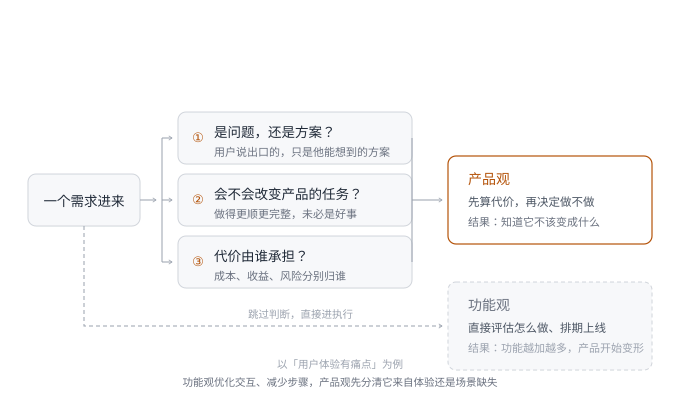

## 引言

> **产品经理的成熟，不是终于能做更大的产品，而是终于能承担「不做」的后果。**

产品经理大概是互联网行业里最「勤奋」的角色之一，一个季度下来，需求文档写了厚厚一叠，版本发了七八个，评审会开了一轮又一轮，周报上也很充实。可如果你停下来问一句：这些功能加起来，到底让产品变好了多少？很多人会突然沉默。不是大家不努力，是我们常常用一把过于方便的尺子衡量自己：用「做没做」替代「值不值得做」，用功能数量替代价值密度。

过去我也常把产品理解成一组功能：页面、流程、规则、权限、数据、后台、活动、运营位，堆在一起好像就组成了一个产品。后来做得久了，我觉得这个理解太浅，功能当然重要，但功能只是产品的表层。决定一个产品能不能活下来的，是它背后那套判断：它到底帮谁解决了什么问题？这个问题值不值得解决？解决它的代价，用户、公司和组织能不能长期承受？当新需求不断涌来时，它知道自己不该变成什么吗？

所以这章我想讨论产品观，它不是「产品经理应该相信什么理念」，而是更具体的东西：当你面对一个需求、一个功能、一个产品方向时，如何判断它是否值得存在。行业里常见的框架很多：JTBD[^1]会提醒你不要只看用户是谁，而要看用户在什么场景下「雇佣」你的产品完成什么任务；KANO 模型[^2]会提醒你，功能对满意度的影响并不相同。这些框架都有用，但要特别警惕一件事：**框架一旦脱离实际场景，就很容易变成漂亮的废话**。真正难的不是知道这些模型，而是在业务催你、用户骂你、老板盯你、团队等你拍板的时候，你还能不能回到产品存在的理由上。**我理解的产品观，不是「我要把产品做得更完整」，而是「我知道这个产品为什么存在，也知道它不该变成什么」**。

## 2.1 辨别方案——用户说的是方案，不是问题

做产品久了以后，我很怕听到一句话：「这个需求用户呼声很高」。这句话很有分量，用户呼声如果完全不听，产品经理会活在自己的想象里。但它也危险，因为它天然带着一种道德压力：用户都这么说了，你为什么不做？我过去很长一段时间也被这句话推着走：用户要入口，我就想怎么加入口；用户要提醒，我就想怎么做提醒；用户要权益，我就想怎么把权益体系做得更顺。后来慢慢发现，用户说出口的，往往只是他能想到的方案，不一定是他真正的问题。这也是 JTBD 这类框架最值得借鉴的地方：它提醒我们，用户不是为了使用你的功能而来，是为了完成自己的某个任务而来。一个功能如果只回应了用户嘴上的方案，却没有解决背后的任务，做得越完整，浪费可能越大。但这个框架在我的实践里只成立一半，它能帮你回到用户任务，却不能替你判断商业代价。很多产品问题不在于用户有没有任务，而在于这个任务该不该由你来解决，以及你解决它之后会不会把自己拖死。

2021 年我负责营销产品线时，反复收到一个呼声很高的需求：支持云币合并。云币是平台的一种虚拟积分，用户可以通过参与活动、消费、互动玩法获得不同面额的云币，然后在下单时抵扣现金，用户希望把多枚小额云币合并成一枚更大面额的。站在用户视角，这个要求太合理了：账户里几十枚云币，金额零散，用的时候还要挑来挑去，谁都会觉得麻烦。但我每次都拒绝了，理由并不复杂：云币存在的核心目的是促进复购，不是给所有订单提供无限制折扣，如果支持合并，用户可以把账户里攒下的云币集中用在任意订单上。对用户来说，这叫方便；对平台来说，这叫营销成本失控。当时云币每日发放量高达数十万枚[^3]，单枚面额大多在 0.1～5 元之间，只要合并规则一放开，云币实际抵扣率就会快速上升，平台的营销成本也会在短时间内被拉高。更糟的是，它还会削弱云币原本对多次复购的牵引作用，一个毛利率本就不高的平台电商，如果把营销货币变成无差别折扣券，看起来是在提升用户体验，实际上是在透支自己的生存空间。

一开始我的判断也不够完整：我只知道「不能合并」，但还没有回答清楚「那用户的问题怎么办」。如果只是拒绝，用户会觉得产品经理不懂人话，业务也会觉得你只会踩刹车。后来我带着团队做了两周用户访谈和数据分析，才发现一个被忽视的问题：用户的不满来自云币能用的地方太少，和能不能合并关系不大，用户说「能不能合并」，背后想表达的是「我攒了这么多，能不能让我更容易花出去？」。这个发现改变了我们的处理方式，我们没有做云币合并，而是扩大了云币的使用场景，接入会员权益、社群红包、礼品兑换等。合并的呼声没有完全消失，但频次明显下降。而我们始终没有用一个会击穿成本底线的方案，去解决一个本可以用场景扩展解决的问题。

后来我形成一条判断：**产品经理不能只问「用户要什么」，还要问「用户为什么要这个，以及这个方案的代价谁来承担」**。用户要合并云币，是因为他站在自己的视角，希望权益用起来更顺，这个诉求本身没有错。但产品的责任不是满足每一个方案，而是在用户价值和商业代价之间找到可持续的解。只站在用户视角，云币合并是 100 分；放到产品视角，它可能是负分。这就是产品观和功能观的区别，如果我当时只用用户满意度做判断，很可能会做错，因为用户满意度是短期的，成本结构是长期的。难就难在这里：**你要尊重用户，但不能把用户说出的第一个方案当成产品答案**。

**图 2-1　产品观与功能观的判断路径**　三道判断，功能观从第一道就分岔出去，产品观每一道都要停下来算一次代价。

## 2.2 明确边界——定位决定你能拒绝什么

我以前对「产品定位」这个词其实有点抗拒，主要是因为很多公司做产品定位，最后都会变成一句漂亮但没什么用的话：为谁提供什么，创造什么价值，成为某某领域领先平台。写在汇报里很好看，开会时也显得大家很专业，但真正遇到需求冲突时，它不帮你做判断。后来我慢慢改变了看法，不是定位没用，是大多数定位写得没有边界。**一个有用的定位，不只告诉你「我是什么」，更重要的是告诉你「我不是什么」**。如果它不能帮你拒绝需求，那它就只是口号。

KANO 模型里有一个很有启发的概念：并不是所有功能都会增加满意度。有些功能是基础要求，做了用户无感，不做用户不满；有些是加分项，做得好会带来惊喜；还有些属于反向需求，做得越多，用户反而越不满意。我在实践中是这么理解的：**功能不是越多越好，关键看它是否吻合产品定位；偏离定位的「好功能」，也可能是坏功能**。

几乎和云币案例在同一时期，我还做过一个类似的拒绝决策。那段时间公司同时在推进十多个增长项目：拉新、老客促活、VIP 转会员、B 端经销商转化……每个小组都有自己的指标，也都有自己的焦虑，尤其是拉新和 B 端经销商转化小组，压力摆在明面上：平台需要新用户，需要更多付费会员，也需要给服务商和店长一个继续经营的理由。一元砍价就是这样被推到台前，它的玩法并不复杂：每天一款商品，用户通过邀请好友帮砍，在 24 小时内砍到 1 元后完成下单。为了控制成本和引导拉新，规则里还设计了「冲刺阶段」：用户接近成功时，可邀请一定数量的纯新用户助力，加快最终砍成速度。站在增长团队视角，这个设计很诱人，它既有低价商品刺激，又有社交传播链路，还能把拉新塞进最后一步。

早期数据也确实给了团队很大想象空间，几次正式活动投放的结果显示：砍价玩法的最大裂变层级曾经突破 11 层，部分场次的平均裂变系数超过 7[^3]。单看这两个数字，它比很多普通活动都更像一个能打的增长工具。更要命的是，这类数据会让团队产生一种错觉：既然它能裂变，那为什么不顺便拉新？既然能拉新，为什么不顺便转会员？既然用户都来了，为什么不顺便推荐商品成交？于是需求也就跟着来了。业务先后提出过几类嫁接需求：加新人专享价，理由是「既然裂变好，就顺便拉新」，但我的判断是会吸引大量为了低价注册的小号，拉新质量不可控；加 C 转 B 路径，理由是「既然用户来了，就顺便转经销商」，但来参与一元活动的人和愿意经营的人不是同一批；砍价成功后推荐高客单商品，理由是「既然用户情绪高，就顺便促成交易」，但那会打断用户完成任务后的满足感。

如果只看增长项目池里的指标，这些需求都不荒唐，大家不是在乱提需求，是在各自的压力下寻找可能的出口。但产品经理不能只看一个目标能不能被顺手带一下，还要判断这个工具到底能不能承担这个目标。当时我针对这几个嫁接需求做了一轮历史砍价活动复盘，里面有几个信号很刺眼[^3]：

**表 2-1　一元砍价历史活动复盘的三个信号**

| 信号 | 现象 |
| :----------------------------------- | :-------------------------------------------------- |
| 裂变能力存在，但并不稳定 | 不同商品和门槛下，分享率、助力率和砍成率差异很大 |
| 普通用户转会员几乎没有跑出来 | 早期几次投放里，活动数据能看，但 VIP 转会员人数为 0 |
| 一线反馈并不支持把它做成独立拉新工具 | 服务商不愿分享给新人，更愿意发给社群老客薅羊毛 |

这些信号让我意识到，一元砍价不是没有价值，是它的价值被大家想多了。它可以成为一个促活工具，可以成为大促前的蓄水工具，也可以成为某些场景下的裂变承接工具，但它不应该被定义成独立拉新工具，更不应该被硬塞进 B 端经销商转化路径。最后一个需求有一定迷惑性：砍价成功后，用户情绪不错，这时推荐商品，似乎有机会带动成交。我们没有直接否定，而是做了 A/B 测试，结果很快出来：推荐商品点击率不到 0.5%，砍价发起率下降超过 10%[^3]，用户在砍价成功那一刻的满足感，被一个不合时宜的销售动作打断了。于是我把一元砍价的定位拆成五个要素，逐个写清它承担什么、不承担什么：

**表 2-2　一元砍价的定位五要素**

| 定位要素 | 一元砍价的回答 |
| :----------- | :----------------------------------------------------------------------- |
| 服务谁 | 已经在平台内有一定关系和认知的存量用户 |
| 完成什么任务 | 用低门槛互动，让用户重新打开平台、参与社群传播，并为大促或重点商品做蓄水 |
| 不承担什么 | 不承担独立高质量拉新、不承担经销商转化、不承担高客单成交 |
| 核心指标 | 参与率、发起率、分享深度、助力转化、活动后回访 |
| 警戒指标 | 页面复杂度、发起率下降、低质量账号占比、砍成后沉默 |

这五个要素里，「不承担什么」那一行最关键。没有这层边界，很多需求都会显得合理：加新人价合理，做 C 转 B 也合理，推荐高客单商品更合理。但如果回到定位，它们就不再只是多加一个模块，而是在改变产品的任务。一个工具不能同时背所有目标：一元砍价的第一任务，是让用户低成本参与、轻松分享、保持和平台的连接。它可能带来一些新用户，也可能间接影响成交，但这些是副产物，不是它的主任务。一旦把副产物当成主目标，产品就会开始变形。后来面对一些已经成功的项目，我会特别警惕一个点：**一个工具的数据越好，越容易被塞进更多目标，而目标越多，工具越容易失去原本的锋利度**。很多产品不是死于能力不够，而是死于被寄予太多和它能力不匹配的期待。

微信圈子从好物圈发展而来[^4]，后来变成类似兴趣小组的产品形态，最终停止运营。这个案例和我做论坛的经历有相似之处，兴趣社区听起来符合提升停留和互动的逻辑，但如果它无法进入用户真实任务，就很难长期留在主产品里。不同的是，微信有足够大的生态空间去试错和收回，大多数中小团队没有这样的资源厚度。我不想把微信讲成神话，任何大产品都会做错，真正值得学的，是它敢于让某些看起来有流量想象的东西退出历史舞台。产品定位如果只鼓励扩张，不允许收缩，那它迟早会失效。所以我现在看一个产品定位是否有效，会问三个问题：它能不能说清楚这个产品帮谁完成什么任务？能不能说清楚这个产品不负责什么？当业务提出一个看似合理的新目标时，它能不能帮团队拒绝？定位的价值，不是写在文档里，而是在需求评审会上保护产品不被撕碎。

## 2.3 判断好坏——先问有没有帮用户完成任务

「这个产品做得很好，但用户不怎么用」，这句话在产品团队里太常见了，我自己就亲身经历过不少：界面做得不错，功能也完整，交互也顺，为什么用户就是不买账？后来我才意识到，这句话本身就有问题：一个用户不怎么用的产品，很难说它真的做得很好，它最多是「做得像一个好产品」。判断产品好不好，我现在会先问一个很朴素的问题：用户在真实场景里有没有反复拿它完成任务？如果没有，后面那些「好看、好玩、体系完整、路径顺滑」都只是局部优点，它们替代不了产品价值。

2019 年我刚负责电商产品线时，平台上有一个成长中心板块：用户可以看成长等级，完成任务赚积分，领取专属权益。等级体系从 L1 到 L7，每个等级有明确权益；任务覆盖签到、浏览、分享、下单；权益包括专属客服、运费券、优先发货等。单看功能完整度，它不像一个失败产品，恰恰相反，它很像一个「标准答案」。但数据很难看：日活渗透率不到 3%，任务完成率不到 1%，权益领取率几乎可以忽略[^3]。

我一开始的判断也很本能：是不是任务不够多？是不是权益不够吸引人？是不是入口不够明显？于是团队做了一轮优化，加了更多任务类型，升级了权益档次，把入口从二级页面挪到一级页面。优化上线后，日活渗透率从 3% 涨到 5%[^3]，涨了，但 5% 仍然是一个很低的数字。后来我们通过问卷和用户反馈才看明白问题：用户根本不觉得成长等级这件事有价值。平台里的核心用户不是传统意义上的普通消费者，而是大量微商和淘客。对他们来说，等级从 L1 升到 L2 算不上成长，佣金有没有结算、货好不好卖、素材能不能转发、社群里能不能成交，才算。有一位用户的反馈我印象很深，他大致是这么说的：「我每天醒来第一件事是看佣金，不是看成长值涨了多少」。这句话有点刺耳，但非常准确，我们以为用户需要一个成长体系，用户需要的是赚钱效率，我们做的是「平台理解里的成长」，不是用户场景里的成长。

当年做的聚合支付是另一个很好的对照。最早做门店工具时，我们不是一上来就做完整的门店管理系统，而是先解决一个具体的问题：店员收款和对账太痛苦。用户买一台手机，钱要分几个渠道付，店员得在好几套系统之间来回确认，用户等得久，下班后还要花 1～2 个小时对账。聚合支付的第一版不漂亮，甚至有点简陋，但它有用，因为它直接把店员最痛的对账问题拿掉了。有用之后，才轮到好用。最初用户扫码后，会看到一个支付方式选择页，微信、支付宝、银行卡、花呗等选项都摆在那里。从功能上看，这没有问题，但门店反馈很快来了：选项太多，用户会问，店员要解释，原本想提高效率，结果在支付选择上又卡住了。后来我们做了一个极简改造：扫码后默认拉起用户上次使用的支付方式，底部保留一个切换入口，改造后，支付成功率从 87% 提升到 94%[^3]。

后来我利用业余时间在三节课做助教的时候，找到了一个简单但很实用的框架[^5]来帮助我判断产品好坏，我自己踩过最大的坑，就是跳过「有用」，直接去做「好用」和「好看」。成长中心就是这样，我们不是没有能力把它做得更顺、更漂亮，而是它没有进入用户的真实任务。所以我现在会把「有用」放在最前面，尤其在面对一些已经存在、数据表现不佳的功能板块时，我会非常苛刻地问自己几个问题：用户不用这个产品时，原来怎么解决这个问题？原来的方案有什么明确痛点？用户有没有在没有激励的情况下反复使用？愿不愿意为它付出成本，比如时间、钱、学习成本、迁移成本？它解决的是用户每天真的在意的问题，还是我们希望用户在意的问题？成长中心没有通过这几个问题，它解决了一个我们很熟悉的问题：如何搭建用户成长体系。但它没有解决用户最在意的问题：如何更快赚钱。这套判断我整理成了五层，每一层都有自己的核心问题：

**表 2-3　产品价值的五层判据**

| 层级 | 核心问题 | 常见误判 | 可观察指标 |
| :--- | :------------------------------- | :----------------------- | :--------------------------------- |
| 有用 | 是否解决真实问题 | 把完整体系当成用户价值 | 自然访问、重复使用、无激励留存 |
| 好用 | 是否让任务更顺利 | 把功能可用当成体验顺畅 | 任务完成率、完成时间、关键步骤流失 |
| 好看 | 是否符合用户预期 | 把设计风格当成审美正确 | 停留、反馈、信任感、专业感 |
| 好玩 | 是否创造愿意分享或重复进入的时刻 | 把游戏化组件当成乐趣 | 分享、回访、主动提及 |
| 超值 | 是否成为用户工作或生活的一部分 | 把高频使用误判成深度依赖 | 迁移成本、依赖度、替代难度 |

「有用」和「好用」不是一回事，有用解决的是方向问题，好用解决的是效率问题。产品经理不能用其中一个替代另一个：如果一个产品没有用，再好用也没意义；如果一个产品有用但不好用，它会在规模化时被效率损耗拖住。

**图 2-2　产品价值的五层递进**　底层不成立，上面几层就无从谈起。

成长中心卡在第一层；聚合支付先过了第一层，再通过流程改造提升第二层；一元砍价则是先明确自己主要服务「好玩」和促活，但没有忘记底层的有用：它必须给用户一个轻松回来看看、参与一下、分享一下的理由。最容易出问题的是「好玩」，很多产品团队一听「好玩」，就开始加抽奖、勋章、任务、等级、签到，可如果这些东西没有服务用户原本的任务，它们只是噪音。成长中心表面上也有任务和等级，但用户不需要，它就不成立。产品看起来完整，不等于它是好产品，用户愿意在真实任务里反复使用，才是。

## 2.4 算清代价——用户价值之外，还要看资源代价

很多产品经理不愿意过早谈钱，我以前也这样，总觉得产品还没做起来，先谈收入、成本、毛利、回收周期，显得太功利，也会把用户体验做歪。这个担心不是没有道理，尤其在产品早期，如果天天盯着变现，产品还没证明价值，就先学会了向用户伸手。但另一个极端也很危险：产品长期只谈用户价值，不谈资源代价，它会让一个产品在组织里变成永远需要别人供养的项目，一旦环境变差、资源收紧、增长放缓，它就会第一个被质疑。所以我现在会把商业边界也放进产品观里，它和资源代价是同一件事。它不要求产品从第一天就盈利，只要求产品经理从第一天就知道：这个产品未来靠什么继续存在，它为谁创造了足够明确的业务价值。一个产品如果只能消耗资源，却说不清自己带来的收益、效率、信任、增长或战略价值，它迟早会在组织里失去位置。这不是商业负责人一个人的事，而是产品定义的一部分。

还是那套门店工具，聚合支付跑通之后，它的定位一直很清楚，就是门店收款工具：钱直接进公司账户，店员不用在几套系统之间来回切换，也不用下班后手工对账。它对内很有价值：减少对账成本，提高收款规范性，降低资金风险。但它只能证明「有用」，证明不了「该长期投入」，如果只停在收款工具，它更像一个内部提效项目：店员没有付费动机，公司也很难把它当成一个独立产品长期看待。

变化来自一次外部交流，当时同业竞对在拜访和参观我们线下门店时发现了这款工具，提出了一个想法：能不能把这套门店收款工具也部署到他们公司。这个问题把产品边界摆到了我们面前：它到底只是一个内部工具，还是可以成为连接门店经营场景的入口？当时最先想到的方案，是做一个付费版收款工具，比如按门店每月收费。但我们讨论后没有这么做，原因主要有两个：**付费对象是老板，不是直接使用工具的一线店员**，这会把我们拉进 B 端销售和交付的逻辑，而我们一直深耕 C 端，并不擅长做 B 端交付；**这件事和新零售主营业务的布局关系不够深**，容易赚一波快钱，却偏离主线。

后来我们重新回到店员场景：店员为什么愿意用这个工具？表面看，是因为它收款方便；再往下看，是因为它减少对账时间；再往下看，是因为店员需要的不是一个收款工具，而是在门店经营场景下，一个便捷且能多赚钱的工具。这个判断改变了产品方向，我们没有把它做成「付费版收款工具」，而是把它升级成门店经营场景里的拉新工具。之后我们陆续接入三大运营商号卡、合约、套餐办理能力；接入淘宝、天猫、京东等 CPS 拉新能力；接入金融产品、银行产品的分期能力。店员原来的工作链路是「推荐手机→达成购买意愿→完成交易」；升级后变成「推荐手机→达成购买意愿→完成交易→顺带完成号卡/合约办理、常用 App 安装、分期方案推荐」。它没有停在加功能，也没有停在把服务链路硬接在后面，真正换掉的是价值分配方式：

**表 2-4　门店工具改造前后各角色的收获**

| 角色 | 原来获得什么 | 改造后获得什么 |
| :-------- | :----------------- | :------------------------------- |
| 店员 | 少对账、省时间 | 少对账、省时间，并获得额外佣金 |
| 门店/企业 | 收款更规范 | 主营业务增长，并获得新增业务收入 |
| 平台 | 提供工具、承担成本 | 从交易、拉新返点中获得收入 |

试点后，店员接受程度很高，因为每月额外收入增加约 300～500 元[^3]；企业和门店也愿意配合，因为在减少门店收款对账的前提下，主营业务有明显增长，拉新返点新增收入也跑了出来；作为平台，我们依赖每笔收款和拉新返点的抽成，在不到两个月内看到了清晰的收入路径[^3]。后来这款工具被当时负责新零售平台的 CEO 带走独立创业，重新包装和体验升级后，一个季度接入数千家门店，团队规模做到数十人[^3]。我想说的是：**一个产品不能只证明自己被喜欢，还要证明自己值得被持续投入**。

我现在回头看这个案例，会觉得它最有价值的地方，不是「我们找到了一个赚钱方式」，而是我们没有被第一个能赚钱的方案诱惑。如果当时直接做付费版收款工具，也许短期能收一些钱，但它不一定能长久：店员没有付费动机，企业老板也会把它和市场上更成熟的聚合支付服务做价格对比，我们很快会陷入低价竞争。让这个产品成立的，是我们找到了一条更贴近场景的价值链：店员愿意赚钱，门店愿意使用，平台愿意投入。这三件事放在一起，产品才站得住。所以产品观不能只停在用户喜欢这一层，用户喜欢很重要，但如果一个产品无法解释资源从哪里来、收益归谁、成本由谁承担，它就会变成组织里的长期欠账。这个判断落到表上，是五个问题：

**表 2-5　商业边界要问的五个问题**

| 判断问题 | 要看什么 |
| :------------------- | :--------------------------------------------------- |
| 用户是否获得真实价值 | 是否愿意持续使用，而不是只在补贴下使用 |
| 一线角色是否愿意参与 | 店员、运营、客服、商家是否有继续使用的动力 |
| 组织是否愿意持续投入 | 收益、效率、风险降低或战略价值是否说得清 |
| 成本是否会随规模失控 | 用户越多、门店越多、订单越多时，维护成本是否还能承受 |
| 产品是否正在偏离主线 | 为了赚钱新增的能力，是否破坏原本的产品定位 |

产品经理谈商业，不是只会算收入，而是要看清楚价值链上每个角色愿不愿意继续参与，如果某一个角色长期吃亏，产品迟早会出问题。

## 2.5 换个位置——前台、增长与产品负责人

同一个产品判断，放在不同位置上，看到的代价并不一样。这里我以自己在这些项目中承担的三个视角为例，不同经历会有不同视角，这里仅作参考。

**电商前台视角：用户任务是否完成得更好**？

在前台产品里最常犯的错，是把触达当成价值，把点击当成兴趣，把短期转化当成用户认可。云币合并如果上线，短期用户满意度可能会上升，使用率也可能很好看，但它对复购结构和营销成本的伤害，会在后面慢慢出现。一元砍价如果不断嫁接转化任务，也许某些入口点击能增加，但用户发起率下降，说明核心任务被干扰。前台产品经理要特别警惕一件事：**用户行为数据变好，不等于产品价值变好**。你要看的是用户是否更顺利完成了原本的任务，而不是他有没有被你多引导一步。

**增长与营销视角：新的想法是否守住 ROI 边界**？

增长工具擅长制造幻觉：裂变系数、参与人数、分享层级、活动期间 GMV 都好看，但这些数据如果没有和成本、用户质量、后续留存放在一起看，就会把团队带偏。一元砍价的裂变系数超过 7[^3]，已经很容易让人冲动，可正因为它数据好，才更要守住定位。增长工具一旦什么都想做，就会从「低成本连接用户」变成「高成本打扰用户」。云币也是一样，它是营销货币，不是用户福利的无限池，营销工具如果没有 ROI 边界，本质上就是把利润换成热闹。

**产品负责人视角：能不能让团队一起学会判断**？

当你只是一个产品经理时，拒绝需求更多是专业判断；当你成为产品负责人时，拒绝需求就变成组织动作。你不能只说「这个不能做」，还要解释为什么不能做，把成本、收益、风险、替代方案都摆出来，更要让团队有共同语言。这也是我为什么越来越重视表格和判断工具，不是因为表格显得专业，而是它能帮助团队在复杂场景里减少情绪争论。一个团队如果没有共同判断框架，最后就会比谁声音大、谁更急、谁离老板更近。产品负责人难的不是比别人更会想，而是能不能让团队一起学会判断。把这四件事连起来看：辨别方案、明确边界、判断好坏、算清代价，它们是产品判断的四个动作，也是产品思维的底层架构。

## 闲言碎语

一个体系缺了一块，我会难受；一个流程没有覆盖到边角场景，我会想补上；一个产品没有远期规划，我会觉得不踏实。我以前很喜欢把产品做完整，现在回头看，这种追求有价值，但也让我做过不少多余的事。产品经理做到后面，最难受的不是不知道怎么做，而是明明知道能做，却要判断不该做。你会看见很多「有道理」的需求，很多「试一下也没坏处」的建议，很多「别人都做了」的参照。它们每一个单独看都不荒唐，合在一起却足以把一个产品拖成一个装满杂物的垃圾桶。我这些年越来越相信，产品观是一个人在具体选择里留下的痕迹，而不是嘴上说出来的信仰：你拒绝过什么，你砍掉过什么，你在哪些地方承认自己想错了，你在哪些地方没有被短期数据哄住。这些东西加起来，才是你的产品观。

说得再直白一点：**产品经理的成熟，不是终于能做更大的产品，而是终于能承担「不做」的后果**。走到这一步，你不再是那个听命行事的执行官，而成了整个产品生态的守门人。这种守门人的工作很孤独：你会被业务方指责不灵活，会被用户质疑不懂变通，甚至会因为挡掉某个「看起来会火」的需求而被边缘化。但请记住：好产品的背后，通常都堆满了一个冷酷的产品经理曾经拒绝过的那些「平庸方案」。保持清醒，哪怕是在所有人都狂欢的时候，因为最终为这些选择买单的人，只有你自己。当浪潮退去，你上线了多少功能已经不重要，能证明判断力的，是产品是否依然拥有健康的生命力和清晰的价值坐标。

[^1]: JTBD（Jobs to Be Done，「需要完成的任务」）见克莱顿·克里斯坦森等：《与运气竞争：关于创新与用户选择》，中信出版集团，2018 年，ISBN 978-7-5086-8562-5。

[^2]: KANO 模型由狩野纪昭（Noriaki Kano）提出，原始论文为 "Attractive Quality and Must-Be Quality", Journal of the Japanese Society for Quality Control, 1984 年。

[^3]: 文中所涉运营数据均为真实项目数据，已做脱敏处理。

[^4]: 微信圈子团队：《微信圈子停运公告》，2021 年 5 月 28 日；前身为 2019 年初上线的「好物圈」，圈子小程序于 2021 年 12 月 28 日停止运营。

[^5]: 这套五层分层是课程里一种常见的整理方式，未见公开的原始出处，按转述处理。
