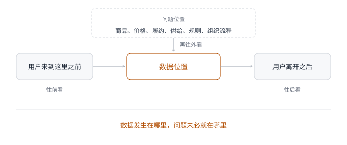
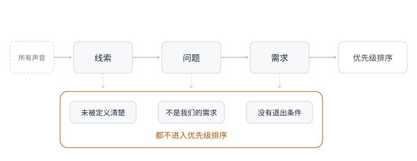

# 第 3 章 · 需求观——从管理需求到定义价值

## 引言

如果你问一个产品经理「你每天在做什么」，答案大概率绕不开需求挖掘、需求评估、需求文档、需求评审、需求排期、需求变更，诸如此类。我们被「需求」这个词包围得如此彻底，以至于很少停下来想过一个问题：当我们说「需求」的时候，我们到底在说什么？我们对各种需求分析工具如数家珍，也能把需求池维护得井井有条，可一到真实工作里，仍然会被一个看起来很合理的需求带偏。

当我们扪心自问「这到底是谁的需求，它在解决什么问题，又该怎么验证问题真的被解决了」，不知道你是否有那么一刻会愣住？需求来了，我们到底该怎么对待它？我以前也很喜欢把需求管理做得很漂亮：需求来源、业务背景、用户反馈、优先级、版本计划、验收指标，每一项都写清楚，评审会上也能讲得有条理。那时候我会觉得，一个需求只要被整理得足够完整，团队就离正确答案更近了一步。后来我才发现，这里面有一个隐蔽的陷阱：**需求池越满，团队越容易误以为自己离用户很近；排期越清楚，团队越容易误以为问题已经被定义清楚**。

危险的需求，恰恰长得最正常：用户说过、业务着急、数据异常、竞品做过、成本不高。每一条单看都没问题，合在一起却不一定能推出正确的结论，它们会让团队很快进入一种安全的工作状态「梳理背景→画原型→评审→排期→上线→」，每一步都专业，每一步都顺。但最初的问题可能根本没被问清楚：这到底是一个真实问题，还是一个被包装得很像需求的方案？

我想说的是：需求不是答案，而是线索。用户说出口的是线索，业务提出的方案是线索，数据暴露的异常也是线索，竞品做出的动作还是线索。线索的价值不是让你立刻开工，而是提醒你继续往下追问：谁在什么场景下遇到了问题，他现在付出了什么代价？如果不解决，真实损失又是什么？所以我们不谈怎么做需求分析，也不谈 5W1H、KANO、JTBD、HMW 这些工具，因为难的从来不是工具本身，而是当需求堆到桌面、所有人都等你开工的时候，你还能不能忍住不立刻动手，先把它重新问一遍。把需求看清楚只是前半程，走到后面你会发现，最难回答的是一个更靠前的问题：这个产品该由谁来定义它的边界。

## 3.1 多问一层——需求不是答案，而是线索

很多需求最初出现时，并不像一个需要分析的问题，而像一个已经想好了的答案。用户不会说「我在某个场景里遇到了什么问题，付出了什么代价」，而是直接说「给我加一个按钮」「能不能多一个筛选」「这里能不能导出」「这个页面能不能改一下」。这类表达非常诱人，因为它降低了产品经理的工作难度。你不用再问太多，只需要评估实现成本、画一个原型、排进版本，团队就能很快产出一个看得见的东西。一个大项目会让人警惕，大家会问目标、资源、风险和收益；一个半天就能做的小需求，反而会让人放松。这些低成本需求更容易骗过团队：它们大多是顺手就能做完的小事，单看都不重，甚至会让团队觉得「做一下也没什么」。但产品变重，往往不是因为某一个大项目，而是因为无数个「做一下也没什么」的小需求不断混进系统。

2019 年我负责的社交电商平台有一个独立的经销商 App，这个 App 服务平台上的店主、经销商，用来处理订货、售后、下游客户沟通和经营数据。对他们来说，系统好不好用，不是页面漂亮不漂亮，而是能不能少漏事、少返工、少被下游客户追着问。当时运营同学收集到几十条内容高度集中的反馈[^1]：用户希望在订单列表里增加一个「按退款状态筛选」的按钮。这个需求看起来太合理了：

- 用户表达清晰：不是那种模糊的「系统不好用」，他们明确要一个筛选项，而且知道筛什么字段
- 反馈数量庞大：不是个别用户的偶发抱怨，对一个 B 端工具来说，几十条同类反馈已经足够引起重视
- 实现成本不高：产品经理已经把原型画好，开发同学评估说这类筛选半天就能做完

如果按照常规需求处理流程，这个需求几乎可以直接进版本，用户要→运营提→产品画→开发做，大家都轻松，周报里也很好写：响应经销商高频反馈，优化订单筛选效率。但当时凭着对用户和业务的了解，我对这个需求提出了质疑：它太像一个已经被用户替我们想好的方案。这种质疑不是因为我觉得筛选没用，恰恰相反，筛选当然有用，问题在于：用户为什么会频繁需要筛这个状态？如果一个经营者每天都要反复进订单列表找退款单，那他要的可能不是一个更强的筛选器，而是系统没有及时告诉他现在有什么事需要处理。

我让团队先别急着做这个小迭代，先把提出这个需求的用户找到，调取了几位用户的操作行为回放。我们发现了一个很小但很关键的细节：这些用户平均每天要打开退款管理页面十几次[^1]。每次进去之后，前几个动作几乎都是翻页、找单、看状态，然后再找待审核的订单，他们并不是喜欢筛选，翻页和筛选只是在弥补系统没有主动提醒这件事。

这时需求就变了：用户说的是「给我加一个按退款状态筛选的按钮」，他真正需要的是「不要让我每天反复去查有没有退款要处理」。产品该做的，也就不再是加一个筛选项，而是把待处理退款变成一个主动触达的任务。最后我们没有做那个筛选按钮，而是在工作台首页加了一个待处理退款的数字角标，退款状态发生变化时，通过消息、站内提醒和弹窗把任务推给用户，关键状态不再依赖用户自己刷新列表。

上线后，一个有意思的现象出现了：用户不再继续提「加筛选按钮」，后来还有用户反馈说「最近退款处理快多了」。严格说，退款处理链路本身并没有因为我们加了提醒就发生本质变化，审批规则没变、处理权限没变、售后时效也没有凭空缩短。变化的是，用户不用再自己反复去查了，系统把他该处理的事递到了面前。

用户每天在列表里找退款单，他自然会想到「加筛选」，这是他在当前系统里能想到的最直接解法。产品经理照着这个解法做，不能说错，甚至短期内也能让用户满意一点，但我们真正该问的是：他为什么要找？为什么系统没有先告诉他？如果他不需要主动找，这个按钮还重要吗？很多需求都是这样：用户说要筛选，可能是因为系统没有提醒；用户说要导出，可能是因为后台没有给他需要的视图；用户说要搜索，可能是因为信息结构本身就混乱；用户说要多一个入口，可能是因为当前路径让他找不到关键任务。

面对低成本需求时要格外警惕：低成本是好事，但它也会降低团队的判断门槛。**产品经理真正要做的，不是把用户说出的第一个方案变成 PRD，而是追问他为什么会说出这个方案**。尤其是看到这类「加一个筛选」「加一个按钮」「加一个字段」「加一个入口」的需求时，我现在会先问三句话，不急着评估成本：

**表 3-1　面对一个方案句，先问的三个问题**

| 问题 | 目的 | 案例 |
| :------------------------------------------- | :--------------------------------- | :------------------------------------- |
| 用户说的是问题，还是他想到的方案？ | 防止把用户的补救动作当成产品答案 | 用户说的是「加筛选按钮」这个方案 |
| 他为什么会想到这个方案？ | 找到现有系统里让他不得不绕路的地方 | 因为每天要反复进列表找待审核订单 |
| 如果不做这个方案，还有什么方式能让代价下降？ | 找到更接近问题本身的解法 | 主动提醒待处理退款，而不是让用户自己查 |

**需求不是拿来直接满足的，而是拿来追问的**：用户的每一句话都值得尊重，但不一定值得照做；尊重用户，在于认真理解他为什么会这么说，而不在于把他说出的第一个方案做出来。很多需求只要多问一层，就会从「做一个功能」变成「修正一个工作方式」，这两者的差别，往往就是需求管理和价值定义的差别：需求管理在意的是「这个需求谁提的，优先级多高，什么时候做」，价值定义在意的是「这真的是需求吗」。

## 3.2 还原任务——用户说的 ≠ 用户需要的 ≠ 产品该做的

小需求容易被忽视，因为它太小；数据异常和业务方案容易被接受，因为它们太像事实。「用户说的不是答案」这句话很容易被误解成产品经理不听用户，其实恰恰相反。只有认真听用户，才会发现用户说出口的那句话，往往只是他在当前认知里能想到的解法。用户当然比产品经理更懂自己的处境，他知道哪里麻烦，哪里焦虑，哪里让他不舒服，但用户未必知道问题应该由产品的哪一层来解决，也未必知道一个方案背后会牵动什么成本。产品经理如果把「听用户」理解成「按用户说的做」，就会逐渐失去专业判断。久而久之，产品就会变成一堆局部补丁，每一个补丁都有理由，但连在一起看，系统越堆越重，问题却没有变少。后来我在团队内部分享需求判断时，经常会强调一个道理：**用户说的 ≠ 用户需要的 ≠ 产品该做的**。

这不是一句绕口令，而是需求判断里最常被跳过的三层关系：**用户说的，是表达；用户需要的，是任务；产品该做的，是经过场景、成本、边界之后的选择**。跳过中间任何一层，都会导致需求误判，最终落地一个不合时宜的功能或者一个不痛不痒的功能。

2017 年我负责的新零售平台完成了一次较大改版，改版之前，平台一直不温不火，流量获取和承接链路都没有真正跑起来。那次改版的核心，是重新定位数码 3C 和手机消费分期场景，并和某大型支付平台的消费分期业务达成合作，承接一部分外部流量。新版上线后流量突然起来了，也很快暴露出一个问题：以前没有流量，很多链路问题都被藏住了；流量一旦进来，哪里接不住，数据会非常诚实地告诉你。我们开始盯搜索、商详页、下单这条黄金链路，发现商详页整体停留时间偏低，跳失率也偏高。按照常规判断，问题似乎很明确：商详页不够好。

运营同学很快做了竞品调研，重点研究了一家垂直数码零售平台，结论也很符合直觉：别人的商详页更丰富，有用户评论，有开箱实拍，有首图视频，价格和利益点也表达得更强。于是运营提出一组需求：补用户评论，补开箱图，支持首图视频，强化价格利益点。这些建议放在今天的电商常识里都对，一个数码 3C 商详页当然需要这些，问题是，当时我们的核心问题真的在这里吗？

我对用户评论这件事尤其敏感，早期平台做过评论能力，但那时候流量太小，一个月 GMV 连百万级都很难稳定跑出来[^1]，线上用户主动评价几乎没有。后来我们为了坚持真实评论，尝试把线下门店消费后的用户评价同步到线上，整体评论数量依然很少。改版时团队讨论过是否保留评论，最后的判断是：不是评论不重要，而是时机不对。一个没有足够交易和评价沉淀的平台，硬把评论模块放上去，大概率是在暴露冷清。运营再次提出「补评论、补实拍、补视频」时，我没有直接否定，但也没有立刻让团队进入商详页改版，我的问题是：如果商详页真的不够丰富，为什么跳失用户会集中在某些商品和某些搜索行为上？

这也是我们早期比较重视数据采集的好处，搜索、浏览、加购、下单、用户分层这些基础数据都还能用。于是我们先没有看页面，而是把流失用户拉出来，用 RFM 模型和行为数据做了一轮分析。很快我们发现一类用户的特征很明显：注册后只浏览一两款商品就离开，短期内访问频次不低，搜索关键词高度集中，而且存在明确的品牌或机型偏好。这就有点不一样了，如果用户嫌商详页不好看，未必会反复回来搜同一类商品；如果被价格吓走，他的搜索词和浏览商品也不会这么集中。更像的情况是：他带着明确购买目标进来，却没有找到一个可以继续往前走的路径。

我们继续拆搜索数据、搜索结果和商品状态，才发现根因在商品供给里：这些用户浏览或搜索的商品，很多是新机、紧俏机型，或者已开售但平台暂时无库存的商品。当时我们是采销模式，呈现的是真实库存，还没有虚拟库存和销采能力。对用户来说，他看到的是「我想买的商品这里没有」；对我们来说，数据表现成了「商详页停留低、跳失高」。如果直接去做评论、实拍和视频，商详页会更完整、看起来也更热闹，但用户要买的那台新机还是不能买，紧俏机型还是没货，他的购买任务依然断掉。

这就是那三层关系在一个真实需求上的样子：运营说的是商详页跳失高，要补评论、实拍、视频和利益点；用户需要的是「我已经明确想买某款新机或紧俏机型，你能不能给我一个可继续的路径」；产品该做的，不是立刻把商详页堆厚，而是先承接这类明确购买意图。我们没有一上来做完整预售系统，而是先做了几个更轻的能力：0 元预约、到货通知，以及少量预售验证。用户在搜索或浏览到目标商品时，即使当下买不了，也能留下意向，等到货或开售时再被触达。这个方案没有评论区好看，也没有首图视频热闹，但它更接近当时的真实问题。

后来的结果也验证了这个判断：相关能力上线后，流失率明显下降，用户分层开始向更有价值的客群迁移；新品上线前后，预售销售额接近单日销售额的 15%，预约和到货通知登记量也接近日活用户的两成[^1]。这几个数字本身不是最重要的，重要的是它让我们意识到：流量不是完全没价值，用户也不是不想买，问题在于我们没有把想买但买不到的意图接住。

从「用户说的」到「产品该做的」，中间还隔着好几步，我把这个过程做成一张很简单的表，方便遇到类似场景时直接套用：

**表 3-2　用户说的、用户需要的、产品该做的**

| 层级 | 要问什么 | 案例 |
| :----------- | :------------------------------------- | :----------------------------------------- |
| 用户说的 | 用户、运营或业务表达出来的需求是什么？ | 商详页跳失高，需要补评论、实拍、视频和利益点 |
| 用户需要的 | 用户真正想完成什么任务？ | 买到明确想要的新机或紧俏机型 |
| 产品该做的 | 哪个动作能让用户任务继续往前走？ | 0 元预约、到货通知、预售验证 |
| 不该急着做的 | 哪些方案正确却没打中根因？ | 先把商详页做得更像成熟电商平台 |

这个表不复杂，但用起来就会发现，我们经常把用户表达、用户需要和产品动作混在一起。用户说「页面不够详细」，我们就做页面；业务说「转化低」，我们就加利益点；竞品有视频，我们就补视频。每一步都有理由，但这些理由之间少了一步改写。把方案句改写成问题句，做的不是把用户的话换成 PRD 的格式，而是把用户说出口的方案还原成他真正想完成的任务，再落成产品在当前边界下该承担的动作。这三层不能划等号，少掉这一步，产品经理每天做的就只是转手：用户打来一个电话，我们转给研发；业务抛来一个方案，我们转成原型；管理者提出一个方向，我们转成项目计划。看起来所有人都满意，只有产品自己越来越不像产品。

## 3.3 溯源追问——数据发生在哪里，问题未必就在哪里

做需求的日子长了，人会越来越信数据，这本身没错。数据能帮我们避免纯粹凭感觉做判断，也能让团队在争论时回到事实，但数据也有一个危险之处，它会给人一种过强的确定感。某个页面跳失高、某个按钮点击低、某条链路转化差、某类售后增长快，它们都很具体，具体到让人立刻想动手改。可数据只告诉你异常从哪里冒出来，不会告诉你异常为什么发生：一个用户在商详页离开，只能说明他在那里离开，不代表问题就在商详页；用户在售后环节取消订单，也只能说明取消发生在售后链路，不代表问题就在取消页。产品经理如果只盯着数据发生的位置，就会做局部补丁：转化低，就改页面；取消率高，就做挽单；投诉多，就加说明；查询频繁，就加筛选。这些方案不一定错，但它们都有一个共同问题：太顺手了，顺手到团队来不及问一句，问题是不是就在这里？

**图 3-1　数据位置与问题位置的分离**　中间是数据位置，两侧分别是它之前与之后；问题位置在上一层，要再往外看。

2019 年我负责的社交电商平台还处在拼团模式探索期，当时业务同学在分析交易链路时发现，整体售后率持续上升，其中申请取消这类未发货前的售后增长尤其明显。这个数据很刺眼，订单都还没发货，用户就取消了，说明用户下单后的确定性不够。业务同学自己体验了一遍售后链路，又参考了一些竞品做法，提出了几个很常见的需求：取消原因拆分，方便看清用户为什么取消；取消前挽单，比如弹窗、优惠券、提示用户再考虑一下；后台做配置，让不同商品和场景配置不同挽留策略。负责售后板块的产品同学整体认可了这个方向。

坦白说，从售后数据出发去优化售后链路，是很自然的反应，取消原因拆分也确实能让数据看起来更细，挽单也确实有机会挽回一部分订单。于是相关需求很快上线，而且还做了比较完整的挽单配置模块。但上线后效果不算好，不是完全没效果，数据有一定缓解，但远没有达到预期。同时产研成本上来了，营销成本也上来了，每一张挽单券都是真成本，每一个挽单策略都需要运营配置和维护。我们像是在一个漏水的桶底下接水，接住了一点，但桶还在漏。

后来我组织了一次专项复盘，那次复盘给我最强烈的感受是：早期分析从一开始就有点奔着做挽单去的。我们不是先问「用户为什么取消」，而是先默认「用户取消时需要被挽留」，然后围绕这个默认答案去找理由。我建议团队把挽单思路先放到一边，重新做一次分析：不要只看售后页面，不要只看取消原因，而是从用户基础和行为数据、商品结构数据、供应链履约数据几个维度一起看。这个过程花了一周多，发现了一个之前被忽略的问题：三方供应链商品的取消率明显偏高，用户大量集中在支付后两天仍未发货的阶段发起取消，这个发现把问题从售后链路拉到了履约链路。

用户取消，不是因为取消页面没有挽留，是因为他等不到发货。再往下追，原因也很现实：这类三方供应链没有接入公司的订单管理系统，发货确认慢，订单状态回传慢，客服和运营能掌握的信息也滞后。用户下单之后，看到的就是一种不确定：东西到底有没有发？什么时候发？如果两天都没有动静，取消就变成很自然的选择。

这时候再看挽单，结论就变了，挽单不是没价值，但它只能缓解症状。用户付出的代价是等待和不确定，你给他一张券，可能让他犹豫一下，但如果履约仍然慢，他下次还是会取消，甚至会更不信任平台。后来业务、供应链和行业同学也尝试推动三方供应链接入订单管理系统，但这件事短期内并不容易。很多三方供应链相对传统，有的还在用老 ERP，有的没有二开能力，有的需要背后软件服务商配合；即使技术上能接，订单量也不一定足以让对方愿意投入资源。对内部来说，接入之后还要培训、维护，还会影响后续拓展新品类的供应商选择门槛。找到根因不等于马上能解决根因，但这次复盘至少让我们看清了一件事：如果只围绕售后链路继续做功能，取消原因会越拆越多，挽单配置越来越复杂，运营能用的手段也会更丰富，可用户的等待代价并不会消失。把这三处放在一起看，结构是一样的：

**表 3-3　数据发生的位置与真正要追问的问题**

| 数据发生位置 | 顺手想到的需求 | 真正要追问的问题 |
| :------------------- | :------------------------- | :--------------------------------- |
| 退款管理页面反复打开 | 加退款状态筛选 | 系统有没有主动告诉用户待处理事项？ |
| 商详页跳失高 | 补评论、实拍、视频和利益点 | 用户想买的商品是否可买？ |
| 售后取消率升高 | 做取消原因拆分和挽单 | 履约是否让用户失去耐心？ |

通过这个案例能看到一条很清楚的规律：**数据发生在哪里，问题未必就在哪里，数据是线索，不是结论**。它能告诉你异常从哪里冒出来，但不能自动告诉你异常为什么会发生。产品经理如果只修数据冒出来的那个位置，就会把问题留在系统深处。后来我在团队里复盘这类问题时，会要求大家至少把异常往前、往后各追一层：往前看，用户来到这里之前经历了什么；往后看，用户离开之后去了哪里；再往外看，这个行为背后有没有商品、价格、履约、供给、规则或组织流程的原因。不是每次都要把链路拆得很重，但如果连这三步都没走，就急着做功能，基本是在赌。数据不是答案，它是线索，线索需要被放回现场，需要和用户行为、业务流程、系统约束一起看，否则数据越清楚，产品经理可能越自信地做错。

## 3.4 抬高门槛——很多需求不该排优先级，而该先退出

判断完需求真伪之后，产品经理很自然会进入优先级排序，做产品的人都熟悉优先级：重要紧急四象限、投入产出比、高价值低成本、RICE、ICE，或者更朴素一点，高层要不要、业务急不急、开发有没有空。这些方法都有用，但我现在的看法是，在优先级之前，还有一个更要紧的问题：这个需求该不该进入排序？**需求管理的高级阶段，不是把需求排好队，而是判断哪些需求根本不该进入队列**。

需求池越变越大，往往不是排序方法不够好，而是太多不该进入排序的东西被放了进来。一旦进入排序，它就获得了某种合法性：这次不做，它就变成「以后再说」；排到后面，仍然会有人不断来问进度。一个需求只要进了池子，就很难消失，尤其是来自竞品、高层和经营压力的需求，更容易直接进入队列，因为它们不只携带需求，还带着组织情绪。

2021 年我所在公司有明确的增长和 GMV 压力，高层希望做一个对标竞品的大额补贴频道，推动力很强。公司最高管理者想要，新来的业务负责人也想要，经营会上有人拿着竞品报告直接拍板推进，意思很明确：某头部平台的大额补贴已经做了两年，我们为什么还不跟？今年的增长缺口，就靠这个方向补。这种场面你大概也见过，会议室里没有人真的反对。运营开始准备补贴商品清单，技术开始看排期，资源似乎也已经协调得差不多了，这个需求甚至还没经过完整讨论，就已经带着战略项目的气味往前走了。

但我当时的判断是：不该这么急着做。GMV 压力是真实的，补贴也未必没用，问题在于这个需求从一开始就把「竞品做成了」和「我们也该做」画了等号。这里至少有几个问题没有被回答：我们的核心用户是不是同一类人？我们的价格空间够不够？我们的平台心智是否适合打价格战？补贴会带来新用户，还是训练老用户等低价？如果补贴效果不如预期，这个频道能不能体面收缩？我没有在会上直接反驳，那种场景下，硬怼通常没有效果，只会让讨论变成站队。会后我拉着数据同学做了两组交叉分析：

- 看用户重合度和用户心智：结果显示我们和对标平台的用户重合度只有 18% 左右，对方的大额补贴打的是价格敏感型用户，而我们平台长期积累的是一批更关注品质、信任和服务的用户。价格重要，但它不是他们选择我们的唯一理由[^1]。
- 看过去的小范围补贴测试：过去一年里，我们做过至少 6 次小范围补贴实验，其中 3 次在补贴后 30 天内出现同一批用户长期价值下降。补贴能拉动短期成交，但它也会改变用户的购买节奏，原因并不复杂，用户被训练成等补贴再买[^1]。

这件事很要命，因为补贴不是只影响一次交易，它会改变用户对价格的预期。如果平台原本就在低价基础上运营，再继续做大额补贴，很多时候不是让用户感知便宜，而是让公司真实倒贴。后来我找业务负责人做了一次 1V1 沟通，建议把方向从「全场价格战」调整成更贴合平台心智的方案，比如品牌清仓专区、会员积分加倍、围绕信任和复购做承接。我的核心意思是：我们不一定要跟别人打同一张牌，尤其当那张牌不是我们的长处时。

但是非常可惜，最后这个项目还是做了，因为真实工作里，产品经理不是每次都能挡住一个自己认为不合适的需求。尤其当最高管理者意愿、业务负责人意志、技术资源和经营压力合在一起时，一个产品负责人的判断并不总能改变组织方向。后来的结果并没有达到预期：补贴力度相对竞品没有明显优势，相比平台原价也没有太强感知，因为我们原本定价就不算高，同时它和当时平台想做精品电商的定位并不一致。最终这个频道没有成为增长引擎，反而是另一个更贴近平台用户心智的增长项目跑了出来。

这个案例我记了很久，不是因为我成功阻止了一个需求，而是因为我没有成功阻止它。产品经理不是站在组织外面做判断的人，很多时候你就在那股惯性里面，你能做的，是尽量把事实、代价和后续复盘条件留在桌面上，而不是摆出一个正确姿态。需求判断不止我认为对不对，还包括组织愿不愿意听见，产品经理有时挡不住组织惯性，但至少要做三件事：**把判断依据留下来，把替代方案摆出来，把复盘条件讲清楚**。否则等项目效果不好时，团队只会说「市场不行」「资源不够」「执行不到位」，没有人回头看最开始那个问题：这个需求是否本来就不该这么进入版本？

外部行业里也有类似的教训，滴滴曾经尝试外卖业务，起点并不缺资源：有高频出行入口，有调度经验，也有可被想象成「配送能力」的组织基础。问题在于，供给能力回答的是「我们能不能做」，不是「用户为什么要选择我们」。外卖用户依赖的是商家供给密度、配送稳定性、价格心智、评价体系和售后预期，这些不是把已有调度能力平移过去就能获得的。相比之下，美团外卖从 2013 年上线后长期围绕餐饮供给、配送履约和用户消费场景累积能力[^2]，它解决的是用户日常吃饭这个高频任务，而不是把已有业务能力延伸到另一个市场。这个对照并不是为了简单评价谁对谁错，而是为了说明一个很常见的需求陷阱：**团队越有能力，越容易把「我能做」误认为「我该做」**。有资源、有流量、有技术、有组织经验，都只能证明一件事有可行性，不能证明它有必要性。

需求进入排序之前，必须先回答这个需求为什么属于我们，这也是很多需求最常混淆的地方：它可能是一个真实需求，但不是我们的需求；它可能在行业里成立，但不在我们的场景里成立；它可能带来短期数据，但会训练出一个长期有害的用户习惯。判断不进入优先级排序，不是否定一个需求的全部价值，而是承认它和当前产品的用户、阶段、心智、成本结构不匹配。面对这类准备进入优先级排序的需求，我通常会先做一轮边界判断，问自己三个问题：它发生在用户的核心工作流里吗？它服务的是当前最重要的业务目标吗？它是不是把成本转给了客服、运营、履约或用户自己？

但不能把不进入优先级排序用成一种个人权力，好像只要自己觉得不对，就可以把需求挡在门外，那不是判断，那是另一种拍脑袋。真正的不进入优先级排序，必须能说清楚至少一个明确理由：用户不匹配、场景不匹配、目标不匹配、成本被转嫁、会训练出坏习惯、结果无法验证，或者没有退出条件。你不是在说「我不喜欢这个需求」，而是在说「这个需求还没有资格消耗团队资源」。

你如果只丢出一句「不行」，业务方听到的是拒绝；你如果说「这个需求对应的用户不是我们当前主用户，过去 6 次补贴测试里有 3 次造成长期价值下降，而且如果效果不好没有清晰退出条件」，对方听到的至少是一组可以讨论的证据。产品经理的不做要从情绪表达变成专业表达，靠的不是态度强硬，而是把不做的判断拆成组织能听懂的事实、假设和后果。排序解决的是「先做谁、后做谁」，但在此之前，产品经理还要判断「谁根本不该参加排序」，否则再精细的优先级方法，也只是给一些没有价值甚至负价值的需求开了绿色通道，让它们先退出，比给它们排一个靠后的位次重要得多。

## 3.5 从宽到严——需求池不是仓库，而是过滤系统

前面讲了几个案例，还是要回到日常机制，因为产品经理不能每次都靠灵感和警觉工作。一个人警觉，团队不警觉，需求还是会源源不断地进来；这次拦住了，下次换个名字还会回来。很多团队都有需求池，但需求池经常被用成仓库：用户提了，先放进去；业务提了，先放进去；高层提了，更要放进去；竞品有了，也放进去。放进去以后，大家就会觉得这件事还在，暂时不做，顶多算排在后面。需求池越变越大，产品经理每天都在整理、合并、归类、标优先级，像一个仓库管理员。但问题是，仓库里的东西并不会因为摆放整齐就变得有价值，甚至摆放越整齐，这个仓库越容易变成垃圾场。

我见过很多需求池变成「需求垃圾场」，半年后打开一看，里面躺着几百条需求。其中一部分来自已经离职的同事，一部分描述的是已经下线功能的问题，还有很多没有人记得是谁提的、为什么提的、当时到底想解决什么。这样的需求池不是资产，而是负债，它会制造一种虚假的安全感：好像所有声音都被接住了，却没有一个被改写过。所有声音都应该被记录，用户原话、业务诉求、客服反馈、数据异常、竞品变化，都有记录价值，因为产品经理不能靠「不听」来保持清醒。但需求池不能只做记录，它应该是一个过滤系统：让每一个声音在进入版本前，经历一次必要的改写和判断，而不是把声音原样存下来。这个过滤系统不需要设计得很复杂，核心只有三个动作：

- **入口要宽**：所有声音都可以进来，不要一开始就把用户和业务挡在外面。先别急着判断它有没有用，更别因为「我觉得不对」就让它消失，那会让团队离现场更远。
- **要有改写**：进入需求池的内容，大多是「方案句」，比如加筛选、做挽单、补评论、上补贴频道。产品经理要做的，是把方案句改写成问题句：用户为什么要筛选？为什么要取消？为什么在商详页跳失？为什么组织想做补贴？如果这一步走不通，说明它还不能进入版本。
- **出口要严**：不是所有被记录的需求都能进入排期，进入版本前，必须写清楚成功指标和不做理由。成功指标是为了防止「上线即完成」，不做理由是为了防止需求反复回来。很多需求被拒绝后会换一个名字再来，如果当初没有留下清楚的不做理由，团队下次还会重新争论一遍。

如果把这个机制放到这几个案例上，就是下面这张表，这张表背后是一种态度：**不要让方案以需求的名义混进版本**。需求评审低效，问题常常不在会不会讨论方案，而在于讨论得太早：原始表达还没有被还原成问题，就开始讨论交互；问题是否属于当前产品还没有判断，就开始估研发成本；成功标准还没有定义，就开始排期。这就是为什么需求池不能只是仓库，仓库负责保存，过滤系统负责让不该进入版本的东西留在版本外面。

**表 3-4　四个案例：从方案句到问题句**

| 原始表达 | 改写后的问题句 | 可能的产品动作 |
| :------------------------- | :------------------------------------------------------------- | :----------------------------------------- |
| 加一个退款状态筛选 | 经销商无法及时知道哪些退款需要处理，只能反复查列表 | 待处理角标、消息提醒、状态通知 |
| 商详页跳失高，要补评论和视频 | 高意向用户想买的新机或紧俏机型无法被承接 | 预约、到货通知、预售验证 |
| 取消率高，要做挽单 | 三方供应链发货慢，用户等待后取消 | 追履约链路、调整供应链方案，而不是只做挽留 |
| 竞品做大额补贴，我们也要做 | 经营压力下，组织想寻找短期增量，但可能与用户心智和成本结构错配 | 先验证用户、定位、成本和退出条件 |

任何一套机制都是有边界的，它不能保证每次判断都正确，也不能保证组织一定听你的。就像前面的大额补贴案例，哪怕你做了分析，项目也可能继续推进。但有了这套机制，至少团队不会在项目失败后只剩一句「早知道当时就不做了」。你会知道当时的假设是什么，风险是什么，替代方案是什么，哪些判断被采纳了，哪些判断被忽略了，这比「我觉得不该做」更有价值。我在需求池里习惯把条目分成三类，而不是简单区分成高、中、低优先级：**线索，是有声音但问题还没被定义清楚；问题，是已经能说明谁在什么场景下付出什么代价；需求，是问题成立、边界成立、成功标准和退出条件也说得清楚**。

**图 3-2　需求池的三状态流转**　三类走不过去的停在原处，不进优先级排序，而不是排到后面。

这三种状态要分开的不是标签，而是团队的下一步动作：线索继续补证据，问题先判边界，需求才进排序。当三种状态混在一起：一个人还在问「这到底是不是问题」，另一个人已经在问「按钮放左边还是右边」，第三个人开始问「下周能不能上线」，状态不清楚，讨论就一定会错位。我建议在需求池里显式标注类型，它要的是减少误会，不是新增一道流程：一个需求如果还是线索，就不要用「需求」这个词吓唬团队；一个问题如果还没证明属于当前产品，就不要拿去和已经定义清楚的需求抢资源。一个版本候选如果没有成功指标和退出条件，也不能因为「老板关注」就直接插队。

需求池的价值，不是帮产品经理记住所有事情、接住所有声音，而是帮团队看清每一件事离「值得做」还有多远：哪些只是声音，哪些已经变成问题，哪些真的值得进入版本。这个区分决定了排序发生在哪里：优先级排序只能在真正的需求之间发生，不能在线索之间发生，否则排序做得再精细，也只是把错误的需求排得更整齐。需求池失控，大多是把「线索」直接当成了需求，一旦中间少了「问题定义」和「边界判断」，需求池就会变成一个没有出口的待办清单。**好的需求池应该越来越清楚，不是越来越庞大**，它要帮团队减少争论，而不是把所有争论都推迟到下一次评审。

## 3.6 锚定价值——产品经理维护的是产品边界

如果说需求池解决的是团队日常机制，产品边界解决的就是产品最终要守住什么。产品经理每天都在管理需求：收集需求、评审需求、拆解需求、排期需求、验收需求。做到负责人以后，还要看不同产品线之间的资源分配，看团队成员的方案质量，看业务方和研发方的协同成本。你会更忙，也会被需求淹没，而产品经理要维护的不是需求池，而是产品边界。需求管理者维护的是秩序：哪些需求先进来，哪些后做，哪些排到下个版本。价值定义者维护的是边界：什么问题值得这个产品解决，什么问题不该由这个产品解决，什么问题虽然真实但现在不能解决，什么方案会让产品偏离原本存在的理由。这就是从需求管理到定义价值的变化，它不是让产品经理站到业务对立面，也不是让产品经理变成一个永远说不的人。恰恰相反，只有当你认真定义价值，你的「做」才更有分量，因为你知道为什么做，也知道为什么不做。

后来我带团队时，会刻意训练小伙伴不要太快接需求。售后取消那个案例里，负责模块的产品同学并不是没有做分析，也不是执行粗糙，他只是在最前面就接受了业务给出的解释。如果我只在复盘会上批评一句「你们需求分析不够深入」，这件事没有任何意义，团队下次还是会换一个需求继续这样做。那次我要求大家把已经上线的挽单方案放在一边，重新从用户行为、商品结构、供应链履约三个维度拉数据。这个动作本身就是一次训练：不要带着已经上线的方案回头找理由，而是允许自己承认，前面的判断可能错了。这件事对团队的影响，比后面有没有立刻解决三方供应链接入问题更重要。从那以后，我在评审里会更少问「这个方案怎么做」，更多问「你怎么知道问题在这里」。如果产品同学答不出来，我通常不会让需求直接进版本，不是为了卡流程，而是为了让团队形成一个习惯：**产品经理不是业务方案的施工队，首先要为问题定义负责**。

带团队最难的不是让大家更快接需求，而是让团队先学会怀疑：问题是不是在需求说的那个地方。你要让团队保持响应速度，但不能让团队变成需求流水线；你要尊重业务和用户，但不能把所有声音都直接变成开发任务；你要让组织看到产品团队的产出，但也要让组织理解，有些最重要的产出，是避免做错。

很多时候，判断不做比推进做更难，因为做有排期、有上线、有数据看板；不做只有判断、解释、证据和承担后果的勇气。在很多组织里，不做甚至不像工作，但产品经理如果不维护这个边界，产品就会慢慢变成一个谁都能往里面塞东西的容器，容器越来越满，价值越来越薄。

同样的边界侵蚀，头部平台也发生过。2016 年 11 月支付宝上线「圈子」相关功能，其中「校园日记」「白领日记」等圈子因为发布规则、打赏机制和低俗内容引发争议，支付宝随后道歉并处理了相关圈子[^3]。这个案例的问题不止内容审核没做好，更深一层是把支付场景里的互动想象误读成了社交需求。用户说「我想在支付完成之后能说句话」，在支付、转账、消费之后，确实可能需要沟通、备注、确认和安全感，但这和「我要在支付产品里经营一套社交关系」不是一回事。前者属于交易链路里的信息补足，后者会把产品带向完全不同的关系场。支付宝最核心的用户心智是安全、可靠、确定，一旦用暧昧社交和打赏机制去承接互动，满足的可能是表层热闹，伤害的却是底层信任。**一个需求如果没有被改写成问题句，就会从「补一个场景」滑向「改一个产品方向」**。

说到底，需求管理到最后，不只是排序，而是边界维护。用户表达、数据异常、竞品动作、组织压力，都只是需求的入口，不是需求的结论，如果接受这个判断，可以把下面四层检查当成一个边界维护的日常习惯：

**表 3-5　边界维护的四层检查**

| 层级 | 要回答的问题 | 常见误判 |
| :--- | :----------------------------- | :------------------------------------- |
| 表达 | 谁说了什么？ | 把用户或业务说出的方案当成问题本身 |
| 场景 | 这句话发生在什么真实场景？ | 把反馈数量当成需求强度 |
| 代价 | 谁正在付出什么代价？ | 只算研发成本，不算用户、运营和组织成本 |
| 边界 | 这个问题是否该由当前产品解决？ | 把所有真实问题都放进当前产品 |

每一个进入版本的需求，都必须说明它来自哪里、解决什么、代价由谁承担、做错了怎么退出。一个产品最终会变成什么样，往往不是由几个宏大的战略决定的，而是由无数个看起来不大的需求一点点塑造出来的。你今天放进一个补贴频道，明天放进一个功能入口，几年以后，你再回头看那个产品，可能已经看不出它最初为什么存在。

## 闲言碎语

拒绝需求这件事比接受需求难得多，我以前很怕这件事，不是怕吵架，而是怕自己显得「不合作」。业务方来找你，通常不是闲着没事，他们有指标，有压力，有管理者追问；用户来反馈，也不是为了给产品添麻烦，他们是真的被某个地方卡住了。产品经理如果总是一副「我比你懂」的样子，迟早会把自己活成一个讨厌的人，但后来我也慢慢发现，产品经理如果只会说「可以」，一样会出问题。你以为自己是在配合，其实可能是在把所有人的焦虑都做进产品里：用户焦虑，给一个按钮；业务焦虑，给一个频道；管理者焦虑，给一个项目；竞品焦虑，给一个同款功能。最后产品像一面墙，上面贴满了每个人当时觉得有道理的便签，远看很热闹，近看没有一张能撕下来。

这些年我越来越怕「半天就能做」「顺手做一下」这类需求，大需求至少会让人警惕，小需求反而最容易混进去。一个筛选，一个字段，一个入口，一个弹窗，单看都没什么，合起来就是一个更重的系统。你问它为什么存在，大家都能说出一个恰当的理由；你问它现在还解决什么问题，会议室会突然安静。**产品经理越往后走，越该练的是把需求看清楚，这比把方案做快难得多**。慢不是拖延，慢是把用户说的、用户需要的、产品该做的分开；慢是承认数据只告诉了你一部分事实；慢是敢在所有人都准备开工时问一句：这件事到底是不是问题？我知道，这句话不好问，很多时候你一问，空气就变了，别人会觉得你在挡事，在挑刺，在降低效率。**可如果没人问，团队就会用最高效的方式，把错误的事情做完**。

我现在对需求的态度比以前更复杂了：我尊重每一个需求，但不再信任每一个需求；我会认真听用户说什么，也会认真怀疑他说出口的方案；我会看数据，也会追问数据背后的场景；我会理解业务压力，也会提醒自己压力不能自动变成产品方向。我不做需求的搬运工，也不做组织焦虑的承接器，产品经理站在需求入口处，守住的是产品为什么存在。这个位置有时候挺孤独，但如果这里没人守，后面所有人的努力，都会变成对错误方向的认真执行。下一次，再有人对你说「半天就能做」，不妨先别点头，回到开头那三个问题，替他重新问一遍。

[^1]: 文中所涉运营数据均为真实项目数据，已做脱敏处理。

[^2]: 滴滴出行 2018 年上线外卖业务；美团外卖 2013 年 11 月上线。此处按公开报道转述，不构成原始出处。

[^3]: 2016 年 11 月支付宝上线「圈子」，「校园日记」「白领日记」等因低俗内容与打赏规则引发争议，支付宝随后道歉并下线相关圈子。此处按公开报道转述，不构成原始出处。
