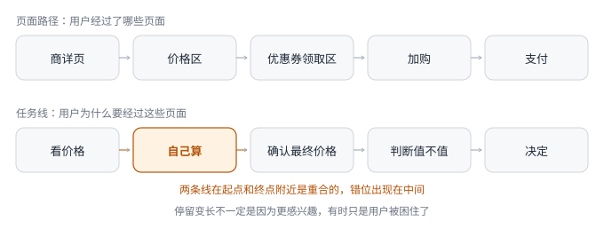

# 第 7 章 · 体验设计——好设计不等于好看

## 引言

我做过不少项目，设计稿一摊开，团队讨论的语言就变得很具体：这个页面是不是太挤，路径是不是太长，按钮是不是够明显，信息是不是完整，交互是不是顺。设计师会关注视觉层级和操作路径，运营会关注利益点是否露出，研发会关注规则能不能实现，产品经理夹在中间，看起来是在做体验判断。

我觉得很多所谓的体验判断，其实只是停留在界面，忽略了对用户任务的关注。界面当然重要，页面混乱、文案含糊、操作反常识，都会让用户被劝退。但如果产品经理只盯着界面，就很容易把体验误解成页面更清楚、路径更短、信息更全、样式更统一。真实情况往往没这么简单：用户觉得累，不一定是因为按钮难找；用户停留很久，不一定是因为兴趣更强；用户不用一个功能，不一定是因为不会用。有时他是在犹豫后果，有时他是在等别人确认，有时他是在跟一件页面上看不见的事较劲。

比页面好不好看更靠前的，是另一个问题：用户完成任务时，哪些成本被产品接住了，哪些成本还留在用户身上。换言之，产品经理要承担的，是这一类判断：**这个设计有没有让用户在真实场景里更低成本地完成任务**。这里的成本，不只包括点击次数和页面长度，它还包括认知成本、操作成本、等待成本、解释成本，以及责任和出错成本。

一个设计如果只是让页面看起来更完整，却把计算、判断、解释等风险都留给用户，它就不算真的好用。反过来，有些设计看起来很朴素，甚至不太显眼，但它把用户脑子里的那道题拿掉了，把用户心里的那点不确定兜住了，把用户出错后的退路留好了，它就可能是好设计。当问题定义已经相对清楚之后，方案不应该自然长成一堆功能，而应该先问清楚，用户完成这件事时，最重的成本在哪里。体验设计不是问题定义之后的美化环节，而是问题定义落到用户任务里的第一道关。

## 7.1 画任务线——从页面路径到用户路径

拿到一个设计稿时，产品经理的第一反应往往很自然：看页面，看路径，看流程。我们对这个反应太习惯了，以至于很少有人会停下来问一句：我看到的这条路径，是用户真正要走的路，还是产品想让用户走的路？这两件事在大部分设计稿里是重合的，用户从 A 到 B 再到 C，流程上确实走得通，但重合不代表一致。页面路径描述的是用户经过了哪些页面，任务线描述的是用户为什么要经过这些页面，以及在页面之外他还做了什么。页面路径在产品内部，任务线在用户现场。只盯着页面路径做判断，所有问题看起来都发生在页面上，但用户觉得累，往往是因为任务线中间有东西没被接住，问题不在页面顺不顺。

**图 7-1　页面路径与任务线的错位**　上排是页面路径，下排是任务线。高亮那一格「自己算」，页面路径上没有对应的一步。

我以前做过一个「到手价」的项目，就是从页面路径和任务线的差异开始切入的。当时平台的营销能力发展得很快，沉淀了大量可复用的促销工具：拼团、秒杀、补贴、套餐，每一个业务场景都有对应的价格形态；满减、立减、赠品、优惠券、积分，每一种促销工具也都有自己的规则和互斥关系。单看平台能力，这当然是好事，促销工具越多，平台可以组织的活动越丰富，运营可以调动的杠杆越多，用户理论上也能拿到更多优惠。

但问题出在商详页的数据表现上，一个商品可能标着「拼团价 89 元」，旁边又写着「单独买 99 元」；页面上有一张「满 99 减 10」的券，但拼团价用不了，只有单独买才能用；积分可以抵扣一部分，但有上限；如果买两件，还有第二件半价[^1]。价格区本身已经很拥挤，往下还有优惠券领取区、满减活动说明、赠品展示区和各种利益点标签。这些信息在页面路径上都是通的，用户能看到每个标签，每个标签都有入口，每个入口都能点进去看规则。从页面设计角度看，信息完整、路径清晰、结构也合理，但用户的任务线不是「看完所有优惠信息」。用户进入商详页时，尤其是在大促场景里，最关键的任务是确认一件事：我买这个东西，最终要花多少钱，然后判断它值不值。

页面路径给了用户一堆材料：原价、活动价、券后价、满减规则、积分抵扣、赠品条件。用户需要自己把这些材料拼成一个最终数字，而任务线需要的，就是这个最终数字本身。页面路径没有给用户答案，只给了原材料，让用户自己算。这两条线之间出现了断层，断层的位置很隐蔽。页面路径看起来是完整的，用户没有在任何一个环节被卡住，也没有任何一个按钮点了没反应。但任务线从「看价格」到「确认最终价格」之间多了一步「自己算」，这一步对页面来说看不见，对用户来说却实实在在。

大促数据印证了这个判断，活动期间的商详页和购物车的用户停留时长相比日常增加了将近 50%[^1]，但转化率没有同步提升。继续拆下去，规律更明显，营销工具覆盖越多的商品，用户停留时长越长，但转化率和其他商品没有明显差异。一个商品如果同时有拼团价、满减、优惠券和积分抵扣，用户会在页面上停留很久；如果只有一个价格标签，用户反而决策更快。与此同时，客服那边也在持续反馈，大量用户进线问：「这个商品到底多少钱」「拼团价和券能不能一起用」「积分还能再减吗」。用户花在「算账」上的时间，比花在「做决定」上的时间还多。

这个差异把问题指向了一个方向：用户在页面路径上走了很远，但任务线在「确认最终价格」这一步断了。因为他拿到的是一堆规则，不是一个答案。方向变得很清楚，商详页不应该继续让用户自己算，系统应该把拼团价、秒杀价、满减、立减、优惠券、积分抵扣等所有可用优惠算好，直接在主价格区给用户一个最终数字：「预估到手价」。其他优惠不再争抢主信息，降级为利益点标签，放在到手价下方，用一句简单说明告诉用户这个价格已经包含哪些优惠，用户如果想看明细，可以点击展开查看。

方案在讨论时遇到一个分歧，运营同学希望把所有优惠明细都直接列出来，理由很合理：我们确实给了这么多优惠，用户要相信这个价格，就应该看见优惠从哪里来。如果只给一个到手价，会不会显得像平台随便标了一个数字？这个担心不是没有道理，但它混淆了两件事：页面路径的完整性和任务线的顺畅性。把所有优惠明细列出来，页面路径当然更完整，但用户的任务线没有变顺。他只是从「自己算」变成「看别人怎么算」，仍然要花精力理解每一项优惠，仍然要判断这个最终价是否真实可达，页面路径看起来更丰富了，但任务线的断层还在。

上线后，A/B 测试验证了这个判断：商详页到支付转化率提升了 23.5%；商详页平均停留时长下降了约 20%；加购率明显提升，尤其是价格敏感型商品；在线客服的价格咨询进线量明显下降[^1]。更有意思的是，不同活动档位、不同营销工具覆盖数量的商品之间，转化差异开始被拉开。过去用户分不清「拼团价」和「满 299 减 50」到底哪一个更值，现在到手价把差异直接摆在眼前，用户能更快判断哪个选择更适合自己。商详页停留时长下降，反而是一个好信号，它说明用户花在算账上的时间少了，用户不是少看了商品，而是少做了一道不该由他做的题。数据不只是在验证一个方案的成功，它也在验证一件事：当页面路径和用户任务线对齐时，用户的行为会发生可见的改变。

**画任务线，不是看页面走到了哪一步，而是看用户为了做决定，到底多承担了什么成本**。流程图在页面边界内就停下来了，用户进入商详页，看完信息，加购或离开；任务线要到用户心里才停下来，他有没有得到做决定需要的那个关键答案，还是说他在用自己脑子里的计算器在算。页面路径说「用户已经看到了所有优惠」，但任务线可能在说「用户看了很久但没看懂」。两条线之间出现断层时，最容易被误读的指标就是停留时长，停留变长不一定是因为更感兴趣，有时只是用户被困住了。页面路径越完整，这种误读越容易发生，因为看起来「一切正常」。

落地到具体方法上就是：拿到一个设计稿之后，先别急着评价页面好不好看、路径顺不顺、信息全不全。先做一件事，画一条线，从用户决定做这件事的起点，到他确认可以结束的终点，把这条线上所有用户自己完成的「脑内动作」标出来。他需要算什么，需要判断什么，需要担心什么，需要等什么，需要解释什么。然后问自己：这些动作里，有哪些本该由产品承担，却被留给了用户？到手价之前，用户需要自己算优惠，这就是一个被留给了用户的脑内动作，去掉它，就是画任务线之后最重要的判断。这应该成为一个习惯：**别急着评价页面，先看见用户正在完成的任务，再决定页面上应该接住什么**。

## 7.2 降成本项——从操作效率到使用意愿

到手价讲的是 C 端场景里最常见的一类体验成本：用户不想在购买前替系统算账。到了 B 端，问题会复杂一些，B 端用户当然也希望系统顺、路径短、效率高，但很多时候，真正挡住使用的不是操作成本，而是责任成本。我曾经在做一个零售平台的价格中心时，对这件事感受很深。

当时平台针对自营品类搭建了价格中心，管理着 5000 多个 SPU、超过 3 万个 SKU[^1]。部分品类的市场价格波动非常剧烈，生鲜、日用、3C 这些品类今天一个价，明天一个价，人工调价很难追上市场节奏。运营和品类同学都很清楚，靠人工维护数万 SKU 的价格不现实，于是团队做了一套自动调价能力。从方案上看，这个能力很完整，系统接入市场价格监控和成本监控，基于成本、市场价、不同时间段、不同用户类型、不同曝光程度等因子，自动计算建议价格并执行调价。策略配置页面也做得不错，操作路径清晰，各种调价因子都能灵活组合，还接入了 OA 审批流程，策略配置完后，要经过层层审批才能生效。站在产品团队视角，这已经是一个相当成熟的中后台能力。

上线后，大家也都说这个能力好，方向对，逻辑对，实现也对。但使用数据不乐观，自动调价覆盖的基本都是低价、低毛利、边缘品类商品，核心品类和重点商品几乎没人敢用。一线运营同学的态度很微妙：嘴上说好，手上不用。问他们为什么，回答很一致：怕。他们信得过系统的计算能力，也承认配置页面不难用，怕的是「出了错算谁的」。自动调价一旦跑起来，价格是系统自动调整的，如果价格调低了导致亏损，或者调高了导致销量下滑，最终背 KPI 的是运营同学，不是系统。审批流程当然存在，审批通过也代表组织认可了这套策略，但「审批过了」和「出问题了我能解释」之间，隔着一道很大的心理鸿沟。

这个现象暴露出 B 端体验里很容易被忽略的一点：审批解决的是合规问题，不一定解决责任问题，用户怕的是出了错之后，自己解释不了。一个策略经过审批，说明它在流程上被允许执行，但当系统自动做出的决策产生负面结果时，谁来解释为什么这么调？谁来证明当时依据是什么？谁来处理亏损或销量波动？这些问题不会因为有审批就自动消失。人工调价虽然慢、累、容易漏，但运营同学知道这个价格是自己调的。他知道为什么调，知道当时看的数据，知道哪位业务同学催过，知道这个决定的来龙去脉，即使被问责，他至少能解释。但自动调价不一样，价格是系统算出来的，运营只是配置了策略，价格出问题时，他很难回答老板那句最现实的问题：「这个价格怎么定的？」

如果系统无法解释、无法追溯、无法补救，用户就不会把核心决策交给它。后来我们做了几个调整，核心思路是让用户对系统行为重新获得掌控感，配置是否更简单倒在其次：

- 兜底策略：用户可以在配置策略时设置安全边界，如果调价后击穿毛利底线，系统自动恢复到上一次调价金额，该商品进入自动调价黑名单，并在群里预警。或者击穿毛利后按策略中约定的固定毛利作为兜底定价，至少保证不亏。这个设计的本质不是多一个配置项，而是告诉用户：系统可以在边界内自动执行，但到了危险边界会停下来等人介入。
- 预览能力：策略新建时，系统提前展示这个策略覆盖哪些商品、下一次预计调价时间和金额、调整后的毛利、与当前价格的差距，并直接提示风险，比如「该商品有击穿当日毛利风险」。这一步把用户最担心的后果提前摆出来，用户不再是把策略交给系统后等结果，而是在系统行动之前先看到可能发生什么。
- 提前告知：针对部分核心商品，系统在自动调价前把即将执行的调价动作和金额变动推送到群里，提前告知相关同学。这个动作很轻，但它对用户很重要，核心价格不是偷偷改，而是有人知道、有人可追溯、有人能在异常时及时介入。

这些调整上线后，自动调价覆盖范围明显扩大，核心品类和重点商品开始有人敢用了。价格风险没有消失，变化在于用户知道自己有退路：击穿毛利有兜底，调价之前能看到预览，核心商品的调价动作有人知道。系统做的事本质上没有变，还是基于各种因子自动计算价格。变化的是用户对这件事的感受，他不再觉得自己把定价权完全交给了系统，而是觉得系统是在自己定义的边界内执行，关键风险仍然可见、可控、可追溯。

价格中心这件事让我加深了对 B 端体验的理解，很多 C 端场景首先暴露的是麻烦，很多 B 端场景更深处藏着担责。C 端用户怕的是「麻烦」，所以体验优化的方向是让操作更顺、路径更短、决策更快。但 B 端用户怕的是「担责」，用了系统之后出了事，自己解释不了、补救不了、也无法证明当时不是自己的问题。如果产品只降低操作成本，却没有降低责任成本，用户会很聪明地绕开它，这也是为什么一些 B 端产品看起来功能完整，却使用率很低。产品团队会继续优化页面、缩短路径、增加快捷操作，但用户缺的，是一份用了不会出事的安全感。系统越自动化，用户越需要知道边界在哪里；系统越替人决策，用户越需要知道依据是什么；系统越高效，用户越需要有撤回、预览、留痕和兜底。自动化要做的，是把责任边界画清楚，让人在边界清楚的前提下使用系统。

## 7.3 抽出视角——从案例判断到可复用视角

两个案例讲完，如果只记得「到手价」和「自动调价」，那就只是我遇到过的两个体验问题，远远不够。有用的是：下一次产品经理面对一个页面、一个流程、一个设计稿、一个中后台能力时，能不能更稳定地判断，体验到底应该往哪里改。体验设计面对的是一组交织的取舍：信息该露还是该藏，选择该减少还是保留，确认该删掉还是补上，复杂该交给系统还是留给用户。所以更适合沉淀的不是一个固定步骤，而是一个拆解视角，**把「体验好不好」拆成「任务成本由谁承担」**。

这个视角里最先要看的，是用户正在完成的任务线，而不是产品里的页面线。页面线通常是产品内部视角：进入商详页、查看价格、领券、加购、支付；进入价格中心、配置策略、提交审批、自动调价。任务线则是用户视角：我想知道这件商品最终多少钱，判断值不值；我想让系统帮我调价，但出问题时我还能解释、能补救。这两条线不一样，页面线描述用户经过了哪些地方，任务线描述用户为什么要经过这些地方。产品经理如果只看页面线，就会自然优化页面；如果看任务线，就会发现有些页面本身不是问题，有些页面外的动作才是问题。

任务线看清楚之后，再看用户付出了哪类成本。到手价里最重的是认知成本，用户要理解优惠叠加、互斥和抵扣规则，同时也有解释成本，因为用户不清楚价格，就会找客服确认。自动调价里最重的是责任成本和出错成本，用户会用这套配置，只是不敢让系统碰核心商品；同时也有解释成本，因为出事以后他需要说明系统为什么这么调。

很多体验优化之所以无效，就是因为把成本看错了。前面讲过的定时群发就是这样：拦住用户的不是设置麻烦，是没有反悔的余地。用户不用它，不一定是时间选择器不顺；用户不用自动调价，不一定是策略配置复杂；用户在商详页停留很久，也不一定是商品信息不够吸引人。你以为在降操作成本，用户承受的可能是责任成本；你以为在补信息，用户缺的是一个可以直接行动的结果。成本看清楚之后，难的是判断复杂应该由谁承担：

**表 7-1　复杂的类型与它的归属**

| 复杂的类型             | 应该交给谁                         | 典型例子                                             | 为什么                                             |
| :--------------------- | :--------------------------------- | :--------------------------------------------------- | :------------------------------------------------- |
| 系统能算得又快又准的   | 交给系统                           | 优惠叠加、价格计算、默认支付方式、库存状态判断       | 让用户自己处理，只是浪费他的注意力                 |
| 关系到信任和责任后果的 | 仍由用户决定，但要让他需要时看得见 | 最终价格明细、调价风险、批量操作影响范围、发送前确认 | 不能完全藏掉，用户不一定每次都看，但需要时得看得到 |
| 需要组织一起承担的     | 回到组织机制                       | 谁有权审批、谁能撤回、异常谁复盘、预警发给谁         | 不是交互设计能解决的，却直接决定体验               |

B 端产品尤其如此，产品经理如果只画页面，就会低估组织关系对体验的影响。到手价不是把优惠规则消灭，而是把计算放到系统里，把明细放到用户需要时可以展开的位置。自动调价把实时计算交给系统，把风险边界、预览和告知留在用户可控的位置，把异常处理放进组织协作里。体验设计不是把复杂消灭，很多复杂本来就消灭不了。优惠规则不会因为页面简化而消失，价格波动不会因为系统自动化而消失，审批责任不会因为流程线上化而消失。**真正的设计，是把复杂放到更合适的位置**。复杂放对了，用户任务就会变轻；复杂放错了，页面再顺，用户也会继续承担不该承担的成本。

## 7.4 嵌入评审——让体验判断进入设计评审

体验判断如果只停留在某个产品经理的个人敏感度里，这件事是不稳定的。这个项目里你想到了任务成本，方案就会往用户任务里收；下一个项目排期一紧、评审一赶，团队又很容易回到页面好不好看、路径顺不顺、信息全不全。体验设计要进入团队工作，不能只靠一句「这里体验更好」，而要让团队在设计评审里沿着一条更清楚的链路往下问。这五个问题是：用户要完成什么，用户多承担了什么成本，复杂应该交给谁，产品用什么设计动作降低成本，最后又用什么信号证明体验真的变好了。

**任务线：用户真正要完成什么**

不要一上来就讲页面新增了什么、按钮挪到了哪里、弹窗改成了什么样，先讲用户来到这里，是为了完成什么任务。到手价里，用户要确认的是最终要花多少钱、值不值，优惠规则怎么算不重要；自动调价里，运营想知道的是这份自动化敢不敢用在核心商品上，配置页面顺不顺是另一回事。任务讲清楚，页面变化才有依据。

**成本项：用户多承担了什么**

体验不好不是一个可以直接落方案的判断，要继续往下问：用户是看不懂规则，还是要重复操作？是在等待一个不确定结果，还是完成动作后解释不了？是担心点错，还是担心出了问题无法补救？不同成本对应不同设计方向：到手价那边最重的是认知成本，主路径先给最终价格就能降下来；调价那边最重的是责任成本和出错成本，配置路径做得再顺手也不解决它，要补的是预览、兜底、留痕和告知。

**复杂归属：复杂应该交给谁**

复杂没法凭空消灭，压下去也只是换个地方待着。关键是这份复杂最后落在谁身上，落在用户身上的那一份，就是体验成本的来源。到手价是系统承担计算，用户按需查看明细；自动调价是系统执行策略，人定义边界，组织接收风险告知。

**设计动作：用什么设计降低成本**

任务、成本和复杂归属说清楚以后，设计动作才有依据。好的设计动作不是为了让页面显得更完整，而是让任务更轻、风险更可见、后果更可控。在到手价那边，结果是前置的，明细挪到用户要看的时候；调价那边，自动执行之前先给预览，执行之后留下记录，让风险有边界、出错有退路。

**验证信号：怎么证明体验真的变好了**

如果评审时说不清验证信号，上线后就很容易只看一个大指标，然后把结果解释成自己想要的样子。到手价不能只看页面点击，而要看商详页到支付转化、停留时长、价格咨询量；自动调价不能只看配置页使用率，而要看核心品类是否开始使用、风险预警是否触发、异常是否能被兜住。验证信号要落到被降下来的那类成本上。

**表 7-2　五个评审问题与答不上来的后果**

| 评审问题 | 答不上来的后果                         |
| :------- | :------------------------------------- |
| 任务线   | 页面变化没有依据，只能比谁的功能更多   |
| 成本项   | 优化方向凭感觉，容易降错成本           |
| 复杂归属 | 复杂全压在用户身上，或者被藏成一个黑箱 |
| 设计动作 | 动作跟着页面走，不跟着任务走           |
| 验证信号 | 评审当场说不清，最后只能各挑各的指标   |

这五个问题如果答不上来，评审不会当场停住，项目会带着一个没被检验的判断继续往前走。把这套问法放进设计评审，并不会让流程变重，相反会减少很多无效争论。以前大家争「信息要不要露出完整」，现在可以问「这条信息是在主路径上帮助用户做决定，还是只是增加理解负担」；以前大家争「确认步骤能不能删」，现在可以问「这一步是在消耗用户，还是在保护用户」；以前大家争「页面是不是更顺」，现在可以问「这个顺，是不是把解释、风险或责任留给了用户」。体验判断进入工作，意味着大家开始习惯把「体验更好」翻译成更具体的话：用户少算了什么，少等了什么，少解释了什么，少承担了什么风险。只有说到这一层，设计评审才不只是看稿子，而是在判断产品有没有把用户任务里的成本放到更合适的位置上。

## 7.5 精简动作——好设计让产品动作变轻

如果说问题定义解决的是「该不该这样做、为什么这样做」，体验设计解决的就是另一个问题：既然要做，产品应该把用户任务里的哪些成本接过来。到了这一步，方案不只是要对，还要轻。这里的「轻」，不是简单少做功能，也不是一味缩短路径，而是产品不再把不该由用户承担的成本推给用户。用户不该自己算的，系统先算出来；用户不该反复跳转的，产品把动作收回当前任务里；用户必须知道的风险，提前讲清楚；用户出了错需要补救的地方，产品把退路留出来。

到手价就是这样的设计，它没有把商详页做成更大的优惠说明中心，也没有试图把所有营销规则都解释完整，而是把主信息收成一个最终数字。用户进入商详页，要确认的是自己最终要花多少钱，拼团、满减、优惠券、积分抵扣之间是什么关系，他不关心。系统把计算接过去，用户就少做了一道题，明细没有消失，只是退到用户需要时再展开的位置。这个方案之所以变轻，跟页面少了几个模块关系不大，变的是用户：他从「自己算规则」变成了「先拿到答案，再按需看依据」。

自动调价也是如此，它要解决的，不是配置页面够不够顺，而是运营敢不敢把核心价格交给系统执行。兜底、预览、风险提示和群通知，表面上看增加了产品动作，但用户任务反而变轻了。因为运营最担心的是出了问题以后解释不了、补救不了、证明不了当时系统为什么这么做，多点几下反倒无所谓。当系统给出边界、依据、留痕和预警，用户才会觉得自己把责任放进了可控范围，系统只是在边界内执行。

**判断一个设计是不是变轻，不能只看页面上少了什么，也要看用户心里少承担了什么**。五类成本对应着不同的设计方向，也对应着不同的验证信号：

**表 7-3　五类成本的设计动作与验证信号**

| 成本类型       | 产品该做什么                           | 验证看什么                             |
| :------------- | :------------------------------------- | :------------------------------------- |
| 认知成本       | 先给结果，而不是继续加说明             | 理解、咨询、停留和转化                 |
| 操作成本       | 减少任务跳出，而不是只压缩页面步骤     | 完成时间、步骤流失和重复动作           |
| 等待成本       | 给状态和预期，而不是只显示「处理中」   | 刷新、催问、超时和取消                 |
| 解释成本       | 给依据、口径和记录，而不是只给一个结果 | 客服进线、群里追问、复盘材料和口径争议 |
| 责任和出错成本 | 给预览、撤回、留痕、兜底和通知         | 核心功能使用范围、异常处理、撤回       |

同一个现象，背后可能是完全不同的成本。用户反复找客服，可能是因为入口不明显，也可能是因为系统没有给出足够可信的答案。产品经理做体验设计，不能只问用户能不能完成操作，还要问他完成这件事时到底多承担了什么。多理解了一套规则，多跳了一个系统，多等了一个不确定结果，多解释了一段口径，还是多承担了一次不可逆的风险。问到这一层，方案往往会自然收敛：该给结果的时候，不再堆说明；该保留依据的时候，不为了简洁把信息藏死；该增加确认的时候，不机械追求少一步。

**好的体验设计，最后会让产品动作更克制**。它不是急着展示产品做了多少，而是把产品能力放在用户任务最需要的位置上。该由系统计算的，就不要让用户自己算；该让用户知道的，就不要为了页面简洁藏起来；该让组织接住的，就不要把责任留给一线使用者。产品在底层做了更多工作，用户在前台才会少用一点力。

## 闲言碎语

刚入行那几年，我很容易被「好看」和「完整」吸引，一个页面排得整齐，按钮层级清楚，流程从开始到结束都能跑通，心里就会觉得踏实。后来做的项目多了，才发现很多真正有用的体验，并不一定显眼。有时是少让用户算一道题，有时是默认一个上次用过的选项，有时只是多给一次撤回，有时只是把风险提前说清楚。好体验经常是沉默的，它不抢用户注意力，不展示产品团队多聪明，也不要求用户理解背后做了多少复杂工作。它只是让用户继续往前走，而且走得没那么累。

这对产品经理其实是一种很好的提醒，我们很容易想证明自己做了很多：功能很多，规则很全，系统很智能。但用户不关心我们做了多少，他只关心自己要完成的事有没有变轻，甚至很多时候，产品越努力展示自己，用户越累。我现在越来越喜欢那些看起来朴素的设计，朴素未必高级，但常常意味着克制：知道什么该露，什么该藏；知道什么该让用户决定，什么该由系统承担；知道什么时候少一步，什么时候多一步；知道让用户快一点之前，先让他清楚一点、放心一点。

产品经理做体验，不能仅仅看作一条转化路径，路径当然重要，但用户不是流量单位。他会算不清、会担心、会犹豫、会怕出错、会怕被问责、会在某个瞬间因为产品替他多想了一点、多担了一点，而愿意继续往前走。**好的设计，不是让产品显得更聪明；好的设计，是让用户不用那么努力**。

[^1]: 文中所涉运营数据均为真实项目数据，已做脱敏处理。
