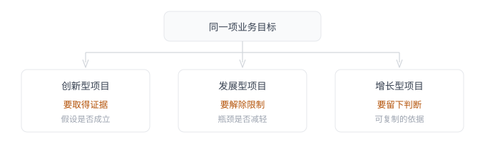
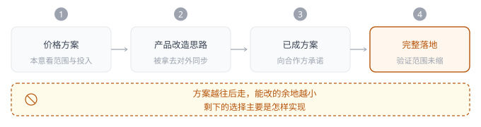
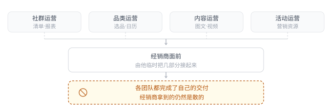
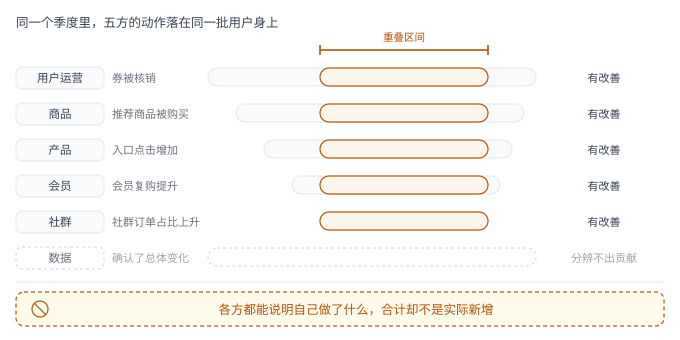

# 第 19 章 · 项目协作——复杂协作中，项目为什么会失控

## 引言

业务规模还小的时候，往往一个人就能拿主意，但规模一大，事情分到了几个团队手里，该谁拿主意反而说不清了：每一步都有人负责，合起来却未必有人再整体看一眼，更没有谁看得全，进度表填得很满，事情却可能已经越做越偏。业务确定方案、产品梳理需求、研发安排版本、运营准备上线，分工让复杂的事能同时往前走，也让进度变得容易检查：方案有没有确认，功能有没有完成，资源有没有到位。但有时各项任务都在推进，项目最初想解决的问题却没有发生改变。上线之后，团队继续补功能、做活动，投入越来越多，反而越来越难说清楚还应该做多久。

这种失控未必表现为延期或争执，更常见的是：一个还只在验证阶段的设想，几轮沟通下来就可能变成必须交付的承诺；一个长期存在的业务瓶颈，可能被拆成许多局部需求，却始终没从根上解决；几个团队一起把数字推高，复盘时却说不清下一步动作。各方都完成了自己理解的那部分工作，项目却仍然缺一个共同答案，协作要管的不只是任务按时完成，还包括让不同团队始终围绕同一个问题工作，并根据已经发生的结果调整下一步。那么一个项目究竟是从哪一步开始，悄悄离开了原来的问题？

## 19.1 识别项目——同一套流程，管不好所有项目

拿到一项业务目标，团队很容易直接进入方案讨论，过去做过类似功能，现有系统也能复用，工作很快就能拆解下去。可同样是建一个交易入口，有的项目还不知道用户愿不愿意买，有的已经有稳定订单只是经营过程不顺，还有的想靠改入口换来更多购买。三者都要产品、研发和运营，决定工作怎样展开的依据却不同。判断属于哪一类项目，不用先给项目贴名字，问三个问题就够了：这个方案有没有被真实用户验证过；这项业务有没有正在运行的收入和服务；如果数字涨了，能不能说清是哪些动作带来的。三个问题指向三种依据，答不上来的那一个，通常就是眼下最该补的。同一个业务在不同阶段会给出不同答案，项目类型也跟着变，三个问题不是一次问完就结束，每往前走一段都要重新对一遍，看哪一问的答案变了。

**创新型项目**

创新型项目面对尚未验证的设想：新用户、新交易方式或新合作关系，都可能让过去的经验暂时不够用，别家跑通的模式换到自己客群和资源里也未必成立。这类项目需要尽早让真实反馈进入决策，先用有限投入回答关键问题，再决定哪些部分值得完整建设。如果一开始就把所有设想拆成确定需求，等发现方向不对，承诺和排期已定，团队多半还是会把原方案做完，错过纠偏的窗口。

**发展型项目**

发展型项目有正在运行的业务：主要任务是解决已有瓶颈，需求、交易与服务都有基础，问题可能出在经营分工、流程衔接或能力不足。各团队往往知道自己缺什么，也能提出不少合理需求，但局部完善未必能够改变整体表现。需要先辨认哪个限制正在影响业务，再把相关角色、流程和能力放到一起调整，功能交付后原问题还反不反复，比需求清单划掉多少项更能说明进展。

**增长型项目**

增长型项目要在已有业务上找到值得继续投入的办法：一次触达、一组权益或一处产品调整，都可能带来变化，但数字上涨还不足以支持下一轮选择，哪些人受到影响，哪些动作产生了增量，投入扩大后成本是否仍然合适，都需要在协作中得到回答。几个团队同时参与时，尤其要避开各优化各的局部指标，最后只看见总数涨了，却拿不出下一步的判断。

这三类项目可以相互转变，也可能同时存在于同一项业务中。划分它们，是为了看清当前最该解决的问题，而不是给项目贴上固定标签。已有业务调整交易模式，仍可能需要重新探索；解决经营瓶颈以后，也可能继续做增长验证。**项目所处的状态不同，协作就要围绕不同的结果组织：探索要取得证据，发展要解除限制，增长要留下能指导下一次投入的依据**。启动、推进和复盘仍然需要，但讨论的事情不能始终只是进度，分错了类，代价会以很具体的方式出现。把没验证过的设想当成发展型项目来做，团队会去补功能和流程，把「做完整」当成进展；把正在运行的业务当成创新型项目来试，会反复推翻已经在用的东西，把稳定当成保守；把需要验证杠杆的事当成既有业务来维护，就会在没有比较的情况下继续加投入。三种错法有一个共同点：把上一类项目习惯的动作带进了这一类，做创新的团队在追完整度，做增长的团队在比谁的局部数字好看，做发展的团队在等一个尚未成立的结论，依据用错了，投入越多，偏离越远。

**图 19-1　三类项目要围绕不同的结果组织**　三类项目并排在一个目标下：一个验假设，一个解瓶颈，一个留依据。

## 19.2 创新型项目——先验证成立，再完整交付

2026 年，我所在的设备租赁平台准备尝试一种新机订阅模式，公司原本已有手机租赁业务，这次希望面向信用表现较好的用户，提供更灵活的用机选择，降低高端机型的使用门槛。公司联合一家大型支付平台和一家头部手机品牌开展试点：支付平台提供目标人群与资源位，品牌方提供新机货源，我们负责方案设计和实际经营。用户预付首租总租金，按约定条件选择归还、买断或续租，不同时间对应不同的租金与结算规则。项目由公司发起，又有两家重要合作方参与，很快被列为年初的重点战略项目。方案借鉴了一家海外设备订阅企业的做法，虽两种业务都是出租手机，但经营重点却有所不同：对方依赖设备归还后通过翻新流程进而继续流转，通过多次出租获得收益；我们的模式更关注租赁加最终买断的商品总收入。这个项目虽挂了订阅的名称，价格设计仍沿着原有租赁思路展开，包括各期租金、设备残值以及归还和买断的结算，老板亲自参与测算，希望把收益算清楚。这事本身有必要，只是收益算的出来，并不能说明目标用户愿意接受。信用表现好，回答的是一部分履约风险，并不直接回答有没有这种用机需求。

方案交到产品侧时，我和负责租赁的主产品同学建议先缩小尝试：利用系统现成的页面搭建能力，可以先展示方案，让资源位带来的用户了解规则、留下联系方式或领取权益，观察是否存在真实的租赁需求。虽然这个 MVP 方式不能验证用户真实付费，更证明不了整套订阅模式成立，但可以先回答「目标用户群体是否愿意了解这个新模式」，如果这一层的反馈就不理性，至少不用等价格和交易流程全改造完以后才发现。业务团队也同意先进行 MVP 试点，只是对「最小」的理解不同，项目由管理层推动，又涉及重要合作方，他们更在意尽快落地以及上线后不要占用太多运营人力。因此他们理解的 MVP：系统最好能够完整支持，技术实现可以临时，必要时也可接受硬编码。产品希望先减少未经验证的建设，业务希望减少运营人工参与，双方都在说「MVP」，事情却不是同一个。这里有个很大的误会，**开发做得快、实现做得简，并不等于验证范围已经缩小**。如果用户从下单到归还、买断的关系仍然完整成立，后面要承担的工作也会一起进入项目。

产品侧最初根据价格方案整理过一版大致改造思路，本意是让业务看见涉及的范围与投入，再讨论是否值得这样推进。业务却已经据此向上、向合作方同步了方案。那时并没有配套的完整运营计划，于是系统要怎么改就先变成了项目要怎么走。等到正式设计和技术评审，产品团队已经很难再把问题退回到客群验证，部分技术同事也提出过疑问，但最终决定仍是先跑通下单与首租，归还、买断和续租以后补齐，团队经过约三周的高强度赶工，做出了第一版。本来用来评估投入的材料，在层层传递里成了实施依据；本该讨论的方案，在对外沟通里成了承诺。等任务进入研发，剩下的选择主要是怎样实现、哪些功能可以晚一点。**创新项目要留出调整空间，得在几方刚开始承诺时就说清：哪些已经定了，哪些还要等用户反馈，第一阶段做到哪，后续投入由谁按结果定**。不然，产品和技术就算都看出验证不足，也只能把疑问留在评审意见里。

**图 19-2　评估材料如何在传递中变成承诺**　图上四个阶段一路传下去，每过一手，能退回去重新商量的余地就少一分。

上线后，支付平台按约定提供了独立资源位，访问流量还算正常，但第一个月累计下单不足 200 笔[^1]，通过审核、真正进入租用状态的不到 5 笔[^1]。运营主要做了商品上架和价格配置，并没有围绕结果持续展开经营，订单少到底和需求、价格、审核或者其他条件有多大关系，仍需要进一步分析，项目却没有沿着这些问题继续走。前期全力推进的是上线，到了需要解释用户反应的时候，投入反而退了下去。少数真实订单，又迫使后续开发停不下来，用户已经租到设备，归还、买断、续租迟早要处理，第一版延后的链路只能接着补齐。业务既没明确决定继续经营，也没组织退出，产研还在为这几笔订单完善系统。几个月后商品和价格方案下架，该模式暂停了后续订单进件，但相关功能却一直留在线上。最初想探索的新模式没有形成持续经营，已经作出的承诺仍然占用资源，所以试点范围不能只按首版开发量计算，还要包括真实交易发生以后必须承担的服务，以及结果不理想时怎样收尾。

在这之前，我还经历过一次方向相近但结果却不同的创新型项目。2018 年，我所在的社交电商平台通过经销商向消费者销售减脂产品与服务，健康管理师提供咨询和后续指导，那时新经销商大多从既有团队服务的消费者中转化，客群来源相对单一，培养周期较长。那年公司一款核心减脂商品正处在品牌建设期，为此冠名了一档减脂类综艺节目，品牌曝光是主要目的，运营同时想借这个机会接触原有社群之外的潜在消费者，并从中发现有意愿成为经销商的人。运营和产品刚开始讨论怎样承接这些关注，话题很快就滑入新增用户的社群与经销体系：用户进来以后如何组织，怎样分层，又怎样继续发展。这些都是长期经营要考虑的事情，但讨论得越细，越容易忽略一个前提：节目观众还没有成为我们的用户，更没有表现出经营意愿。

重新对齐目标时我们才发现：观众通过什么途径找到我们、为什么愿意进一步了解服务，都还没有具体安排。讨论于是回到节目现场：100 多位来自现有社群的健康管理师，正在以大众评委身份参与节目，他们既跟节目有关，也能做减脂咨询。先让有减脂需求的人找到一位可以咨询的健康管理师，就有了接触潜在用户的具体办法，后续也能继续观察兴趣是否会转化为购买。团队联合节目及宣传渠道，把健康管理师在 App 中的名片分享出去，观众可以下载 App、添加健康管理师，先了解自己的减脂问题。完成咨询、意愿较强的用户，再领取一张「好友邀请卡」，邀请 1～3 位有相同需求的朋友；邀请双方后续购买产品与服务，均可以获得相应优惠。权益没有只停在转发上，而是接在咨询之后、购买之前，让已经了解服务的人有理由邀请朋友一起参与。第一版因此只做了权益领取、邀请关系和优惠发放，原来讨论的社群关系没有完整搬进来，活动只记录这一次分享与购买，不建立新的经销层级。它保留了共同减脂的参与理由，也暂时避开了复杂的经营利益关系。咨询和后续服务由已有能力承接，产品需要新增的部分相对有限，团队可以先观察潜在消费者能否进入、购买与邀请能否发生。长期发展经销商的目标仍然存在，只是不再要求第一版替用户完成从观众到经营者的全部转变。

节目播出和前后宣传持续近半年，累计有 60 余万潜在用户添加健康管理师名片[^1]，相关交易达到亿元级[^1]，后续又从这些消费者中逐渐发展出近 1 万名不同层级的经销商[^1]。这些结果来自节目、商品、服务和邀请活动的共同作用，邀请卡在其中承担的是把曝光后的兴趣转化为咨询、购买和分享，让后续关系有机会从实际体验中形成。它没有先建设完整的经销体系，却没有因此妨碍经销关系后来出现。

两项尝试的差别，不在于一个复杂、一个简单。订阅试点本该先确认客群和方案是否匹配，团队却提前扛起了完整交易建设；邀请活动先承接真实的减脂需求，把尚未形成的经销关系留到后面。**创新型项目的协作，要让当前投入与当前需要取得的证据相称**。业务、产品、技术和运营需要共同确定这一轮准备回答什么、已有能力能够承接什么，再据此安排工作。

## 19.3 发展型项目——先找到瓶颈，再持续完善

2021 年，我所在的社交电商平台已经有成熟的商品供给、经销商体系和交易流程。平台提供商品、内容与分佣支持，经销商经营自己的社群，根据成员需要推荐商品、解释卖点并维护关系，再通过成交获得收益。早期的爆款经营也依靠这套分工：由社群组织推荐与分享，带动商品打爆和持续的复购。用户需求和交易方式都已有基础，业务后来面对的主要问题，是这套经营方式在调整中逐渐失去了平衡。那一年平台开始更集中地打造爆款，每个周期直接向消费者主推 1～2 款商品，也逐步接过内容、触达和部分社群运营工作。短期 GMV 被拉高，经销商自己选品、安排推荐和维护用户的空间却在收窄，原本需要他们判断和组织的事情，越来越多地由平台决定，他们逐渐变成安排的执行者和转发者。

这个情况来到 2022 年，社群活跃持续下滑，部分头部经销商开始带着团队离开，公司决定把主推商品的经营重新交回社群。为了配合这次调整，团队准备在经销商 App 里建设「社群主推清单」，覆盖选品、排期、内容准备、推广节奏和经营反馈。历史上社群已经证明过自己能组织交易，这次需要解决的是平台怎样提供支持、经销商怎样重新承担经营，产品侧据此承接各团队的需求。社群运营希望经销商找回对用户的影响力，提出潜在购买用户清单、经营报表、消息互通和推广海报等需求；品类运营希望把平台已有的选品能力带回社群，提出选品投票、主推日历和推广流程；内容运营继续生产图文、海报和视频，尝试哪种形式更有效；活动运营则把营销资源向社群倾斜，让经销商参与执行。

运行 2～3 个月后[^1]，社群互动有所回升，交易与转化却没有明显改善，一线仍然说社群不活跃，也有人直接反馈太乱、不知道怎样配合。各团队都在帮助社群，经销商却没有得到一套能够完整执行的经营安排。内容可能已经储备了很多，却不是这一期主推所需；营销资源按活动日历提供，和社群准备推荐的时间对不上；品类给出商品和节奏，社群收到以后还要自行拼接材料与活动。平台内部按照部门拆开的工作，最后都落到经销商面前，由他们临时把几部分接起来。战略上说经营权回归社群，实际仍由平台决定商品、内容和活动，经销商主要负责执行，原来的关系并没有随工具增加而改变。能够看到更多数据、使用更多素材，不等于能够自主决定怎样经营；平台需要提供哪些支持，社群可以决定哪些事情，仍然没有划清。继续补一个入口或换一种海报，只能完善其中一项动作，很难让社群重新变成经营者。

**图 19-3　分头交付与共同经营之间的缺口**　四个团队各自完成交付，到经销商面前仍要自己拼接；问题留在职责的交界处。

这时再看「社群主推清单」，它需要承接的就不只是一批待展示的商品，每一期到底主推什么、为什么适合这批社群、什么时候开始、素材和优惠怎么配合、经销商要做什么、结果回来又怎么调，应该成为几方共同完成的一件事。此前各团队都有自己的交付，却没围绕这一整期经营建立责任。**部门缺什么很容易变成需求，业务为什么仍然做不顺，却可能落在几个部门的职责之间**。如果不把完整过程放回讨论，需求越拆越细，整体问题反而越难被看见。一个人排定的取舍与优先级，到了几个团队之间还要再排一次，不同的是这次排的不是一个人的清单，而是几个部门的排期。后续调整围绕每一期主推清单展开：平台负责候选商品、内容素材、数据工具和营销资源，社群保留具体主推和用户经营的选择；选品、排期、素材、活动和推广进同一套 SOP，明确各环节由谁准备、交给谁、何时能继续。项目也开始暂停或延后那些不能直接帮助本轮社群经营的需求，把资源集中到这条流程上，「社群主推清单」不再只被当成一项产品功能，也成了各团队共同安排和检查经营工作的依据。

SOP 也只有进入这些具体关系才有用。谁完成选品，不只是流程图上的一个节点，还决定内容何时可以准备；活动规则是否确认，会影响经销商能否向用户作出承诺；商品临时变更，则需要有人把影响同步给内容、活动和社群。项目负责人要处理的，是这些跨团队的依赖和取舍，不能只汇总各部门完成了多少。如果主推清单有了，部门排期却仍然互不影响，它就只是一张汇总表，原来的经营困难还是留给了一线。

调整以后，经销商逐渐清楚每一期需要怎样配合，内容准备和活动安排也更贴合社群节奏，关于混乱的反馈减少，头部经销商持续退出的趋势也有所缓解。交易没有立刻大幅提升，社群经营却开始从分散应付回到可以持续组织的状态，后续复购也有所改善。这类变化要分步看：先确认原来的等待、冲突和责任缺口是否减少，再观察改善有没有影响到经营结果。如果流程已经稳定，业务仍然长期没有起色，还要继续检查商品与用户关系，不能把一套 SOP 当作全部答案。

发展型项目往往不会因为某一个功能上线就结束，它需要让原先依赖临时协调的工作，逐渐成为能够稳定完成的日常经营。识别瓶颈之后，得留下调整前的工作事实：素材通常要等多久，一期主推有多少安排需要临时协调，经销商在哪些环节反复求助。后续交付再与这些事实比较，才知道原来的困难是否减轻，也要看节省的一方是不是把准备和处理成本转给了另一方。需求应当接受同一个检验：这项投入究竟改变了哪一处限制，下一环节是否因此更容易完成工作。各团队仍然可以有专业目标，但当这些目标与整体经营发生冲突时，需要有人作出取舍，不能因为需求各有理由，就让它们始终按部门分别推进。

## 19.4 增长型项目——先验证杠杆，再放大结果

2021 年，同样还是在这家社交电商平台，母婴作为当时的重点行业线，主要承接奶粉、纸尿裤和湿巾等商品销售，在长期经营下已经积累了稳定的购买用户，用户随着日常消耗回来补货，复购也随业务自然增长。但当时 90 天复购率在约 28% 附近停留了两个季度[^1]，获客成本还在往上走，继续靠拉新维持增长越来越贵，业务因此想把更多投入转向已有用户，寻找能够提高复购的办法。团队定下的目标，是用一个季度把 90 天复购率提到约 33%，同时控制补贴对毛利的影响。用户运营、商品、产品、会员、社群和数据团队共同参与，各自领取了对应的任务与指标。这里并不缺用户需求，也有现成的购买和服务流程，需要进一步判断的是：对哪些用户采取什么动作，能够带来值得持续投入的新增复购。

用户运营安排优惠券、Push 和短信，品类团队增加常买商品曝光和组合购，会员团队给积分和连续复购奖励，社群按购买时间提醒补货，我们产品侧也加了「我的常购」「再来一单」这些入口。各项动作几乎同时上线，每个团队分别观测自己的指标：券核销、组合购渗透、入口点击、会员复购和社群订单占比。总目标相同，日常工作却仍然由这些局部指标牵引。

季度结束，整体复购率升到 31% 以上[^1]，多个局部指标也有改善。用户运营看到券被核销，品类看到推荐商品被买，产品看到入口点击增加，会员和社群也能解释自己的动作怎样影响了用户。可当管理者问下一轮应该保留哪几件事、停掉哪几件事时，团队却没有明确答案。数据同学能确认总体变化，却很难从高度重叠的动作里分辨出贡献，同期促销、季节和外部变化也搅在一起。第二次照相近做法继续，改善幅度明显缩了约 0.4 个百分点[^1]，原来的成功经验没帮上多少忙。一个用户收到优惠券、看过常买推荐、又从社群链接下单，可以同时算进几个团队的成绩，但经过某个环节不等于购买就是由它额外带来的，而且母婴商品到了补货时间，就算没有活动也可能发生复购。各方都能说清自己做了什么，却没共同留下「如果不这么做会怎样」的比较，动作叠在一起后，用户被重复触达，贡献也被重复理解，最后既没法据此分配投入，也很难知道哪些成本可以省下来。

局部指标还会继续影响动作选择：用户运营希望核销提升，容易增加优惠力度；会员团队优先照顾会员；社群希望订单从自己的链接进入；产品则希望更多用户经过新增入口。每个选择单独看都可能合理，合在一起，却可能让同一批高意向用户反复获得优惠，其他用户没有得到适合的支持。**把同一个增长目标分给多个团队，并不会自然形成共同策略**。若各自的考核仍然鼓励更多核销、点击和渠道订单，团队就有理由继续增加自己的动作，即使整体已经不需要那么多。

**图 19-4　重叠动作稀释归因**　同一笔复购进入几个团队的成绩；各方都能说明自己做了什么，增量却难以分辨。

要把增长放大，得看增量、看成本、看哪些动作值得继续，几个团队同时动手时，难的是另一件事：怎么让比较一直成立。后来这个项目改变了判断结果的方式：各团队共同看增量复购及其成本，关注额外带来的用户、交易和毛利，局部指标用来解释过程，不再单独证明某动作值得扩大。用户也按既往购买频次、近期是否沉默和会员状态等条件区分，在对比人群里安排单项动作和组合，并保留同期对照；不同维度要合起来看，不能把「高价值用户」和「会员用户」简单当成两批不重叠的人，否则同一位用户仍可能被重复安排。

这套验证要参与团队共同遵守，哪些用户接受什么动作、期间能不能加别的活动、优惠和触达由谁统一检查，都得在执行前排好。如果某组原本只收补货提醒，另一个团队又临时给他们发券，购买变化就混进了新的影响。数据团队可以指出对比被破坏，却不能在复盘时替各部门补回没有保留的条件，跨团队增长因此需要统一的动作安排，变更可以发生，但必须让其他参与者知道，并判断要不要重新组织对比。谁打乱了安排，谁就得在事前把变更说清，而不是等到复盘再各自解释，对比一旦被破坏，重新对齐条件比解释结果更要紧，如果这一轮已经补不回，就把结论限定在还能成立的范围里。

几轮验证后，一些差异慢慢清楚了。优惠券对有较好购买基础的沉默用户更有效，对低频沉默用户的增量偏弱；Push 和短信一起用，效果没随投入相应增加，投诉却往上走；社群补货提醒比泛化优惠更贴当时的用户需要；常买商品推荐也比单纯加入口表现更好。对合适的人群，把补货提醒、商品推荐和定向券组合起来，比各团队分别叠加动作更值得继续试。这些结论都带着当时的人群和经营条件，能指导下一轮，却不能直接变成适用于所有用户的永久规则。团队据此减少重复触达和泛化补贴，把有效的人群和动作组合留下来，后续仍保留对照、共同看增量毛利，再决定扩大还是停。

归因在这里是服务于投入选择，不必把每一笔增长精确拆成各部门的功劳，有些效果来自提醒、商品和权益一起作用，确认组合在什么条件下有效，已经能支撑继续经营，需要进一步省成本或判断哪个环节能去掉时，再做更细的对比。后续复购率逐步接近 35%[^1]，补贴和投诉都有所下降[^1]，更重要的是，团队能说清哪些动作值得留、哪些该停，换一批用户或换一个周期时，又得重新检查什么。原来留下的是各部门的活动记录，后来留下的是适用人群、动作组合、成本条件和继续验证的安排。增长型项目由此开始具备复制的基础：下一轮不必再把所有办法一起做一遍，而是从已经拿到的判断接着往前走。扩大覆盖时，用户运营、商品、社群和数据仍要共同检查：新进来的人群是否符合原条件，推荐和提醒能否保持质量，每增加一批复购用户需要多少补贴。若整体交易涨了，单位增量却越来越贵，就不能只靠总量上涨支持继续扩张。有效做法交回日常运营时，也要一并交出这些适用条件和复查责任。

## 19.5 匹配协作——不同项目需要不同的交付方式

几类项目最后都可能留下页面、系统、活动和流程，但这些交付物要证明的事情并不一样。创新型项目要让组织知道某个假设获得了什么支持、是否值得继续投入；发展型项目要确认原有瓶颈确实减轻；增长型项目则需要留下有效做法及其适用条件，让下一轮能据此安排工作。完成标准不同，前面的目标、计划和进展判断也得跟着变，不能等到验收时才补问业务结果。这些差别得提前规划至里程碑：创新型项目的一次阶段检查，可以据用户反馈决定缩小范围；发展型项目完成一批功能后，还需要观察原来的工作困难是否减少；增长型项目取得正向结果后，要确认哪些条件能随扩大继续保持。里程碑因此既检查任务完成情况，也给下一段投入提供依据。会议、排期和文档都能沿用，但不能让开发进度、需求完成量或部门成绩代替当前项目需要交出的答案。

**表 19-1　三类项目在五个维度上的差别**

| 维度 | 创新型项目 | 发展型项目 | 增长型项目 |
| :--- | :----------------------------- | :--------------------------- | :------------------------------------------- |
| 目标 | 判断关键假设是否成立 | 改善当前限制业务的瓶颈 | 找到并放大有效杠杆 |
| 计划 | 围绕假设安排分段验证 | 围绕瓶颈组织上下游依赖 | 围绕共同结果安排动作与比较 |
| 进展 | 新证据是否足以更新判断 | 原有等待、冲突或代价是否减少 | 增量来自哪里，取得它付出了什么 |
| 交付 | 验证结果、判断及继续条件 | 相对原有基线可确认的业务改善 | 有效组合、适用条件及持续运行安排 |
| 复盘 | 哪些假设得到支持，哪些需要调整 | 瓶颈是否改善，代价是否转移 | 哪些做法值得保留，扩大后效果与成本是否仍成立 |

推进过程中，发现偏差还需要有人能够处理，产品经理可以指出方案超出验证范围，却未必有权改变对外承诺；品类和活动的排期发生冲突，也不能只让经销商自行协调。谁提供事实，谁提出调整建议，谁对涉及范围与资源的变化作决定，需要在项目开始时明确。负责人不必代替每个团队作专业判断，但不能让影响整体结果的事项长期停在「已同步」。没有决策安排，知道问题的人越多，也可能只是多了几轮讨论，周会和阶段汇报应当帮助这些决定发生。功能完成比例可以继续保留，同时要把影响原计划的事实带进来：例如目标用户没有表现出预期兴趣，素材仍然赶不上主推，另一项活动改变了实验条件。汇报需要说明这些变化会影响什么，接下来需要谁调整哪些工作，这样会议才能改变项目的走向。如果所有异常最终都只被记录成风险，再由原团队继续按原排期推进，协作机制就没有真正起作用。

复盘则要把执行情况与业务判断分开：没有触达到目标人群、运营没有跟进、记录缺失，都可能让一个项目没有完成原定验证，不能据此直接宣布方向不成立；在执行条件可靠时仍未出现预期行为，才有理由调整原来的判断。另一方面，数字增长也不能说明所有动作都有效，哪些事实已经支持继续投入，哪些仍然不清楚，应当成为下一轮分工与资源调整的依据。复盘如果不改变任何后续安排，很容易只剩对已完成工作的解释。同时，项目结束还需要明确责任如何保留：创新试点停止新增以后，已有用户和订单仍需服务；社群经营流程跑顺以后，需要由日常业务继续维护；增长组合交给常态运营，也需要有人检查人群、成本与效果是否变化。建设完成和经营结束不是同一个时间点，不能用一次上线代替全部交接。**项目可以结束，已经形成的责任却需要有人继续承担，把后续工作交到明确的角色手里，临时项目组才有条件真正退出**。

回头看前面三类项目，它们失控的样子并不相同。创新型项目里，一个还没验证的判断被当成已经定下来的事，是因为没有人给它留出一段可以回头的时间；发展型项目里，一整块困难散进各自的待办，是因为没有谁对完整的一期经营负责；增长型项目里，成绩上去了却不知道该留下哪些动作，是因为几方的动作叠在一起，比较已经不再成立。项目失控很少发生在没有人做事的时候，反而常常发生在每个人都做完了自己那一份的时候。长期目标可以很大，第一阶段却不必提前完成长期目标里的所有组织与系统建设，需要辨别的，是眼下这件事属于哪一种，以及该把协作的重量放在哪里。

## 闲言碎语

参与协作时，我们很容易先从自己手头的工作去理解整个项目。产品看到的是需求和流程，研发看到的是实现和依赖，运营看到的是活动窗口和经营压力，业务还背着合作方的承诺和当前季度的盘子。同一句「先做起来」，落在不同人耳朵里意思并不一样：有人想到尽快接触用户、拿到真实反馈，有人想到按节点把系统做完，也有人想到把已经和合作方谈好的事情兑现。讨论时往往没有明显的分歧，有时恰恰是因为这些不同的理解还没被说出来，大家以为自己同意的是同一件事，其实各自脑子里跑的是不同的画面。

这类没说出口的错位，正是那些失控的起点。一个还没验证的设想被当成既定方案，常常不是谁故意，而是产品在想「先接触用户」，业务在想「先兑现合作」，两人在「先做起来」上以为达成了共识，等到承诺已经对外发出，才发现该验证的那一步被跳过了；一整块困难散进各自待办，也往往始于每个人只看着自己那一环，没人对完整的一期经营负责。所以协作里最该被摊开的，不是各自的任务清单，而是每个人心里的那个「做起来」到底指什么、各自又在为哪件事守住不退。

在这样的讨论里，弄清楚对方正在承担什么，再讲自己在做什么，通常更管用。对方为什么坚持这个时间，为什么不能轻易缩小范围，又需要什么条件才愿意调整，把这些问清楚，才能分得清分歧是来自事实判断不同，还是来自各自背着的约束。产品经理未必能决定所有事情，但可以帮助不同角色把各自看到的一部分放到一起：让业务知道产品担心的验证缺口，让研发知道运营赶的是哪个窗口，让大家既看清此刻共同在完成什么，也看清自己这一环会怎样影响下一环。周会和复盘里那些「已同步」如果只停留在各自报进度，错位就不会自己浮出来；只有把各自的前提摊开，会议才谈得上是一起做决定，而不是各做各的再拼起来。

[^1]: 文中所涉运营数据均为真实项目数据，已做脱敏处理。
