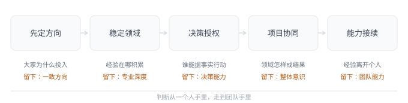
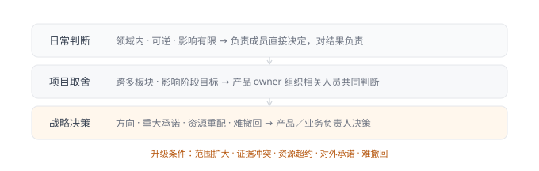
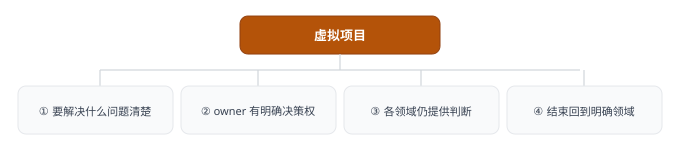

# 第 20 章 · 组织能力——团队如何形成稳定的判断与行动

## 引言

如果团队里最能干的那个人休假一个月，事情还转得动吗？带过团队的人大多经历过这种落差：负责人在的时候，很多问题当场就能解决；负责人一忙、骨干一离开，团队就开始等待、反复确认，或者反复在同一类问题上出错。遇到这种事，常见的反应是再招个更厉害的人，或者把流程盯得更紧一些。可这两个办法默认的都是靠个人、靠更严的管控把事顶住，要么换更强的个体，要么把每个人看得更死，都没有解决根本的问题：判断和行动始终集中在少数人手里。

再强的人也会忙、会走，靠个人顶住的团队，人一变动就回到原点。项目不断变化、人员也会流动，能让团队在变动中还做得出可靠判断、持续推得动工作的，不是靠某几个人的能力，而是判断和行动有没有变成团队自己能维持的东西。说「建立机制」容易，难的是让那些本来只在几个人脑子里的判断，变成换个人也能接着干：负责人不在，工作不至于卡住；骨干走了，经验也不至于一并带走。

## 20.1 先定方向——自驱需要共同的目标

我在几年前曾带过一支近 20 人的电商产品团队，当时我们这支团队同时支撑着公司两条核心业务线：一条是已经处于成熟期阶段的业务线，系统基本成型，仍然在持续建设和优化的阶段；另一条则是刚进入成长期阶段的业务线，系统还在构建初期，部分流程、功能上还带着创新型项目的性质。这条新起的业务线对于我们产品团队而言，并不是另起炉灶，而是尽量复用已有能力：能复用的不新建，必须新建的排进主链路。

起初这个产品团队只有两条产品线，但在半年左右的周期内，陆续并进了另外两支团队，最后变成五条产品线：前台、中台、供应链、社群、工具，其中前台、中台、社群是核心三条线，供应链在源头做支撑，工具偏探索。随着团队的合并，管理关系也随即发生变化，一开始我直接负责其中两条线，其余几条线各有原负责人向我汇报；中间有一段时间，一两位负责人计划离开，我一度直接管起五条线，那段日子有点乱，大家什么事都让我点头，我几乎快成了所有需求的瓶颈。

这支团队当时同时面临几类问题：老业务沿着原有惯性在走，节奏也不是说停就能停的；新业务要发展，系统层面和老业务之间的关系还没有梳理清楚；两条业务线和五条产品线如何分工，团队都才刚合并还需要磨合。这几类问题叠在一起后，方向就慢慢模糊了，分工也没办法及时定下来，逐渐就导致了决策集中到我这里，协同彼此割裂，同时在我心里又担心人员流失导致某一块工作停滞。这些问题看似互不影响，其实它们处在同一条链路上，这条链路上断了哪一环，下游就会跟着乱，这条链路也是我从这段经历里逐渐打磨出来的。

**图 20-1　能力链：判断怎样从个人走向团队**　五环从左到右，各解一类问题、各留一项能力；链条越往右，越不依赖某个人。

很多团队把「自驱」理解成让一线成员自己决定当前做什么，一线成员确实应该养成多想一步、多学一点、主动发现问题的习惯，但如果连这一阶段要解决什么、资源主要往哪里投入都不清楚，让每个人自己找方向，很容易冒出一批各有道理、彼此却衔接不上的动作。大家都很忙，忙的却没什么效果，沟通与协作都是脱节的。**目标清楚以后，自驱才有边界**，方向仍然要由负责人定：在团队内强调阶段性的共同目标，再向下拆解，同时给一线成员的发现和主动探索留出空间。一线成员看到的真实情况当然可以影响方向，但负责人需要把这些发现整理成共同选择，不能把确定方向的责任留给一线成员各自承担。行业里常讲「产品团队赋能」时，一个容易被负责人忽略的点是：赋能不等于让一线成员决定公司当前要解决什么，而是负责人给出重要问题和结果要求，团队拥有寻找解法的空间[^2]。新的事实可以反过来调整目标，但不能让团队长期依靠一线成员自行拼出方向。

当时这支团队处于合并磨合期，方向不清让「自驱」变成了各自忙碌。老业务沿着原有惯性继续走：前台优化下单链路，中台升级商品和订单能力，供应链打通供应商协同，社群做运营工具，工具探索裂变。新业务线也要往前走，但没人能说清这一阶段到底先做什么：有人想单独做一套，有人想先复用原有能力。团队合并还在进行，另外两支团队陆续纳入，管理关系也在收紧，五条产品线的需求一度都压到我这里。于是跨产品线的需求开始互相等，老业务和新业务也开始争资源，周会变成了「各自汇报进度」，而不是「共同判断方向」。

我观察到的问题，不是大家不够主动，反而一线成员其实很主动，每个人都在找自己认为重要的事。但因为没有阶段性目标，这种主动变成了各自忙碌，单看每件事都有道理，合在一起却说不通或衔接不上，沟通成本上升，协作里开始出现情绪。这让我更确信自己一直以来的判断：**自驱不能建立在方向不清的基础上**。观察到这个问题后，我当时并没有把方向交给一线成员去反哺，而是把本来就在用的方法用到新局面上：先重新明确一个阶段目标，再向下拆解。我先让团队暂时停下手上的工作，把五条产品线的成员拉到一起，明确这一阶段先打通新老业务共用的这条「供应链—中台—前台—社群」主链路，同时理清新业务在这条主链路上的位置和优先级，每条线列出当前工作，标注哪些直接支撑主链路、哪些支撑新业务、哪些可以暂缓，工具线暂不强求扩张。

在调整之后，一线成员仍然可以提发现、提想法，但方向不再由每个人各自拼凑。做社群的同学原本在做运营工具，目标是「让经销商管理更高效、佣金结算更自动」，这个目标其实很清晰，只是它放到团队视角下也许不是当下最重要的。在团队重新明确阶段目标后，社群产品线的同学的目标就变成了「社群用户与中台权益的打通」，至于运营工具就先往后放放了，对应的同学说过这样一句话：「以前我觉得运营工具很重要，但那是从社群视角看；现在从主链路看，社群用户和中台权益打通才是这一阶段该做的，运营工具可以晚一点，但主链路不能断。」做供应链的同学也类似，把打通供应商协同改成先支持主链路的库存和商品能力：供应商协同是长期问题，主链路是生死问题，顺序不一样。

新业务刚起的时候，团队成员一直在问「到底怎么做」，目标明确后，大家开始看到原有业务线已有的能力哪些能复用、哪些要新建，不再是简单的全部从 0 到 1 来一次了。**目标清楚之后，需求没有变少，但投入结构变了**。团队不再各自忙碌，而是围绕同一条主链路协作；沟通时也有了共同判断的依据：这件事是不是支撑主链路？是不是支撑新业务？如果不是，能不能往后放？

## 20.2 稳定领域——深度来自长期深耕

在管理任何产品团队时，我从未奢望每个人把所有板块都摸透，也不会随便调整大家的工作范畴。我看过太多分工模糊的情况：同一件事情谁都能接，可以让 A 来干，也可以让 B 来干；或者是按系统切分，你负责这个系统、他负责那个系统，甚至跨到完全不搭边的领域；更极端的情况，让产品经理去承担运营或其他岗位的工作。这么导致的问题是，团队成员每次调整或跨越领域时都要把上下文重新建立一遍，深度根本积累不起来，做的事情往往都是治标不治本。**稳定分工是为了形成深度，不是为了谁有空谁上，也不是按系统或岗位边界把人切散**。

我更看重的分工，是让大家有明确且稳定的深耕领域：一块相对完整的业务，由相对固定的人持续负责。用户、规则、历史决策和上下游关系，才能一点点沉淀在具体的人身上，判断才不必每次临时请示。负责人也由此看清能力分布：哪些领域已经有人能独立负责，哪里还缺深度，哪里边界过大需要补人或重新划分。一线成员同样清楚自己的发展路线，少一些不安和抱怨。这里需要分清楚一个问题：按系统分工未必不对，关键是系统边界是否对应连贯的业务领域；跨岗位参与也可以有价值，但如果长期靠临时调配填空，就会打断专业积累。

这支团队合并以后，刚开始为了应急，我也一度按「谁空谁上」临时调人：前台同学忙，就让中台同学过来支持；社群有活动，负责工具的同学去帮忙；供应链缺人，用对供应链有一定认知的前台同学临时补位。短期确实顶住了，但很快卡点就显出来了。

卡点之一是历史决策没人记得：一个商品或权益的规则，前台同学做过、中台同学也做过，但两个人只知道自己那一段，遇到边界问题，就要重新翻记录、重新问人。有一次一个商品在前后台的价格和库存规则对不上，我们花了半天才理清：这条规则历史上改过几次，每次都是不同的人改的，没人能完整说出当初为什么这么改。

卡点之二是上下游关系每次重建：做前台的同学被调去做社群工具，再调回来时，原来的合作方已经换了沟通方式，他要重新认识人、重新对齐接口、重新理解对方目标。每调一次，就要把上下文重新建一遍。

卡点之三是我自己也成了瓶颈：合并初期有一段时间，五条产品线的需求全都堆到我这里，导致团队成员自己也不清楚到底深耕什么，绩效沟通时经常问：「我接下来负责哪块？」

靠临时调人补窟窿，补不出稳定的深度，于是我重新划定了相对明确且稳定的业务领域：前台、中台、供应链、社群、工具，各自由相对固定的成员持续参与；UI 也按业务线稳定支持，而不是每次随机分配。每个领域负责的都是一块从头到尾连贯的业务，不仅仅是系统里的某个模块，然后在每个领域下再划分对应成员具体深耕的方向。如果某条线确实忙不过来，优先考虑补人、重新划分边界，或者临时协作，而不是直接把人调走。调整之后，最明显的变化不是需求响应得更快，而是判断开始有了连续性。同一个人能说清这个领域的历史决策和边界条件，我也第一次看清能力分布：哪块已经有人独立负责，哪块还缺深度，哪块边界过大需要补人。团队成员同样清楚了自己的发展路线，绩效沟通里我们不再聊「你接下来做什么」，而是聊「你在这个领域扎到什么程度、下一步往哪走」。

**表 20-1　领域划分：五条产品线各自的范畴**

| 领域 | 范畴 |
| :--------- | :------------------------------------------------------------------------------------ |
| 前台产品 | 由 3～4 位产品经理持续负责 C 端体验和转化，涵盖导购、营销、交易等整条链路 |
| 中台产品 | 由 3～4 位产品经理持续负责交易的底层支撑，涵盖商品、订单、库存、用户、权益等底层能力 |
| 供应链产品 | 由 2～3 位产品经理持续负责货源与履约协同，涵盖供应商、仓储、库存等协同环节 |
| 社群产品 | 由 3～4 位产品经理持续负责 B 端与社群经营，涵盖经销体系、分佣结算、社群成长等经营环节 |
| 工具产品 | 由 1～2 位产品经理持续负责赋能工具，涵盖社群历史成熟工具及增长、社交等探索环节 |

印象中有一个做中台的初级产品经理，之前被调去做过社群工具，再调回来时对中台的理解已经断档。团队调整为明确的领域划分后，他持续参与中台板块建设，半年后他已经能说出这个领域过去为什么这么设计、哪些坑踩过、哪些边界不能碰。后来一次跨团队需求涉及前台和中台的商品规则，他没有直接说「我问一下」，而是给出了判断依据：这条规则历史上为什么这么设计、前台和中台的边界在哪、如果改动会影响哪些下游、建议怎么改。他已经不仅仅是从「知道怎么做」走到了「能够判断为什么这样做」，也从一个初级产品经理向着中高级产品经理成长发展，除了他个人的「自驱能力」，也得益于「稳定领域」的深耕。我也开始在不同产品线上培养负责人，让每条线都有一个能接住的人。稳定分工是这件事成立的前提：**没有人持续深耕，就不会有可以接住判断的人**。

## 20.3 决策授权——权要配得上责任范围

很多团队管理者喜欢一言堂，什么事都要他点头通过才行，这一点我不敢苟同，我自己带团队的时候甚至会尽量杜绝这种情况，以产品经理每天打交道的需求为例：重点需求、专项才需要内审，其他需求一线成员应该拥有决策权。但「授权」不能只停留在说一句「你们自己定」，一个人有明确领域，却连日常需求都必须等负责人批准，他获得的只是执行范围，并没有形成责任。**授权需要与影响范围匹配，也要约定什么情况下必须升级，下放的不是所有决定，而是与责任范围相匹配的决策权**。

**表 20-2　决策分级：影响范围决定由谁判断**

| 决策范围 | 建议方式 |
| :----------------------------------------------- | :-------------------------------- |
| 领域内、可逆、影响有限的日常判断 | 由负责成员直接决定，并对结果负责 |
| 影响多个板块、重要用户或阶段目标的事项 | 由产品 owner 组织相关人员共同判断 |
| 涉及战略方向、重大承诺、资源重配或难以撤回的事项 | 由产品负责人或业务负责人决策 |

在有了决策分级后，还要关注升级条件：影响范围扩大、证据相互冲突、资源超过约定、涉及对外承诺，或可能带来难以撤回的后果时，需要及时上升。否则没有升级条件，团队成员容易在该决定的时候等待，也可能在需要协同时独自推进。把「决定者、建议者、知会者」分清，团队才不必事事等管理者点头[^2]，大家在真实决策中承担结果，经验才会从「知道怎么做」变成「能够判断为什么这样做」。

**图 20-2　决策三级与升级条件**　范围越大、越难撤回，决策越往上走；有了升级条件，成员才不必事事等点头。

这支团队没有合并之前，原先我自己负责的两条产品线一直遵循类似的做法，但是团队短时间经历合并扩充后，这个习惯在当时也遇到了挑战。有一段时间，事情又都收回到了一个人手里，不是我不信任大家，而是合并后的局面让我不自觉又变回「什么事都要看一眼」。结果团队成员把方案写得很完整，真正决定的时候还是要等我点头，我一旦不在，需求就停在那里。

有一次我出差三天，回来发现积压了 20 多个需求没处理[^1]，成员反馈「我们不敢定，怕定错了」，于是我问「那你们觉得哪个该做？」，他们说：「都觉得能做，就是不知道你觉得该不该做」。这句话把我点醒了，他们不是不会判断，而是手上没有决策权。决定权一直掌握在我这儿，日子久了，他们的判断能力也跟着退化了，而我这边，把自己困在五条产品线的细节里，每天花大把时间看方案、回消息、做判断，真正要紧的事反而腾不出脑子想。所以我没再把需求都揽在手里，而是把本来就在用的方法重新摆到台面上：按影响范围把决策分级，再约定好什么情况得升级，重点需求和专项仍然走内审，至于其他，一线成员在自己那块领域里拥有绝对的决策权。

在这之前，负责中台商品板块的同学，甚至连改一个商品字段都要问我，在做了决策授权后，他已经可以自己做小范围调整的决策：把某个商品属性的必填改为选填，先观察一周，数据没明显变化就恢复，有正向变化就继续，并提前写好了回滚方案。他当时列的很简单：影响范围只在中台部分商品、可逆、资源投入有限、不涉及对外承诺。上线后数据没有明显变化，但他在复盘后表达了「以前我只知道怎么做，现在开始想为什么这么做、什么情况下不该这么做。」再后来处理同类问题，他不再等我，而是先给判断和依据，一个跨板块需求涉及前台和中台，他没有自己拍板，而是按升级条件把相关人员拉起来共同判断，这个时候他已经清晰「知道什么该自己定，什么该找大家一起定」。

决策分级之后，我不再是所有需求的瓶颈，团队成员在领域内有了决策权，也开始对结果负责；升级条件让他们知道什么时候该等待、什么时候该协同，而不是在该决定的时候等待，或在需要协同时独自推进。这套授权能成立的前提，仍然是稳定分工：**领域里没有可靠的判断，决策权就分不出去**。

## 20.4 项目协同——让专业分工共同形成结果

稳定分工解决了领域深度的问题，但也可能带来新的割裂情况：每个人只懂自己负责的板块，跨领域目标一出现，就没人能把它形成完整结果。所以我更喜欢在团队内部保留一套「虚拟项目」机制：每一位成员都有机会做项目的产品 owner，这培养的是大家的协同能力，也让核心业务不只装在负责人或少数骨干脑子里。**项目 owner 不是临时「管理所有人」，而是负责把各领域判断共同形成一个结果**。虚拟项目不能破坏稳定领域，也不能让协作长期停在临时状态：临时的跨团队配合如果一直不结束，就会形成隐藏依赖，责任边界会重新变得模糊[^2]。一个健康的虚拟项目最好具备四个条件：

**图 20-3　虚拟项目的四个边界条件**　问题清楚、owner 有权、各领域仍提供判断、结束回到领域，四条边界缺一不可。

这个项目机制并不要求每个参与人都熟悉所有细节，而是希望核心成员能讲清楚公司的主要业务，以及自己负责的部分与其他领域有什么联系。团队合并后，这个机制当时也卡了壳：五条产品线背景不同、节奏不同，有人偏体验、有人偏支撑、有人偏运营。合并初期大家各自守着自己的领域，跨产品线的目标一出现，要么没人愿意牵头、项目停在原地，要么牵头的人只懂自己那块、协调不动其他领域。

我留意过一位成员，之前只负责中台那块能力，并且做得还不错，但他对公司其他业务了解有限。后来有个跨前台、中台、社群的项目要找产品 owner，我让他上，他第一反应是「我只懂我这块，能行吗？」，这句话已经把问题点出来了：稳定分工让他有了深度，也让他只看得见自己那块，那如果人人都这样，跨领域目标出现时就没人能承接。我没有因为这句话换人，这个时候原有的「虚拟项目」机制正好用得上：让他做这个项目的 owner，在项目中协调不同产品线的判断。这个项目就是社群同学主动提出、先把运营工具往后放的那个「把社群用户和中台的权益能力打通」，涉及前台的用户场景、中台的权益能力、社群的运营场景，周期大概两个月。方向已经定了，缺的是需要有一个人把它在三个领域中进行拉通，并且保障大家的协同形成一个完整的方案。我给他的要求不是「你自己拍板」，而是「把各领域判断共同形成一个结果」。

他一开始想自己拍板，觉得既然是 owner 就该自己定，但很快发现难点不在自己那块，而在各产品线的判断如何融合：前台关心用户体验，中台关心能力复用，社群关心运营效率，各有各的道理，谁也不愿先让步。有一次开会，前台和社群为一个权益的领取条件争论，前台希望门槛低、提升体验，社群希望门槛高、控成本，双方都有数据，但谁也说服不了谁。他很为难：自己拍板可能得罪一方，不拍板项目就停着。后来他换了做法：不再自己扛决定，而是把各方的判断和依据摆出来，自己负责把共同目标和取舍讲清楚。他把这个项目拆成三个共同目标：用户体验、能力复用、运营效率，让各方围绕这三个目标重新看自己的方案。结果发现，前台和社群的争执并非目标冲突，而是信息不对称：前台不清楚运营成本的具体数据，社群不清楚用户体验的具体瓶颈。信息摆出来后，双方很快找到折中：门槛适中、分层设计，新用户低门槛、老用户高门槛。

项目结束后，他不仅能解释自己负责的部分，还能说清它和其他产品线怎么连在一起，他后来单独跟我说到「以前我只知道自己这块怎么做，这次开始理解，为什么前台要这么设计、中台为什么要复用、社群为什么要控制成本」。除了原各产品线负责人外，后来他成了团队里第一个能跨产品线解释业务的一线成员，又带另一位同学做了一次项目 owner，把这种协同方式传了下去。我们也就保留了这套「虚拟项目」机制：每位成员都有可能做 owner，不固定由某几个人担任；同时守住边界，项目不能破坏稳定领域，也不能让协作长期停在临时状态，结束后能力和责任回到明确领域。直到后来，已经有差不多 7～8 位核心成员能清晰讲出公司业务。**稳定分工解决了深度问题，虚拟项目解决了协同问题，两者不能互相替代：没有深耕的领域，就不会有能接住跨线判断的 owner；没有项目机制，深耕出来的能力也走不出自己的板块**。

## 20.5 能力接续——让个人经验成为团队能力

方向、分工、授权、项目协同都有了，这个时候还看不出来团队能力是否提高。团队能力不看制度多完整，而看负责人离开、骨干调整、业务变化以后，判断与行动还能否继续。我带团队一直很看重分享和学习，但分享不能只靠一个人输出，很多团队一遇到新事物，就依赖某位同学或 leader 一个人学习和讲解，其他人即使听懂了，也未必能够掌握具体的方法进而形成自己的判断与行动。分享要往前走一步，从「轮流输出」走向「共同形成判断」，可以分成三层：

**表 20-3　分享的三层：从信息同步到能力接续**

| 层次 | 作用 | 做法 |
| :------- | :------------------- | :----------------------------------- |
| 信息同步 | 让团队知道发生了什么 | 业务、市场、项目进展同步 |
| 判断讨论 | 暴露理解差异 | 说出自己的理解、依据，接受他人追问 |
| 能力接续 | 让其他人能接手 | 实际参与项目、共同处理问题、逐渐承担 |

只听一次分享，很难在团队内部形成 backup，真正的接续通常来自共同工作、短期协作、代理负责和实际决策。分享帮助团队发现认知差异，项目经历才让其他人获得可以独立使用的能力。可以用几个实际问题检查团队能力是否真的形成：

- ① 阶段目标变化以后，成员能否解释自己的工作为什么要调整？
- ② 日常问题是否仍然大量等待负责人决定？
- ③ 某个领域负责人休假或离职，其他人能否先接住基本工作？
- ④ 新项目出现时，是否有人能够承担 owner，而不总是落到同一批人身上？
- ⑤ 分享过的认识有没有进入需求判断、项目方案和复盘？
- ⑥ 团队能否指出自己的能力缺口，并主动提出补充方式？

这几条不是在纸上推演，而是当时这支团队真实面临的问题，当时团队合并原因之一就是其中有两位负责人计划离职，对团队冲击不小。有一段时间我直接管起五条产品线，既是负责人、又是瓶颈，原来的判断链条也跟着断了：每条线依赖原有负责人或某位骨干，新业务出现时大家默认负责人会研究清楚，确实基本每次负责人都能把事情讲清楚，但其他人只是听分享，却没有真正经历这个形成具体判断的过程。后来这两位负责人离开了，新业务相关的问题堆到我这里，其他人只能等，于是我问「你们之前不是听过分享吗？」，团队成员回答「听过，但真遇到问题，还是不知道该怎么做」。这样几次下来，让我充分意识到：分享是信息同步，不是能力接续，其他人即使听懂了，也未必形成自己的判断和行动。加上人员变动，原来的判断链条断了，团队一度不知道该找谁，所以只能原地等待。

我没把希望放在「再招一个更厉害的人」上，而是顺着已有的分享与学习习惯往前推了一步，做了几件事：在不同产品线上培养负责人，不一下子指定，而是在实际工作中慢慢让某个人接住某条线的判断；用 owner 机制让大家了解别的项目，让核心成员能讲清公司业务以及自己这块和别的领域怎么连接；鼓励分享，但不只靠一个人输出，不局限分享形式和内容，在团队形成信息同步、判断讨论、知识学习的氛围。新业务仍由骨干先研究，但要求往前走一步：不是只做一次分享，而是做成课题形式，带着一两位相关成员一起看、一起讨论、一起写方案，从信息同步走到判断讨论，再到实际参与项目、共同处理问题。

有一次老业务中出现一个新的方向可以尝试，按照惯例还是由团队某位骨干进行研究，但是这次不同的是，我让他将此形成课题，并带了几位相关成员一起参与。分享会上他不再从头讲到尾，而是让其他成员先讲自己的理解，他来补充和追问。几个月后，又一次出现类似探索，其中一位参与过的同学已经能够掌握相关判断和行动，并且在关键问题上知道该找谁、该升级到什么条件。这位骨干不再需要从头讲到尾，团队也不再因为一个人不在就停住。后来其中一位同学成为了这位骨干的 backup，在对方忙不过来或者休假时，团队不用再把问题集中到我这里，而是可以暂时由 backup 先进行一轮基本判断，再按升级条件处理。某个领域负责人休假，其他人能先接住；新项目出现，也不再总是落到同一批人身上。到这一步，方向、分工、授权、协同，才算真正落在了人身上：能力不再跟着某几个人走，而是留在了团队里。

## 闲言碎语

一个团队强不强，到底看什么？是看它有没有几个厉害的人，还是看能人走了以后，事情还能不能照常往前走？我以前更容易把它理解成前者：多带几个得力的人，就觉得团队强了。后来才意识到，能力留在某几个人身上和留在团队里，根本是两回事。人一变动，留在人身上的能力就跟着走；留在团队里的，是方向有人说明、领域有人深耕、判断有人承担、复杂项目有人协同，人员变了，经验也还能接着发挥作用。**团队管理应该要落在让对的事不依赖某个人持续发生**。

回过头看，我自己也走过弯路，那段直接管理五条产品线的日子，表面上是我在兜底，实际是我把决策权收得太紧，团队反而不会自己走了，等到那两位负责人离职了，团队一下子就露了脆弱。这件事提醒我，瓶颈常常不在别人，而在自己手里：把本该分散的权力攥住，团队就失去了练习的机会，负责人一离开，断层就暴露出来。组织能力这件事，没有一劳永逸的形态，业务在变、人在流动，今天沉淀下来的方向、领域、授权和协同，过一阵又得重新校准。作为团队管理者能做的，是让这套机制比人更扛得住变动，换掉任何一个人，事情仍然能往前走。

[^1]: 本章所涉团队与运营数据均为真实项目数据，已做脱敏处理。

[^2]: 本章所引外部框架为公开资料观点，按转述口径处理，未经逐项核验。
