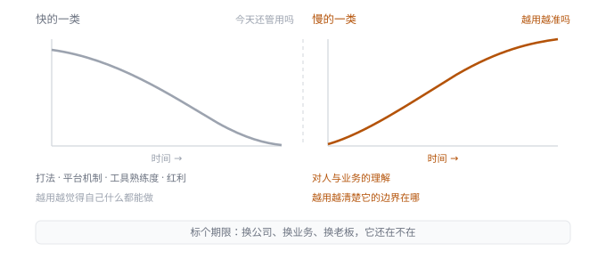
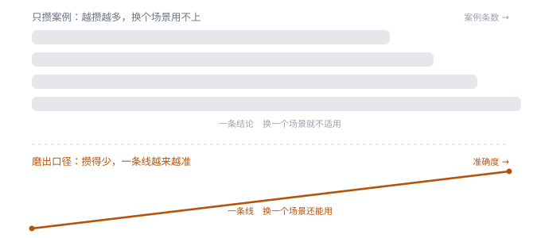
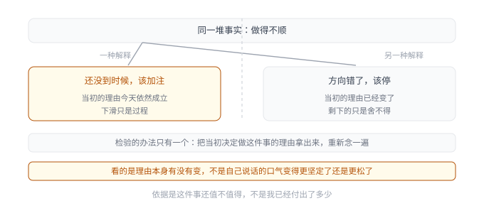

# 第 21 章 · 长期价值——产品经理靠什么继续往前走

## 引言

我相信产品经理经常会犯的一个错是：一套打法连着成了几次，就默认它是一条规律，收进自己的方法里，下次接着用，后来它确实又成了两次，但可能第三次就不灵了。很多人的第一反应是这次运气不好，可过几年才发现，它根本不是规律，只是当时那个环境里一个正好管用的做法。那几次成功会给我们一种虚假的确定，让我们在它失效之后，还惯性地往老路上走了一遍。

这件事的麻烦不在于看错，而在于它过期的时候没有任何提示。一条判断不成立了，很少会当场报错，产品照旧发版，各项数据甚至还在慢慢变好，团队照旧往前推，等结果出来才发现当初的方向已经不对。没有人会在那一刻提醒你，因为没有哪个环节出过问题，它只是在时间里悄悄换了前提。**判断错了能感觉到，判断过时了察觉不到**。

做到一定年限的人大多攒下不少东西，方法、案例、对业务的理解等，平常看不出它们是不是真的属于自己，环境不动，方法就一直有效。待在原地的那些年，你很难看出自己的判断到底成不成立。方案上线了，数据涨了，团队运转顺了，看上去每一步都对，可这份「对」里有多少是判断的功劳，有多少只是环境没变带来的，环境不动的时候分不出来。真正能把两者分开的机会，是离开原来的位置。环境一变，原来成立的条件会露出来一部分，你才有机会看清哪些是真本事，哪些只是刚好赶上了。

## 21.1 划清分工——什么能交出去，什么留得住

判断和产出不是一回事，差别比绝大部分人以为的大。产出是可以整段交出去的：查资料、列清单、对比方案、按要求出一版初稿，这些活做完当场就能验出对不对。数字对不上、条目漏了、格式不对了，当场就能发现，错了立刻能改。交给 AI 或者别人承接这些动作，没什么心理障碍，省下来的不是判断的时间，是等结果的时间。判断交不出去：要解决的是哪个问题，两个都不错的目标之间放弃哪一个，没有数据的时候往哪边下注，这三件事当下就没有答案，做完以后也没办法当场验出来。它只能靠事先把问题界定清楚，再对后果做一次预判，然后承担这个预判带来的后果，这种活宁可慢一点，也不敢整段交出去。

接下来就有一个问题：那如何划清这个分工，哪些能交出去、哪些必须自己扛。我最早用的标准是难易，难做的自己扛下来，容易的交出去。这个标准用了挺久，但是都出过错：有几件事我以为很难，做下去才发现是接一个接口、调一段现成能力就解决了；也有反过来的情况，我以为简单，一上手才知道底层要重做一遍。前者让我白白拖了两周排期，后者引发的对外承诺，得花好几倍的时间去补。后来我发现，难易衡量的是能力，不是归属。做一件事之前先估一估工作量，心里是有底的，可这个数只说明我能不能做好，不说明这件事错了会怎样。同样是从零做一个功能要两周，和接一段现成能力半天上线，从难易看差得很远，但两者错了以后要承担的事完全不一样：前者退回重做一遍，后者要对外解释一个已经承诺过的日期。这跟做的人是谁没关系，难易会随熟练程度变化，代价并不会。所以我换了一个思路：这件事错了，谁跟着受影响？是内部返工一下，还是有用户、有同事、有一笔钱跟着受影响。前一种交出去无所谓，后一种无论多小，我都自己过一遍。

**图 21-1　划清分工：两堆任务，两种衡量**　左边这堆当场能验对错，可以整段交出去；右边这堆验不出，只能留在手里。

判断留在自己手里，还有一个前提：它本身可能出错。有一次我让 AI 整理一份材料，给了它几份功能清单，它很快吐出一段结构清楚、结论利落的文字，读起来甚至比我写的更顺。几乎都可以直接拿去评审，但多看了两眼才发现问题被换掉了：它按功能的多少排了优劣，我那次要回答的却是哪一类用户会被哪个差异留下。所以 AI 给的结论，我都会习惯先问一句依据是什么，依据说不清的不当真。不是不信它，是知道它那份流畅会骗人，它能在正确的句式里填一个没人验证过的答案。

这两年聊 AI，大家比的多是它让一件事快了还是慢了，我更关心另一件事：它到底替我做了什么，没替我做了什么。写文档第一稿、搭竞品分析框架、整理会议纪要、生成一个粗糙的原型，这些过去要占掉我大半时间的动作，它做得又快又稳。但它不会替我界定这个问题到底要解决什么，不会替我决定这件事该不该做，也不会替我承担做错以后的后果。

在 AI 出现之前，大部分产品经理的时间是被执行吃掉的。你明知道自己该去用户那里待一个下午，但手上有几个需求文档明天要评审，你只能留在工位上写文档。AI 确实把一部分执行消耗释放出来了，可它同时把另一样东西摆到了台面上：你终于有时间去回答那个被搁置很久的问题，我们的产品到底为用户创造了什么价值。**AI 不会淘汰产品经理，它淘汰的是只有执行能力、没有判断能力的产品经理。它省下来的那部分时间，最后要落在判断上，而不是落在更多的执行上**。

把判断交出去，风险也不会转移出去，它只是换了一个承担的人。交出去的不只是执行，还有让别人替你的判断买单的可能。对方越信任你，越不好意思拒绝，最后这份责任就落在最不该落在的那个人身上。

产品经理最常碰到的其实就是这件事。业务绕过你直接找研发成员要东西，销售说这个页面下周要改，运营说活动规则先按这样做，理由通常都很具体，人也很客气。这时候要判断的就不是这件事有多难，而是它到底是一个具体要求，还是对方要你替他判断。我的做法是先接过来，但不替他判断：字段怎么改、排期调多少，当天就回；至于这个页面该不该改，得先弄清它想解决什么，这件事我会拉上业务和设计一起看一次，看完再说做不做。

留在手里的那些，判断对了，是判断力被证明了一次；判断错了，赔掉的是别人的时间、团队已经投下去的资源，还有你在团队里建立起来的那份信任。一个功能做砸了，改版重做就行；一个方向判断错了，团队照着走了半年，资源投入收不回来。产品新人判断错，赔的是一次返工；资深产品判断错，赔的是别人跟着你走的那段时间。这个思路也影响着我负责的团队，交付方案之前我们会先自问一遍：这件事如果错了，谁跟着受影响。**工具再强，也替你承担不了判断的后果，所以想清楚只是第一步，代价要别人一起付**。

## 21.2 标明前提——哪些先过期，哪些越用越准

把该留在手上的那堆划出来之后，还得再分一次，因为它们不是在同一个速度上变化的。有一类很慢：你怎么理解用户，怎么理解业务的底层逻辑，怎么判断哪件事值得做，这些东西一旦真的长出来，放几年还在用，甚至会越用越准。另一类很快：某套具体打法、某个平台的机制、某个工具的熟练度、某一段行情带来的红利，今天有效，过一阵就可能不灵了。

这两类的差别，用一句话就能试出来：一类越用越清楚它的边界在哪，一类越用越觉得自己什么都能做。前者是在长，后者是在骗自己。我过去最常犯的错，是把快的那一类当成慢的，收进自己的方法里接着用，然后照着老路走了一程。

怎么分辨？我的办法是给手上的东西各标一个期限，问它一句：换一家公司、换一条业务、换一个老板，它还在不在。还在的是慢的，不在的是快的。这个问题问起来简单，答起来常常出乎意料，我一直以为自己攒下了一大笔东西，一问，掉一半，掉的多半是位置给的、行情凑的、别人教的，我从来没分清过。

标前提不用写得很细，可以在自己的那份清单上给每一样东西加一行字：它管用的前提是什么。比如一套增长打法，前提可能是流量还便宜、用户对活动还有反应；比如对某类用户的判断，前提可能是这门生意的结算方式没变。前提写得越具体，它会不会过期就越早看得出来；前提写不出来，通常说明那样东西本身就是凭感觉攒的，还没到能依赖的程度。给东西标前提还有个好处，它让你在沉淀的时候更有选择：凡是写不出前提的收获，多半是当下的一次运气，不必急着收进方法里。

**图 21-2　标明前提：判断也分快慢**　快的一类当下最管用，随后一路衰减；慢的一类放几年还在用，甚至会越用越准。

红利是最容易判断错的一类：一种成绩来自一段特殊的时机，你正好站对了地方，它出现得快，消失得也快，但在消失之前会被反复确认成能力，因为你每次拿它去用，它都还管用。等它忽然不灵的时候，人会以为是自己退步了，实际是那个前提没了。判断的价值下降是跳着来的，环境在一点一点变，结论却是某一天突然不灵，所以人在变化发生的前一天，还觉得自己一切正常。

我合作过的团队里有同学做过类似的事[^1]：一块业务跑通了一套打法，遇到转化下滑就补一轮站内触达，补完当周转化就回来，连着三次都是这样。他把前提写成了「站内流量足够便宜」，意思是这条触达不花钱，人群里随便筛就能捞够人。这个前提写得很具体，具体到他自己都不怀疑。然后第四次再补，转化没回来，站内人群筛了三遍也没捞够人，回头看，「站内流量足够便宜」这个前提一直在，是它下面那个变量变了：那批便宜流量被各家抢完了，剩下的人得花钱买，一次触达的成本翻了几倍。这时候补上去的不是判断，是运气。后来他复盘中就意识到：标前提最容易骗人的地方在于，标的是一个自己当时相信的说法，而它下面还藏着一层没看见的东西，他标的是「站内流量足够便宜」，藏在底下的其实是「这批便宜流量还没被抢」。

光标了前提还不够，标的时候得清楚它会变。一条判断失效的时候，逻辑往往还在，换掉的是它成立的那个条件，而当时写下来的那行字没人再回头看。标完那一刻不算数，要过一段时间回头核对：那个前提现在还在吗。这套办法放到团队上也一样，一个团队待久了，会攒下一套一开始很好用的做法，打法、流程、评审标准全都跑顺了。越是跑顺，越没人回头问一句，它成立的前提还在不在，等到外部条件变了，团队不是不会反应，是反应慢，因为身上背着一套自己都不再检查的旧结论。给手上的东西标前提，比等它失效再回头认，要划算得多。

## 21.3 磨出口径——从记住做法，到说清条件

认清了哪些快、哪些慢，下一个问题是：那些慢的，靠什么才磨得厚。大多数人的做法是多存案例，做过的事、见过的问题、听过的方法，一条条记下来，越厚越安心。我也有一份这样的东西，记了很多年，后来发现它几乎没帮上过我，真到了要做判断的时候，我不会去翻那几百条，翻了也翻不出眼前这一件该怎么定。我后来想明白，案例记录的是过去，判断要面对的是没发生过的事，两者之间隔着一道换算，这道换算只能靠一层长期磨出来的标准完成，案例本身完不成。

真正在起作用的，是案例磨出来、慢慢沉淀下来的几样东西：一套越来越稳的口径，一组知道在什么条件下该放弃什么的取舍标准，还有对代价的直觉。这几样没法一条条记下来，只能一次次做出来，每做一次判断，它们就准一点，每躲一次判断，它们就钝一点。同样是做了十年产品，差别在每一件事之后有没有把口径往前挪一格：有人做完一件事，带走的是「这次过了」，有人带走的是「原来在这种条件下，这么做比那么做对」。前者存下的是经历，后者存下的才是那层东西。

口径不是知识，是一条判断依据，它得满足两个条件：换了场景还成立，能告诉你这件事该怎么定。满足这两条的其实不多，慢慢就磨厚了。举个能感觉到的例子，同样是判断一个需求该不该做，有人靠的是「这类需求我以前做过，效果一般」，有人靠的是「这类需求成立的前提，是用户得先有意愿，而这个场景里意愿还没有」。前者给的是一个结论，换一个场景就不适用；后者给的是一条线，换一个场景还能用。两个人在同一个项目里待了同样久，一个存了一堆结论，一个存了一条线，环境不变的时候看不出差别，环境一动，差别就出来了。

就像之前有提到的复购项目，季度目标是把 90 天复购率从 28% 提到 33%，最后停在大约 35%。当时项目里试过很多东西，最后稳定起作用的是三件事：给沉默用户补货提醒、对购买频次高的人加常购推荐、按会员状态区分对待。真正有用的是第三条，它是从一次误判里长出来的：最早我们把高价值用户和会员当成两批人，同一批人身上排了两轮动作，复盘才发现增量算不清，用户被重复算了一遍；改成先分层、再排动作，结论才立得住。

项目结束以后，我们产品团队留在方法里的不是「母婴复购该怎么做」，是那一条口径：**涉及增量的问题，得先说清增量从哪来，人群重叠的部分不算数**。这条口径后来用在了完全不同的事情上，一次促销的资源怎么分、一次改版的先做哪一页，判断的还是同一个：增量从哪来，谁和谁重叠。同一个项目，有人带走的是「母婴复购要做补货提醒和常购推荐」，品类一换就用不上；有人带走的是这条口径，换什么品类都还成立。

**图 21-3　磨出口径：一条线比一堆结论值钱**　存的案例越多不一定越准，把外部的东西转成内部那条线，才越值钱。

这种做法靠的是收敛，东西越多不一定越值钱，那套标准越清楚才越值钱。你会慢慢发现，自己要判断的范围在缩小，以前什么都得从头想，现在越来越多的事一眼能归类，知道该套哪一条，范围缩小说明那层东西开始替你干活了。还有一个信号是，你解释一件事越来越短，刚做产品那几年，我得花很大力气才把一件事讲清楚，现在常常两三句话能说完，因为中间那些弯早被磨成了直线。

所以我不再往那份清单里加案例了，改成一个小习惯：每做完一次重要的判断，回头问自己一句，这次是哪条标准起了作用，它是不是该改一改。多数时候答案是没变，但只要有一次是变了，那一次抵得上几十个案例。这个动作花不了多少时间，可它是这一整套里唯一能让判断变准的一步。案例增加的是过去可用的东西，校准标准降低的是未来每次判断的成本，后者的收益是复利的。这跟「积累」这个词平时给人的印象不太一样：平时说的积累，是把外面的东西搬进来，案例、方法、模板、关系；算得上复利的，是把外面的东西转成自己内部那条越来越准的线。**前者随时可能被替代，因为它本来就在外面；后者替代不了，因为它不在任何一份文档里**。

复利常被理解成时间的函数，好像待得够久，自然就厚了，其实更接近一笔账里的本金和利率：本金是那些你反复做的事，利率是每一次回头校准的认真程度，利率低，做十年也只会得到一堆经历，利率高，做三五年就能看出那层东西在长。同样做很多次复盘，一个把结论写成「这次哪一步没做好」，另一个写成「我们的判断在什么条件下会错」，前者的本子很厚，每一条只对当时那次有用；后者的本子很薄，每一条都在改同一条线。

## 21.4 认清来路——哪些是自己的，哪些是位置给的

判断的口径、取舍的标准、对代价的直觉，这几样跟着人走。供应商关系、内部的数据权限、某个系统的后台入口、团队对你的信任，这几样留在原地。前者是你的，后者是位置给的，只不过平时这两样长在一起，看不出来。

最容易混的是第三种，借来的东西被用得像是自己的。你在一个平台上做出来的成绩，一半来自你的判断，一半来自平台给你的资源，这两半在成绩里是长在一起的，只有在离开的时候才分得开。我见过不少人，离开之后才发现，自己一直以为的能力，其实是那个位置给的杠杆：他们在原来的地方无往不利，换个地方却处处受阻，不是本事退了，而是那根杠杆没了。还有一种不太容易被算进去的，是时机。有些局面的成立靠的不是判断，而是时机，把时机算成自己的功劳，和把平台的资源算成自己的能力，是同一类错，只是更隐蔽。它不会当场翻车，只会在下一次环境不一样的时候，让你拿着一个错的前提出牌，而你还以为那是经验。

**表 21-1　归属分层：什么能带走，什么带不走**

| 类别 | 内容 |
| :----------- | :------------------------------------- |
| 能带走的 | 判断的口径、取舍的标准、对代价的直觉 |
| 位置给的 | 资源、权限、数据、上下游关系、团队信任 |
| 借来当自己的 | 平台红利下的成绩、时机凑成的结果 |

靠位置拿到的数据权限，值得留下的是这个业务该看哪几个数字、这些数字从哪来、口径是怎么定的，权限会撤，看指标的习惯撤不掉；靠上游关系才能拿到的东西，值得留下的是我在这段关系里替对方解决过什么、交付过什么对方下次还愿意要，关系会跟着人走，交付记录会跟着人走；靠系统入口才能干的事，先问一句这件事是不是只有我能干，如果答案是只有我有权限，那这件事从一开始就不该由一个人干，得想办法让它变成一个别人也能走通的东西，哪怕当下没有第二个经手的人。

这三条做完，一件事上依赖位置的部分会少一点。依赖没有消失，只是换了个位置：从靠这个位置才能办成，变成靠这层判断才能办成。交出去的那部分，是工具接走的；留在手里的那部分，也不全跟着人走，还有一部分是位置给的。这一部分更麻烦，因为它一直装在你的判断里，你用它做成了很多事，很难怀疑它不属于自己。前面交出去的风险是别人替你承担，位置给的风险是你替位置承担了几年，回头还以为是自己的。

我后来把这件事做成一个固定动作，每过一两年，坐下来列两份清单：一份写，如果明天离开现在这个位置，我能带走什么；另一份写，我会立刻失去什么。第二份通常比第一份长。第一次列的时候我心里挺不是滋味，但过几年再列，第一份会长起来，第二份会短下去，这比任何自我鼓励都实在，因为它量的是真东西。列清单最难的地方不是写，是承认，承认有些东西我一直当成自己的，只是这段时间恰好摆在我手上；承认有一部分不属于自己，当时是有点泄气的。

留在组织里的东西越多，说明你做得好；能带走的东西越多，说明你这个人立得住。位置给的东西不是不重要，资源、权限、信任，都是好做事的前提，用好了能放大判断，只是别把它们算进对自己的估值里：把它们当工具，你在用；把它们当本事，你在依赖。前者随时可以换一个，后者一撤走，人就空了。**长期价值的前提，是分清什么算你的**。

## 21.5 决定去留——什么时候该从一件事里退出来

前面讲的都是产品上的退出：一个需求该退出、一个功能该下线、一条路线该收。这些事在产品上我从来不陌生，做得很熟，可轮到自己身上，几乎没认真解过几次：一段投了很多时间的路，什么时候该停。停比开始难：开始只需要一个理由，停需要一个否定的理由，而人天生不愿意否定自己已经付出的东西，投进去的时间、建立起来的优势、对外说过的方向，全在拉着你继续往前走。

退出和加注在当下看起来是同一件事：一件事做得不顺，可能方向错了，该止损；也可能只是还没到时候，该加注。这两种判断面对的是同一堆事实，做出的动作却完全相反，分不清这两种，前面的账就都算不准，你会在一片低谷里退掉本该坚持的，也会在一件已经错了的事上，因为不甘心而加更多的注。

**图 21-4　决定去留：停和加注看起来是同一件事**　图里的两条路，走哪条不看眼下有多难，看的是当初那个理由还在不在。

我给自己定的一个检验是，把当初决定做这件事的理由拿出来，重新念一遍：如果那些理由今天依然成立，中间的下滑只是过程，那就加注；如果理由已经变了，剩下的只是我投进去的太多、不舍得，那就该停。这个办法的好处是不用重新算一遍账，当初的理由就是账，理由变了，说明变量变了，不是我变了。判断的依据永远是那件事本身还值不值得，而不是我已经付出了多少。这句话说起来清楚，做起来难，因为「我已经付出了多少」是能看见的，「它还值不值得」是要重新算的，人下意识会抓住能看见的那一头。

前面聊过的那个从商学院改版换成任务节点提醒和素材工具的例子，那套方案的逻辑本身没有错，行业有先例，数据也支持，问题出在它成立的那条业务线用户结构稳定，而要用它的那条新业务线刚起步，用户完全是另一批人。方案还是那个方案，成立它的环境换人了，理由自然就不成立。真正难的不是判断，是这个方案已经过了汇报立项、团队按它排了期，这种时候说「先不做」，你得同时给出别的方向；光把方案按住却不接手，问题会一直挂在那里。

这里还有一个很常见的陷阱，就是用新的说法去维持旧的投入：方向明明已经不成立，人会给自己找一个新理由继续做下去，比方说再撑一阵说不定就起来了、都做到这一步了不能白费。这些理由听着像坚持，实际上是在给不肯止损找一个体面的说法。我判断自己有没有掉进这个坑，看的是理由本身有没有变，不是我说话的口气比以前更坚定还是更松。

我见过不止一个人，在一件已经明显不成立的事上又耗了两三年，不是他们看不出来，而是他们把停下等同于认输，而认输比继续做更难：继续做至少还在动，看上去还在往前；停下什么都不做，反而更像失败。这种错觉很贵，它吃掉的是最不该浪费的那部分时间，也就是一个人还能重新选的那几年。

**要让停下变得可能，得提前给自己留出口**。我过去有个很好的做法是，在投入一件事的时候，就把它的退出条件写下来：什么情形出现，说明这件事该重新算账。写的时候不用很准，重要的是先写出来，等真到了那一步，人容易被当下的情绪和已经付出的量绑住，这时候手上有一份当时清醒时写下的条件，比临场决定要靠谱得多。

真正难的是停下来以后的那几天，决定停的那一刻反而是最轻松的，难的是停完之后：团队会问，这几个月是不是白干了；合作伙伴会问，当初说的那件事还算不算数；自己也会反复想，要是当时再坚持一下会不会不一样。这几个问题没有一句能用「方向不对所以止损」打发掉，该回答的是白干了什么、留下来什么。停下来能留下三样东西，都得趁还记得的时候写下来：这段路成立过的那部分前提，试过的那些组合，以及最后确认走不通的那条结论。不写下来，停掉的项目就只是一次没做成的事，同样的路口下次还会再走一遍；写下来，它才从一次失败变成一段可以复用的判断。这和前面说的两份清单是同一件事，列清单最难的是承认，而停下来的那一刻，正是必须承认的时刻。

还有一点值得提前想清楚：停掉一件事最容易伤的，往往不是业务，是团队对自己的信任。所以停的理由要给到人听，不是给到事听。「这个方向我们确认走不通，接下来去做某某」和「这个方向我们先不做」，对团队是两句完全不同的话，前一句他们知道判断是什么，后一句只会让人以为是不是哪里出了错。

职业时间的投入是收不回来的，一个月放在 A 上，就没法同时放在 B 上。要能持续创造价值，前提是你手上那条路还值得走，一条明知道不值得、只因为舍不得而继续走的路，会一点点把你能投给别处的时间耗完。还有一种退出更少被提到，是从「证明自己」这件事里退出来：很多人做产品做到后面，真正放不下的不是某个方向，而是那个方向背后的自己，停了，好像就承认了这几年白做了。

## 闲言碎语

有一件事是我慢慢才发现的：判断是有记忆的。以前做出一个判断，心里记着的是结论本身；现在记着的是当时用什么理由说服自己的。结论容易错，理由更容易被检验。一个判断做完，我尽量记住三件事：当时手里有什么证据、谁反对过、哪一个条件一变我就要推翻它。前两样帮我当时做决定，第三样帮我以后改判断。人的记忆容易把结论和理由焊在一起，焊上以后就很难拆开，只能整条接受或者整条丢掉。

所以现在，每做完一件重要的事，我会回头对一遍：当初说服我的那个理由，现在还站不站得住。站得住，说明这件事还值得做，也说明当初那个理由本身站得住，得记住；站不住，说明变量已经换了，那条理由就该划掉，换一条更准的重新说服自己一次。同一件失败的事，留下的东西往往不是它教会我什么，而是它让我看清了一条原来没看见的理由。这样回头看得多了，手里就有了几条可以拿来比对的判断，下一次再遇到类似的事，不用重新从头想一遍值不值得做。

当熟练和执行不再是最稀缺的东西，一个人靠什么继续创造价值。我的答案不复杂：判断。它不随位置走，也不随行情掉，不会因为工具换代就贬值。它不保证你对，只保证你在环境换了之后，比上一次更早认出自己的前提已经变了。往前走比的从来不是速度，是手上的判断比上一程准了多少。

[^1]: 本章所涉团队与工具实践均为真实经历，已做脱敏处理。
