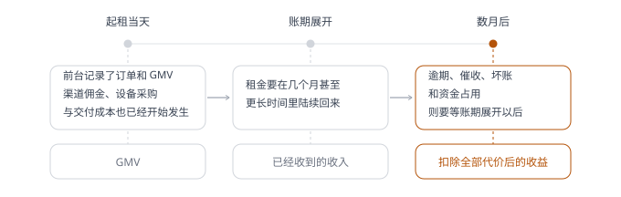
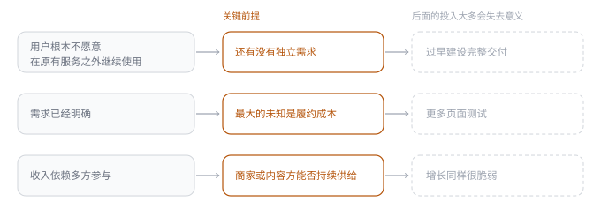

# 第 15 章 · 商业思维——产品如何养活自己

## 引言

一个业务从现场里长出来，经过能力抽象和系统建设，总算能稳定运转了，到了这一步，松一口气几乎是本能反应：产品已经上线，流程能跑通，用户也在用，前面投入的人和系统看起来都有了交代。可真实经营不会停在上线那一刻，一个产品继续往后发展，会在几个地方各自落定：用户手里是一项服务，业务账上是一笔订单，运营和客服接着往下干活，财务要等的，是收入、成本和回款陆续到账。

产品经理最先看到的，通常是页面、流程和行为数据，这一段顺了，就容易觉得事情大体成立。但一项产品选择带来的服务、协作和资源占用，会沿着业务继续往后走，走到界面上看不见的地方。商业思维要处理的，正是这些散在不同角色、不同时间里的结果：产品站在哪一层，靠什么持续交付，又拿什么换回下一轮投入。

## 15.1 确定角色——产品在哪一层形成闭环

2018 年我所在公司的主营业务里有一条大健康业务线逐渐趋于成熟，用户购买减脂产品和服务后，会得到持续数月的配套服务：健康管理师一对一跟进，帮助安排饮食、提醒记录体征，并在过程中提供课程和建议。公司为此运营了一款大健康 App，用户可以同步体脂等数据、查看健康报告、接受指导，体脂秤、血糖仪等设备也常常和服务一起交到用户手中。

这款 App 最初并不是一门独立生意，它首先解决的是减脂服务如何在线上交付，过去散落在电话、社群和人工表格里的记录与跟进，一步步搬进了产品。用户每天可以看到自己的体脂变化，健康管理师也能根据记录继续提供建议，课程和饮食方案有了稳定入口。随着主营业务增长，App 注册用户从两百多万增长到五百多万，日活长期维持在十余万[^1]。用户、数据、内容、教练和硬件都聚集在一个产品里，团队自然开始期待另一种可能：它能不能从主营业务的配套工具，变成一款独立经营的健康管理产品？

这个设想有它的依据：减脂需要长期配合，用户通常会连续使用六到九个月；服务结束后，也有一部分人因为已经形成记录习惯，继续使用一段时间。但把用户来源放回原来的交易，情况就没有那么乐观了，App 里绝大多数用户本来就是减脂产品和服务的付费客户，他们不是先发现一款健康工具，再决定购买服务，而是在使用一项已经买下的服务。服务仍在交付时，记录体脂、接收提醒、与健康管理师沟通都是其中的一部分；周期结束以后，打开频次便逐渐下降。数百万注册用户和十余万日活都是真实存在的，它们证明的是线上交付已经形成规模，但还不足以证明 App 拥有独立的用户来源。

团队后来尝试通过已经存在的服务或能力来衍生出新场景：App 配套的自有硬件开放销售通道，并且对接其他三方品牌设备，扩大硬件销售范围；课程、食谱和更细致的健康内容也尝试过收费；同步电商端口的优惠，让用户在这形成购物习惯。三种尝试看起来都有依据，但结果并不如人意，卡住的地方各不相同。

**表 15-1　三次尝试各自卡在哪里**

| 尝试 | 为什么被看好 | 实际卡在哪里 |
| :--------- | :----------------------------------------------------- | :---------------------------------------------------------------------------------------------------------------------------------------------------------------------------------------- |
| 硬件 | 体脂秤和血糖仪是用户可以直接感知的实物，也比较容易标价 | 基础设备原本就随减脂服务一起提供，高阶设备没有形成足够普遍的额外需求；公司一度只让 App 兼容自有硬件，希望借此保留后续销售空间，后来接入其他品牌，软件与第三方设备之间的体验又很难真正做顺 |
| 内容与课程 | 减脂需要长期指导，课程和饮食方案有稳定入口 | 减脂产品和服务本身并不便宜，健康管理师指导、饮食规划和相关内容本来就应该包含在其中，为什么还要在 App 里再付一次钱？ |
| 电商 | 有流量，优惠也同步了进来 | 用户愿意看数据、接受提醒、和健康管理师沟通，购买仍然留在原来的渠道，没有在这里形成购物习惯 |

这些尝试没有找到一份用户可以清楚辨认的新增价值，硬件、内容和商品并非不能卖，只是放进这款 App 以后，它们仍然被理解为原服务的延伸。随着主营业务体量逐渐下降，持续流入 App 的付费用户也在减少，活跃随之收缩，这款 App 最终在 2022 年停止运营。

**它没有被证明的，并不是有没有价值，而是能不能脱离原有定位独立经营**。作为配套交付的一款服务工具，它的用户来源、使用理由和资源预算都来自主营业务。如果它能够降低服务成本、改善健康管理师的工作效率，或者提高用户完成减脂过程的质量，这都符合它的定位发展，但团队希望它成为一款独立健康产品以后，情况随之改变：原来的交易拿掉，还有谁会主动来，为什么留下，又愿意为哪一份新增价值付费，这几个问题始终没有得到足够支持。

**表 15-2　三种商业角色与各自的价值体现**

| 角色 | 价值从哪里来 | 价值如何评价 |
| :----------- | :--------------------- | :--------------- |
| 本身就是交易 | 销售、订阅或服务费 | 直接收入 |
| 支撑主营业务 | 获客、转化、留存和交付 | 对主营业务的贡献 |
| 服务组织内部 | 效率、质量或风险改善 | 可确认的改变 |

产品不必都向使用者直接收费，以上三种角色，每一种都能成立，也都有可能被淘汰，关键在定位：准备独立经营的产品，不能长期靠借用主营业务的用户和预算来给自己背书；内部工具，也不该用直接的财务收入去衡量它的价值。**商业判断的第一步，是先看清产品在哪一层创造价值，再用与这个角色相匹配的标准去评价它**。

产品的角色也不是一贴上就永远不变：一项内部能力，可能渐渐对外提供服务；一项主营业务的配套工具，也可能拿到独立经营的机会。**角色变化时，过去积累的用户、数据和能力当然可以接着用，但原来的成绩不能直接搬过来当依据**。服务期内的活跃数据，撑不起独立产品的留存；主营业务带来的用户，算不上新的获客能力；组织内部省下的成本，更推不出外部客户愿意付的价格。角色一旦跨层，使用者、付费者、竞争对象和交付责任往往都会跟着变。许多产品转型栽的跟头，不是缺可复用的能力，而是还在拿旧角色的结果，去证明新角色已经立住了。

## 15.2 识别回报——投入究竟改变了什么

2025 年，我所在公司的运营团队在做活动复盘和用户分析时，经常遇到一个现实问题：公司不是没有数据，而是等数据到手的时候，运营窗口有时已经过去。原有 BI 和数仓能够提供经营数据、用户行为与活动效果，但新的分析需求需要排进开发计划，等数据表、指标和报表准备好，业务动作往往已经错过了合适时间。运营负责人因此提出采购一套专业的数据分析工具，把一部分必须依赖产研和数据团队的工作交回一线，让运营自己查看数据，也能完成部分分析和后续动作。产品和研发团队随后参与调研与选型，比较埋点数据如何同步、接口和权限怎样接入、现有系统需要付出多少改造成本。最后选中的方案除了基础数据分析，还包括营销自动化和 A/B 实验等模块，前后投入十余万元，后续每年还需要续费[^1]。

从当时的背景看，这笔采购的理由并不牵强：运营想缩短等待，产研通过数据打通可减少支撑成本，公司则希望分析效率最终能转化为更及时的经营动作。只是我们把大量注意力放在了工具能做什么，对它准备改变哪一段工作这一点，说得不够清楚。哪些分析必须由一线自己完成，哪些判断会因为数据更及时而改变，哪些需求以后不再交给 BI 团队，采购前没有形成共同约定。营销自动化和 A/B 实验也是如此，系统与工具具备实验能力，不等于团队已经知道要验证什么、由谁设计，又准备根据结果调整什么。数据和权限接通以后，这款工具在技术上已经可用，但却没有真正进入运营工作。

工具上线一段时间后，长期活跃的使用者不到五人，真正高频打开的只有一两位[^1]。有人能看到数字上涨或下跌，却很难继续解释变化来自哪里，更谈不上据此调整运营动作。团队需要固定经营数据时仍然等 BI 报表，遇到临时分析还是找数据同学，就连运营负责人自己有数据需求时，也延续着原来的协作方式。没有谁故意让工具闲置，原来的工作分工、能力要求和责任关系没有改变，新的系统工具便一直停在主流程之外。

回过头看，使用人数少只是结果，核心原因是采购前缺少一条从投入走到回报的路径。工具上线以后，团队也需要有人负责指标口径、培训、使用场景和后续运营，少了这些安排，一套功能完整的系统只能提供可能性，无法替组织改变工作方式。这些本来应该成为采购的基线，当时都没有留下来：

**表 15-3　投入前该留下的工作事实**

| 投入前留下的工作事实 | 半年后看什么 |
| :--------------------------------- | :----------------------- |
| 分析需求平均要等多久 | 等待有没有缩短 |
| 每个月有多少次判断因此延误 | 延误有没有减少 |
| 哪些工作交给一线后能够减少多少等待 | 这些工作有没有真的交出去 |
| 临时分析占用数据团队多少时间 | 时间有没有回到一线 |
| 哪些运营动作经常错过窗口 | 错过窗口的次数有没有下降 |

续费期临近，工具并没有形成稳定的使用习惯，很难说已经证明了自己的价值；可埋点数据和历史报表仍在里面跑着，真要彻底关掉，还得面对迁移、整理和追溯。公司当初付出的不只是采购费，还包括产品和研发的接入、数据的持续同步、一线人员的学习，以及现在的退出成本。这些投入分散在不同团队，很容易就压在一张续费账单底下，看不出分量。运营负责人倾向继续续费，理由是「以后也许会用得上」；但团队真正离不开的分析工作，其实早就回到了数仓、BI 和数据分析师手里。

内部工具不必用直接收入来证明自己的价值。它的回报，可能是一张报表少等几天，一次活动更早得到调整，一类重复分析不再占用数据团队，或者一个过去无法追踪的风险开始被稳定识别。这些变化未必都能立刻折算成收入，却必须看得见，并且能和原来的工作摆在一起比，否则「提高效率」就会变成一句永远正确、却无从验证的采购理由。

使用人数少也不能直接判定一套工具没有价值。有些系统本来就只服务少数专业岗位，有些风险识别能力一年可能只在少数时刻发挥作用，一次避免的重大损失就足以覆盖长期投入。使用频率、覆盖人数和直接收入只是几种证据，它们都要放回产品承担的角色里去解释。一套工具采购时如果原本就是为了让更多一线运营自主分析、减少跨团队等待，最后却只有极少数人用起来，原有的依赖也没有降下来，那么采购时最主要的回报设想就没有发生。

内部投入还有一种常见的模糊地带：工具上线后，团队会罗列许多它「可以带来」的价值，却很少确认其中哪一项真正发生了。决策更快、洞察更深、协作更顺、人员更专业，这些描述都很难被反对，也很难据此决定是否续费。更实际的做法是，在投入前先记下几项原来的工作事实，再约定好谁准备改变什么，半年后再回过头看它们变了没有。**商业回报未必都要换算成人民币，但不能永远停留在形容词里**。

不同商业角色用不同的尺度衡量回报，但有一条是共通的：投入得在某个地方留下能确认的改变。到了直接面向市场的产品，回报常常以收入的形式出现，关系反而更复杂。钱从谁那里来，会改变产品首先回应谁，也会慢慢改变用户对产品的理解。

## 15.3 选择收入——谁付出，产品就要回应谁

常见的短剧产品，先让用户免费看前几集，后面的剧情再逐集解锁收费。平台把收费点卡在故事最有悬念的地方，内容方也依据付费转化，判断一部剧还值不值得继续投入。对用户来说，这是一笔很直接的交易：先看一段，如果还想往下看，就接着付钱。

红果短剧走的是另一条路，内容免费看，平台靠广告挣钱，再跟内容方分账。2025 年 3 月，红果单月内容分账金额超过 5 亿元； 2026 年 2 月，其月活跃用户达到 3.04 亿[^2]。这样的规模说明大量用户接受了这种方式，而它带来的改变，不止是拆掉了一道付费墙。用户不必再反复掂量后面的剧情值不值得花钱；取而代之的付出，是观看时长，以及愿意承受广告。广告主为触达用户付费；内容方用作品换播放和分账；平台则要把内容、用户注意力和广告，在同一套产品里持续转起来。

逐集付费的产品需要在关键节点促成支付，内容往往围绕付费转化组织。免费观看的产品更依赖用户持续停留，也要控制广告出现的频率和位置。内容能不能连续看下去，推荐能不能让用户找到下一部想看的剧，广告增加到什么程度会破坏观看，都会影响收入。内容方关注的指标也随之变化，一集带来多少充值不再是唯一依据，整部剧获得多少播放、停留和分发，同样决定它能拿到多少回报。

收入从哪里来，会让产品同时回应不同角色。平台如果只追求广告曝光，观看体验会被挤压，用户停留随之下降，广告价值也会受损；如果分账不足以支持内容生产，短期仍有流量，后续供给也会逐渐变薄。这套关系能够运行，需要用户、广告主、平台和内容方都得到继续参与的理由，产品在其中承担的，是把这些理由落实为推荐、广告、内容和分配规则。同一项产品能力，放在不同收入方式里，优先级也会改变：

**表 15-4　不同收入方式下产品优先保证什么**

| 收入方式 | 用户付出什么 | 产品优先保证 |
| :--------- | :----------------------------- | :----------------------------- |
| 逐集解锁 | 为后面的剧情逐集付费 | 在关键节点促成支付 |
| 免费＋广告 | 观看时间，以及对广告的接受 | 用户持续停留，推荐找得到下一部 |
| 会员 | 为能够区分免费与付费的权益付费 | 权益持续可辨认 |

推荐、试看、提醒和会员看起来都是产品功能，它们背后服务的却是不同的交换。团队如果先把功能做出来，再考虑如何收费，很容易发现用户已经形成了另一种使用习惯，内容供给也已经围绕原来的指标运转。到那时，增加一种收入方式动到的就不只是结算，还包括流量分配、内容选择和用户预期。

用户不会用商业模型理解产品，却会从一次次体验中形成自己的判断：打开以后能不能马上看，可以看多少，要不要先付钱，中间需要接受什么。红果长期把「免费追剧」放在主要位置，用户也逐渐把它视为与平台之间的基本约定。2026 年站内少量带有 VIP 标识的内容引发讨论，平台随后回应，这类限制来自极少量影视内容的版权要求，相关设置自产品上线时便已存在。规则并没有在当时突然改变，用户的反应仍然说明「免费」已经不只是一句推广语，即使面对原本存在的例外，用户也会追问：哪些内容可以通过广告交换，哪些内容需要另行付费，多付的钱又换来了什么。

会员、付费内容和其他收入来源当然可以并存，前提是用户认得出其中多出来的价值。免广告、更完整的版权内容，或者另一种服务，都可能成为真正的新选择；可如果只是把原本靠广告就能看的内容重新挪到付费门槛后面，用户感到的就不是多了一项权益，而是原来的交换条件被改了。收入方式从设计起就在塑造产品：它决定内容方为什么还愿意供给、用户为什么留下，也决定产品必须向用户守住什么样的承诺。有了收入仍然不能说明一门生意已经成立，钱进入业务的那一刻，交付、服务和风险也可能刚刚开始，它们不一定出现在同一张报表，更不会在同一天显现。

## 15.4 算完整账——收入、成本与风险不在同一时间发生

2025 年，我所在公司的一条长租业务接入了新的 CPS 渠道，流量主要来自一类金融平台。业务希望借此触达原有渠道没有覆盖到的人群，风控团队很快发现，这批用户和过去的核心客群并不一样。最初系统只从中筛出有真实租赁需求、信用表现较好的用户，通过率和成交规模都不高；但业务侧想尽快把渠道做起来，一季度末开始持续推动放宽准入标准。标准调整以后，月起租单量从一万多单涨到接近两万单，GMV 也几乎翻番[^1]。单看订单、成交和 GMV，这条渠道像是找到了打开方式：进来的人更多，通过的人更多，业务规模也被快速推高。站在当时的经营现场，这种判断并不难理解：渠道已经投了钱，团队也背着新增压力，最先冒出来的数字，自然最容易被人当成结果。

可租赁业务的订单、回款和风险，并不在同一时间发生。用户完成起租那一刻，订单和 GMV 就已经产生，渠道佣金、设备采购和交付成本也随之发生；后续租金要在几个月甚至更长时间里陆续回来，逾期、催收、坏账和资金占用，则要等账期展开以后才显现。一笔订单在起租当天看起来是增长，几个月后可能留下完全不同的结果。GMV 描述的是合同期内可能发生的交易规模，不是已经收到的收入，更不是扣除全部代价之后的收益。

**图 15-1　一笔长租订单的时间轴**　同一笔订单在不同时点留下的东西并不一样。账期走完，才知道它最后留下什么。

数月后，准入调整的另一面逐渐显现：这批用户的整体逾期率明显高于原有业务，接近原来的两倍，催收和坏账压力也随之增加[^1]。继续经营这批订单时，渠道、交付、资金和风险代价明显上升，原先支持扩张的测算已经站不住，渠道尝试最终被叫停。前台数据没有造假，它准确地记下了起租发生，问题在于，我们用交易刚开始时的数字，替一笔还没走完整个周期的生意下了结论。

判断长周期业务，不能把不同月份的数字随意拼在一起。某个月进来的用户构成一批客群，他们在起租时带来订单，在后面的账期里陆续形成回款、逾期、催收和坏账。只有沿着同一批用户继续看下去，团队才能知道，准入调整增加的是能够履约的需求，还是让更多后续风险一起涌进了当期 GMV。前台数据回答交易有没有发生，完整账期才回答这笔交易最后留下了什么。

风控准入也不只是一道把人挡在外面的门。不同风险水平的客群，可以对应不同的额度、租期、保证方式、价格和服务安排。只是这些条件一旦没有同步调整，团队实际上是在用原来的收益结构，去承接新的风险结构，表面上只动了一项规则，用户范围、回款节奏和后续服务却全被一起改动了。风控能识别和限制风险，但用什么产品结构、什么价格、多大成本去服务这批人，要由业务自己决定。

一笔完整的商业账，至少要沿着一笔交易继续往后看。收入这一侧有什么、什么时候能收回来；获客、商品与资金、履约、客服和售后要付出什么；规模扩大以后，哪些成本随订单增加，哪些能力会在某个水位突然成为瓶颈；不利结果出现时，组织又要承担多少。并不是所有项目都能在开始前算准，但只盯着那些最早出现、最容易拿去汇报的数字，后面的代价并不会因此就消失。

规模对成本的影响，也不总是一条平滑的直线。渠道佣金和商品成本可能随每笔订单增加，系统、人力和仓储在一段范围内却未必明显变化；一旦订单超过现有能力，客服、审核、仓配或资金需求又可能跨上一个台阶。小规模试点看上去还有余量，扩大以后反而变重；有些前期投入较高的能力，则要到一定规模以后才会被摊薄。判断业务能不能继续，既要看一笔新增交易留下多少，也要看新增规模会不会逼着组织补上一整块能力。只算平均成本，容易把还没发生的扩容藏进现有业务里；只算当前边际成本，又会让人误以为下一批订单几乎不用再付出。

风险滞后时，团队还需要在最终结果出现之前，找到可以提前观察的信号。准入之后，首期履约、资料真实性、异常行为、客服争议和早期逾期，都可能比最终坏账更早出现，它们代替不了完整账期，却能帮助团队判断要不要继续放量。更重要的是，观察期要跟着业务周期来定：一个需要半年才能看清的项目，如果每周只按新增订单决定是否扩张，扩张的节奏天然会比证据跑得更快，等后端结果赶上来，前面已经又放进来了更多相同客群。

这条渠道的问题，不在尝试了新客群，真正代价高的，是团队没先围绕不同的准入水位做完整测算，也没为滞后风险设好清楚的观察周期和收缩条件。先放宽看看，再等着逾期和坏账来表态，结论当然还是能得出，只是代价已经先发生了。**商业边界不是一条钉死不动的保守线，而是当前产品结构下，新增收益仍能覆盖获取、交付、资金和风险代价的范围**。条件变了，边界可以重算，而账没重算，订单增长也就没法单独证明业务真在变好。当然，早期探索很难把收入、成本和风险一次算清。如果因此非等所有数据凑齐才动手，不少机会就溜走了，更现实的做法，是承认这笔账里本就有假设，再决定先用多少资源，把最可能让它断掉的地方先暴露出来。

## 15.5 分段投入——用事实决定下一笔资源

2017 年 11 月，美团点评叫停了「松鼠便利店」和共享充电宝两个试点[^3]。松鼠便利店从 2016 年底开始尝试，共享充电宝在 2017 年上半年启动，两个项目都还只是十余人的小团队在试，没到大规模扩张。便利店和共享充电宝在当时都是大家反复讨论的新方向，美团手里有大量本地商家和用户，要继续投下去，理由一抓一大把。团队已经搭起来、行业还在升温、公司也有现成资源，这些事实能支撑项目去试，却撑不起下一轮扩张。

王慧文在当时的内部信里提出，新业务探索的资源应以满足「最小测试单元」为默认标准，而不是公司拥有多少资源，就先配置多少资源。这个标准难在怎样让投入和要验证的问题对上。资源太少，用户需求、履约过程和协作关系无法充分暴露，团队得到的只是一场功能演示；资源铺得太开，假设一旦不成立，已经投入的人、资产和组织协同又会反过来绑住判断。

**一次合适的验证，要大到足以让真实交易发生，也要小到组织还能根据结果随时调整**。它不需要在第一轮就复制出一门完整生意，而要先找到最可能让这门生意断掉的地方。用户会不会脱离原来的交易接着用，投入是不是真的改变了工作方式，谁愿意为价值付钱，收入走完整个周期后能不能覆盖交付和风险，这些都是商业假设。每个项目面对的关键前提不同，第一次投入也不应该把所有问题同时验证。

关键假设的顺序，也会改变试点的代价。假如用户压根不愿意在原来的服务之外接着用，早早把完整交付建起来就没有意义；如果需求已经明确，最大的未知是履约成本，继续做更多页面测试也不会增加多少认识；当收入要靠多方一起参与时，先验证了消费者愿不愿意用，却没确认商家或内容方能不能持续供给，这样的增长同样很脆弱。团队要先找出那个一旦不成立、后面大半投入就白费掉的前提，再决定用多大的规模把它看清。

**图 15-2　先验证哪一个关键前提**　不同情况下，该先看清的那一条前提并不相同。先把它找出来，再决定投入多少。

这与通常所说的「先做一个最小版本」还有一点差别，功能可以很少，验证却不能失真。共享充电宝如果只验证用户愿不愿意扫码，仍然看不到设备铺设、商家分成、周转、维护和丢失；内部分析工具如果只验证数据能不能接通，也看不到运营会不会把它放进工作；大健康 App 如果只看现有用户是否活跃，就无法知道原有减脂服务拿掉以后，还有没有独立需求。要缩小的是投入范围，不是把最关键的交付和回收关系从验证里拿掉。

共享充电宝后来发展成更成熟的业务品类，美团也在 2020 年前后重新进入。后来的选择没有反过来证明 2017 年的停止是对是错，它说明的是，市场条件、组织位置和可行的商业关系发生变化以后，同一家公司可以重新做判断。停止一轮试点，也不等于此前投入全部浪费，哪些用户关系没有形成，哪些交付比预想更重，哪条回收路径暂时走不通，都会改变下一次尝试的范围和方式。

商业模式写进立项材料时，只是一组对未来的解释。真正投入以后，事实会逐渐支持其中一部分，也会推翻另一部分。产品经理不必在开始前算出几年后的利润，却应该知道这一次把资源投进去，准备看清哪一个关键前提。证据出现以后，团队再决定下一步是扩大、调整、暂停，还是把资源留给其他方向。

这一步最好发生在资源投入之前。团队需要提前约定，哪一种结果支持扩大，哪一种结果只说明方案还要调整，哪一种结果会让项目停止。标准不必精确到一条绝对的数字线，但要足以改变动作。比如，一项工具试用结束后，如果目标岗位仍然没有把它放进日常工作，下一轮就应先处理场景和责任，而不是继续购买更多模块；一条长周期渠道在早期风险信号持续恶化时，也不该等全部坏账发生以后才收缩。结果出来以后再把它解释成成功，任何数据都能找到好听的故事；事先说清准备依据什么行动，验证才真正参与了资源判断。

已经投入的人力和协作越多，停止越难。项目做了一半、团队已经组建、系统接入不少、外部伙伴也开始配合，都会成为继续投入的理由。可已经花掉的资源，换不来下一笔投入的回报，需要讨论的是，最新事实让原来的商业假设发生了什么变化，继续投入想换回一个什么新的答案。**一项探索获得下一轮资源，不是因为它已经走了很远，而是因为它对怎样继续成立，拿出了比上一轮更充分的证据**。

## 闲言碎语

刚做产品的时候，我更习惯把自己的责任放在方案里。需求有没有想清楚，流程完不完整，系统能不能稳定运行，上线后的数据有没有变化，这些事情看得见，也容易判断。至于定价、预算、履约和损益，我很自然地觉得有更专业的人负责。这样的分工没有错，真正让我后来不断调整的，是产品并不会沿着组织架构运行。一次免费开放会改变用户以后获得价值的方式，一个准入调整会把原本不会进入的人带进业务，一项为了体验而新增的服务，也会变成人、系统和合作方此后要反复承担的工作。

现在再看一个方案，我会在页面和流程之外多一些思考。免费开放以后，客服会接到什么；准入放宽以后，几个月后的账会多出什么；服务增加以后，谁要把它日复一日地完成。很多问题当时仍然算不准，但只要知道后果会落在哪里，团队就还有机会决定试到什么程度，又在什么时候回来重算。

[^1]: 文中所涉运营数据均为真实项目数据，已做脱敏处理。

[^2]: 短剧行业的分账金额与用户规模，来自平台公开披露和第三方机构的公开统计，按转述口径处理，未经逐项核验。

[^3]: 美团点评 2017 年叫停「松鼠便利店」与共享充电宝试点、以及此后重新进入共享充电宝的情况，来自公开报道与王慧文当时的内部信，按转述口径处理，未经逐项核验。
