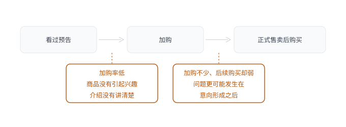
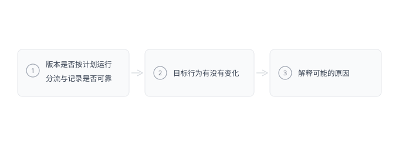

## 引言

> **验证不是项目末尾的一次验收，而是让后续选择不断拿到新依据的工作方式。**

业务跑起来以后，产品经理会越来越频繁地面对增长目标：订单要涨，用户要留，活动要比上次更好。围绕这些目标，团队通常不缺想法：换批商品、加些流量、调整页面，或者多给点优惠。每个想法都能说出理由，也都能找到类似的成功经验。**困难的是在这么多可能的动作里，如何判断眼下这块业务更值得从哪里往前走**。

增长目标最后都会落到报表上，订单、转化率、活跃度放在一起，涨跌都看得见。可报表把不同的原因搅在一起：同一笔订单，背后推动的事并不一样，数字能说明结果变了多少，却说不清变化发生在哪。做了什么、看到了什么、什么被真正改变，其实是三个不同的问题。把增长当成一组动作，第一反应往往是「还能再做点什么」；一旦和动作分开，才会去问眼下到底卡在了哪里。前者从手上的方案出发，后者回到用户和业务本身。

最容易被跳过的，是判断到底要放大什么。**增长更像放大器：它能让一件已经成立的事来得更快、更大，却不会让原本不成立的事情变成立**。方向要是站不住，投入越大，离原来的问题反而越远。这一章要回答的，正是这个判断：什么值得被放大，又该从哪里先看起。

## 17.1 定义增长——增长首先要改变什么

2021 年，我在一家社交电商平台参与了一个每日主推频道的增长项目。平台原本就有集中选品、打造爆款的节奏：站内靠首页的专门入口承接主要曝光，站外主要依靠经销商在社群里分享商品。经销商经营着自己的社群，熟悉群里的消费偏好，从平台商品里挑出适合推荐的，靠交易赚取收益。频道里同时跑着两个模块：一个主推当天售卖的商品，用户可以当天下单；另一个预告次日售卖的商品，用户先了解、加购，等第二天正式开卖再下单。这两个模块撑起每天的销量，一个促成当下交易，另一个提前积累兴趣，也给经销商留出推荐和分享的时间。同一件商品会从明日预告进入今日售卖，但用户并不都提前看过。有人今天才从首页发现它，看完就买；有人昨天已经放进购物车，今天回来付款；也有人先在社群里听过介绍，再通过分享链接进入。

只看页面，很容易把这个项目理解成一个导购页面：选好商品，放上入口，把用户带到商详页。可影响结果的因素，在页面之前和之后都存在：经销商为什么愿意分享，消费者为什么对这件商品感兴趣，已经加购的人为什么第二天没买，都会影响订单。当时我们整理了 17 个可能作为核心目标的指标，访问、社群活跃、订单、交易额、客单价、经销商收入和购买频次都在其中，它们各自有用，可把所有指标平铺在一起，仍然说不清这轮增长工作究竟先对什么负责。几个看起来都在变好的指标，未必指向同一件事：

**表 17-1　三类指标变好的其他解释**

| 看着变好的指标 | 也可能只是因为 | 要接着看什么 |
| :------------- | :------------------------- | :--------------------- |
| 客单价上升 | 今天售卖的商品恰好比昨天贵 | 商品结构有没有跟着变 |
| 社群更活跃 | 讨论多了，购买没有跟着多 | 活跃有没有变成成交 |
| 分享次数增加 | 带来的人未必对商品有兴趣 | 分享来的人是不是真想买 |

相比之下，频道订单量更接近我们当时想推动的事情：让已有的商品、站内流量和社群推荐产生更多交易。它既包含当天售卖的结果，也能继续追踪预告商品后来的成交，不会只把某一个入口或某一个角色的动作当成全部成绩。我们最终把它放在核心位置，再沿着订单形成的过程拆出其他指标，这个选择也让不同团队开始围绕同一个结果工作：平台准备商品、给出曝光，经销商投入推荐，消费者完成购买，几方的动作才在一笔交易里连起来。增长里常说的**北极星指标**，在这里承担的就是这个作用：它不需要包办一切，但要让团队知道，自己负责的点击、分享、加购，最后准备改变什么，否则每个人都能把手里的数字做得漂亮，合起来却未必多卖出多少商品。

选这样的指标，可以从三个方向检查：它变好时，用户是不是更接近产品的核心价值；它能不能支撑业务持续经营；团队能不能把它拆成日常能推进的具体动作。注册人数增加，未必说明用户已经用上了产品；收入上升，也要分清是来自更多真实使用，还是一次提价。不同业务会给出不同答案，协作工具更看重的，是有多少团队在持续完成共同任务；交易平台要看的，是供需双方有没有形成有效交易。**北极星指标的价值，是把各自的产品价值变成团队能一起观察、朝同一目标发力的结果**。

**用更大优惠换来的订单，和商品被更多需要它的人理解以后带来的订单，后续代价并不相同**。订单量提供的是当前工作的重心，成本、退款和后续购买则帮助检查这些交易是否值得继续，购买频次和留存并没有因此失去意义，它们观察的是用户关系能不能延续，只是需要更长时间才能对这轮改善给出更完整的回答。这里还要把长期方向与阶段任务分开看：一个产品长期希望用户持续使用，当前却可能首先得解决第一次使用的困难；也可能首用已经顺畅，问题转到了后续回访。阶段目标是在同一个方向下选出眼下要改变的结果，不能每做一次活动就重新定义产品的价值。每日主推频道把订单放在核心位置，再去看预告加购和正式购买，这样每个具体动作都指向同一个方向。

我理解的增长，是把产品的价值传得更远，让更多用户更快、更顺利、更频繁地体验到它的核心价值。这里的频繁要服务用户的真实需求，低频业务不必为了活跃把用户每天叫回来。每日主推频道要增加的是合适商品被发现、理解并购买的机会；工具产品可能要缩短用户从注册到完成任务的距离；服务产品也可能首先要让一次服务值得被再次选择。**增长首先要说明值得增加的是什么，再用指标追踪它，而不是从一个方便上涨的数字倒推用户价值**。

## 17.2 拆解变量——结果是怎样一步步发生的

我们开始往下看订单时，今日售卖和明日预告的区别就显现出来了：前者能直接看到有多少人进到商详页，最终下单了多少；后者当天还没开始售卖，得先看多少人产生兴趣并加购，再追踪这些人正式开卖后有没有下单。两个模块都能带来订单，问题却未必出在同一个环节，如果把它们简化为一个频道转化率，数字即便变了，也很难知道该调整哪一段。就今日售卖这块来说，一部分订单从商详页进来，另一部分通过购物车完成，而购物车里又可能装着此前预告时加进去的商品。所以分析不能简单地把今天看到的页面当成交易的全部起点，用户的决定可能昨天就开始了，也可能在 App 之外已经形成。我们把这些路径分别展开，继续看访问、加购、购买和人均下单次数，原本汇总在一起的订单，也就有了可以追溯的来源。

当我们把范围收窄到一批访问用户时，订单量可以拆成「访问人数×购买转化率×购买者人均订单数」，几个数字的关系并不复杂，它的用处在于把「订单没有上去」拆成了几种不同的情况：

**表 17-2　订单变化的两层追查方向**

| 看到的变化 | 先要检查什么 | 还要往下想一层 |
| :--------------------- | :------------------------- | :----------------------- |
| 访问减少，转化不变 | 商品是否还被足够多的人看见 | 曝光的位置或渠道有没有变 |
| 访问相近，购买减少 | 人群、商品和决策过程 | 进来的人或承接的商品换了 |
| 购买人数没变，订单增加 | 原来的购买者是不是买得更多 | 也可能只是订单被拆得更细 |

公式写对只是起点，它里面的每一项都要对应同一套业务事实。在模型里，不同来源的结果可以相加，但归属要互不重复；同一人群经历的连续步骤则可以用转化关系相乘，分母和观察周期要接得上。比如预告访问人数乘以加购率，得到这批用户中的加购人数，再乘以他们后来的购买率，才能估算这条路径带来的购买人数。同一个人在首页和社群链接里都出现过，不能因此算成两位新访客。

预告商品还要多看一段时间，提前加购的人，已经比只浏览的用户多走了一步，但有些人还在比较，有些人只是想先留着，第二天的需求和选择仍然可能变化。因此，分析这条路径要跟着同一批人走，这条路径要经过三个环节，容易出问题的是两个衔接处，而且不在同一个地方。加购率低，可能是商品没有引起兴趣，也可能是介绍没有讲清楚；加购不少、后续购买却弱，问题更可能发生在意向形成之后。只有把这两段分开，才不会在已经有兴趣的人身上继续重复做吸引注意的工作。

**图 17-1　预告商品的两段路径与两个卡点**　先看有没有加购，再看加购之后有没有买；两段的问题不在同一个地方。

拆到入口时，我们看到不同位置的表现相差很大：有的入口占了相当一部分访问，购买却很少；有的访问量没有那么大，成交反而更好。首页主推位置与日常互动场景，把用户带过来时的意图并不一样。前者的用户可能就是来看今天有什么值得买，后者可能只是完成原来的活动后顺手点进来。低转化的位置值得继续看，但先要知道这些人为什么来：若用户原本没有商品需要，增加几处购买提示很难让他改变；如果分享里已经让他产生兴趣，页面却没有回答他最关心的问题，改善才有更明确的对象。

沿着这些入口往前看，分析范围也会从页面扩展到用户怎样被吸引、怎样第一次获得价值。把获取、激活、留存、转化和推荐放在一起，可以帮助检查有没有漏掉重要环节，但这些环节仍要按具体业务连接。模型应当保留业务中真实发生的联系，不需要为了画成一张标准漏斗，把站外推荐、跨日购买或者后续使用省掉。业务里如果先有社群推荐，再有访问和交易，就按真实顺序分析；已经有稳定用户的产品，也不必每次都从拉新开始。

商品差异比入口更明显，频道的节奏相对固定，每天的商品却在变。一个熟悉的品牌、一款需要解释用途的新品、一件价格较高的商品，面对的购买判断各不相同，在当时的数据里，商品之间的转化可以相差很多，整体平均值把这些差别遮住了。我们如果只拿某一天与另一天比较，很可能把好商品带来的变化算到页面头上，或者在商品本身不适合时，反复寻找一个并不存在的交互问题。**同一个转化率，同时受到商品、人群和页面的影响，先分清差异，才知道还能改什么**。

当时我们用分位数看数据比较集中的区间，把特别高和特别低的表现暂时放到一边，再估算流量、转化分别还有多少空间。这样处理，是为了不让极端商品主导比较，并没有把选品的影响彻底拿掉，留下来的商品仍然不同，后面要判断页面改动是否有效，还是要尽量在同样的商品条件下比较。历史数据帮助我们缩小了关注范围，接下来要通过实际的改动，辨认其中哪一部分能够被改变。

选品因此始终留在分析中，平台本来就有自己的爆款安排，也与社群经营有关，早期先从转化入手，只是这轮资源的选择，不是把商品划出了增长范围。关系拆清楚以后，团队才看见跨部门的联系：页面优化需要商品信息配合，流量扩展要有适合新人购买的商品，后续销售也会影响下一轮选品。这些变量之间还会互相影响：扩大流量可能带来意图较弱的人群，更换商品会同时改变点击和购买，缩短路径也可能减少用户获得必要信息的机会。**拆开是为了分别分析，不是认为其他条件可以永远不变**。

拆解到什么程度可以停，要看它是否已经帮助团队形成下一步分析。只剩「提高转化率」时，仍然有很多原因混在一起，明确到某类用户从某个入口进入、在某一步没有继续，才有机会追问具体阻碍。有些原因已经有了较清楚的线索，可以先验证，有些还需要访谈、行为观察或补充数据，不必把整棵指标树都拆到同样深度。**指标帮助找到问题的位置，继续识别能够改变的条件，才会让分析进入行动**。到了这一步，团队面对的就不只是报表里的高低，而是一串可以继续追问原因、比较投入的问题：哪个入口、哪类用户、卡在哪一步。

## 17.3 选择杠杆——哪一个变量值得优先改变

流量和转化是当时最直接的两个方向，每日主推频道已经有首页入口，站外也有经销商在分享，继续增加访问当然可能带来更多订单，另一方面已有访问内部的购买差异也很大。我们把两种变化放回刚才的订单关系里，先做了一次粗略比较：如果其他条件暂时不变，把流量或转化提高到历史样本中较好的水平，结果分别能增加多少。在相对集中的数据区间里，访问量从平均值到较高水平约有 17% 的差距，购买转化率则从约 6% 到约 9.3%，相对增幅超过 50%，按一万名访问用户折算，两种方向的差别是这样的[^1]：人均订单数相近时，两种方向都能增加最后的订单量，但在当时的估算里，转化有更大的潜在空间。

**表 17-3　增加访问与提高转化的估算对照**

| 情形 | 变化 | 一万名访问对应的购买者 |
| :------- | :----------------------- | :--------------------- |
| 维持现状 | 转化约 6% | 约 600 人 |
| 增加访问 | 访问增加约 17%，转化不变 | 约 700 人 |
| 提高转化 | 转化达到约 9.3% | 约 930 人 |

这些数字让优先级有了依据，却无法直接得出方案：样本里出现过较高转化，不等于每件商品都能达到，较好的商品和更明确的购买意图，本就会贡献其中一部分差异；另一边，增加访问也要付出资源，新进来的用户未必保持原来的转化水平。所以我们还要把实现方式一并比较：频道已有稳定的站内位置，想进一步扩展就得考虑其他业务的资源安排；站外分享要靠经销商愿意持续推荐，没法仅凭产品排期直接加量；页面上的一些改动，则可以先在部分流量里试，很快就能看出它是否真的拉动了购买。把改善空间和验证条件放在一块，转化就成了当时更值得先研究的方向。

选定转化以后，工作才开始具体起来，数据能够告诉我们多少人没有买，却不会直接告诉我们为什么没买。用户可能觉得贵，也可能不知道商品为什么值这个价格；可能根本不需要，也可能有兴趣但还有一个顾虑没有解决。如果这些原因没有区分，最后做出来的通常还是产品团队最熟悉的事情：调整排版、强化价格、把购买按钮做得更明显。它们都可能有用，但是需要说清楚这些改动和用户行为之间的关系，事实上当时我们的假设想法中也确实有这些方向：强化价格，希望用户更容易理解当次购买的利益；调整按钮，希望已经想行动的人更容易完成；补充评价，是尝试回应信任或适用性方面的顾虑。它们看起来都在改商详页，实际上影响的是购买过程中的不同环节。**同一个转化目标，只有继续走到这里，才能变成具体的产品工作**。

当时能选的方向不止这些，其中在「内容承接」这个方向最初落在明日预告：用户看的是第二天售卖的商品，提前加购说明他愿意把商品留到后面继续考虑。原来的页面基本照搬常规商详页的展示，能提供图片、规格和价格等信息，但对于不熟悉的商品，用户仍要自己完成一次翻译：这些信息和我有什么关系，我为什么要买。预告加购率约 10%[^1]，团队由此提出一个假设，是否可以换一种表达，先让用户对商品产生更明确的兴趣，再承接加购。这里的内容要进一步解释商品怎样被使用：比如一件家用产品，参数告诉用户它有多大、功率多高，使用过程才能让人知道放在家里究竟能解决什么问题；一件衣服，面料和尺码是必要信息，上身效果和搭配则帮助用户判断是否适合自己。把商品特征转成可以理解的用途和体验，才是内容有可能增加购买意愿的原因，用户未必缺少更多信息，只是缺了做决定需要的那一部分。这种表达也与社交电商的推荐方式接近，经销商长期在社群里卖货，面对具体用户时，需要说明为什么值得关注，而不只是公布价格。平台提供的内容如果能把商品解释得更清楚，同样的预告商品，换一种介绍方式，用户会不会更愿意继续行动。

如果把这个想法写成可以验证的假设，就要同时说清楚对象、原因、动作与预期行为：针对进入预告商详页的用户，尝试用更具体的使用介绍帮助理解商品，观察加购和后续购买是否改善。这里假定的原因是商品理解不足，并没有提前证明原因成立。策略要跟着更可信的原因来定方向，选定了原因，再落实成页面、规则或者运营动作。假如用户其实没有需求，再好的介绍也未必有用；如果主要顾虑是售后风险，方案就应该转向服务说明和保障。

为了安排验证顺序，我们也用过 ICE，把预期影响、成功信心和实现难度放到一起考虑，这个工具最有用的地方，是让大家把理由摊开：一个覆盖面广、改动较小的方案，可以较快开始；一个可能影响更深、但证据还弱的方向，可以先用较小的投入取得反馈。分数本身没有那么精确，尤其是「有多大把握」，很容易受到经验和偏好的影响，它适合帮助安排下一次实验，不适合代替实验结果。一个方案排在前面，只说明当时值得先试，实际效果还要等用户给出反馈。信心也最好能说出来源，同类商品的真实反馈、已有行为差异和相似实验，比「大家都觉得合理」更有分量。风险则不能完全被一个总分抵消，涉及用户信任、交易质量或难以撤回的承诺时，即使预期收益高，也应先缩小范围。验证快是一个优点，但如果只挑最容易出结果的小改动，团队同样可能长期绕开影响更大的问题。

回头看这次选择，找增长杠杆，要比的远不只是哪个数字最差。入口弱，可能是人群没找对；转化已经不错，也还可能靠更充分的商品解释继续往上提。找杠杆，既能补损失，也能把原来的优势放大，关键看它能撬动多少真实交易，要做成得付出什么，又有多大把握实现。我们从订单目标走到转化，再走到价格、操作和商品理解，问题越拆越小，产品动作反而越做越准。优先级还会随着结果变化：某个环节改善之后，剩下的空间可能变小，另一个原本不显眼的限制就冒出来了；一个方案在少数用户身上有效，也可能值得先把这类人放大，而不是急着铺开到全部业务。所以「先做什么」最好一并说清为什么先做，以及出现什么新事实以后要重新比较。这样，增长工作才能从一次排序进入持续选择，不必等到旧办法彻底失灵才去找新方向。

## 17.4 验证假设——结果出来以后，判断如何更新

第一轮内容实验做的并不是一个完整的版本：当时的页面搭建能力能做出内容页，却没有直接打开规格+完成加购的组件。原来用户进到预告商详页就能选规格，实验版本先让用户看内容，点了加购以后，还得跳回商详页才能操作。我们先用这个版本测试，原因很实际：商品介绍已经能呈现，用户也能走完加购，足够先看看这条路值不值得往下走。这其实就贴近最小可行方案的意思：留住了能检验关键假设的真实体验，把不影响验证的问题先留到后面。最小可行方案可以靠人工，也可以用现成工具，重点是用户能不能亲自走一遍要验证的那个变化。前期投入可以缩小，关键行为却不能从验证里拿掉，若只让内部同事看一张设计图，哪怕都觉得更有吸引力，也回答不了真实用户会不会加购。

实验在同一批预告商品上保留了原版和内容版，用 A/B 分流量，观察加购以及这些用户后续的购买。两个版本放在同一时期比，主要是为了避开每天换商品带来的干扰。停留时间、浏览屏数和跳失也都在看，但它们只是帮着解释过程，最后还是要看用户是不是更愿意加购，以及后来有没有购买，内容如果只让页面停留时间增加，却没推动后面的行为，还不足以支持增加制作投入。A/B 测试适合这里，是因为两个版本能并行跑，用户行为也可以被持续记录。换成客户少、决策周期又长的业务，差异可能更多来自客户本身，小范围试点往往更合适。无论用哪种方式，都得在开始前先想清楚：主要看什么、等多久、什么变化值得继续，以及哪些不利结果要让实验停。核心指标判断目标有没有改善，辅助指标解释过程，护栏指标检查有没有把问题推到退款、投诉或后续使用里，这几件事得在出结果之前就定好。

大约一周后，内容版本先有了正向反馈：报告里逐商品平均下来整体加购率从约 10% 提高到约 14%[^1]，加购之后的购买表现也有改善。这个结果让我们有理由继续沿着这个方向探索，在当时这批商品上，用户看过新介绍后，确实更愿意往交易方向多走一步，而且实验版还多一次跳转，页面在操作上并没占便宜。多出来的这一步，也让报表冒出一个容易误读的数字：实验版里，只有看完内容后愿意继续的人才会进到原商详页，如果还只拿商详页访问人数算加购率，分母已经变成一批意愿较强的人，看起来会比原版好很多，完整比较得把前面看了内容却没继续的人也算进去。我们要看的是同样进入预告商品的用户，换一种介绍方式后有多少人加购，而不是最后一小段路径上的数字有多高，看懂这个差别，比记住一个很大的提升百分比更有用。

围绕购买转化的价格面板和行动按钮实验，没给出同样的支持：价格面板调整后，两组购买转化的差距在 5.7% 上下[^1]，差异并不显著；按钮改动同样没出现明显改善，实际实现还偏离了原方案。用户仍然会关心价格，想买的人也仍然需要方便的操作，只是眼下这几种改法没带来预期效果。不显著和「效果为零」并不相同，样本不足、实际差异较小，或者执行没体现原方案，都可能让实验没有得到充分结论，需要结合具体条件分辨。这几项实验的指标和覆盖条件也不同，没法简单按涨幅给内容、价格和交互排个固定座次。但资源选择已经可以更具体：当时的内容方向出现了继续尝试的理由，部分视觉调整暂时没有。我们不必等到某一类方法被永久否定，才降低它的优先级；也不能把没有明显下降当成成功。证据不足时，是补充验证，还是先转向更有希望的方向，取决于继续取得答案的价值和成本。

**表 17-4　三组实验的结果与投入判断**

| 试过的方案 | 观察到的结果 | 能不能支持继续投入 |
| :----------- | :-------------------------------------------- | :----------------- |
| 内容版商详 | 加购率从约 10% 提高到约 14%，后续购买也有改善 | 值得继续 |
| 价格面板 | 两组平均购买转化都在 5.7% 左右，差异不显著 | 证据不足 |
| 底部行动按钮 | 没有明显改善，实现还与原方案有偏差 | 暂时放下 |

内容方案接着补上了直接加购：用户在介绍里产生兴趣以后，可以在当前页面选规格，不用再先跳回原商详页。新实验里，多数参与商品的加购表现比原来的承接方式好，部分商品的后续购买也有改善。这次测试的整体方案和入口范围跟第一轮不一样，结果支持的是内容和直接加购结合的方式。这组比较没单独测算出少一次跳转带来多少，却给后续投入找到了依据：新方式能完成加购和后续购买，也在更多商品上拿到了正向反馈。即使观察到明显改善，还要继续算它对整体目标的贡献。预告加购提高了，真正受影响的是走过这段路径的用户，还要经过后续购买才形成订单；其他入口、直接购买和未覆盖商品，不会自动获得同样增量。相对提升说明局部变化有多大，覆盖人数与后续转化决定这次变化能带来多少实际结果。把两者接起来，团队才能决定值得投入多少去扩大。

不同商品的效果还是有差别，有的改善明显，有的变化有限，这些差异给内容打磨留下了具体要解决的问题。一件本来就容易被理解的商品，可能不需要很长的介绍；一件用途陌生的商品，多加图片也未必就解释清楚了。这时候再回到商品，看的已经不只是「这件商品好不好卖」，还包括介绍里缺了什么、表达是否合适、用户停在哪个位置没继续。内容到底有没有效，开始可以通过更细的商品差异继续研究。复盘时，这三步的顺序不能颠倒：

**图 17-2　复盘时的判断顺序**　三步要按顺序看；顺序颠倒，容易把执行问题写成结论。

若实现和测量本身出了问题，补做一个可靠比较，比给结果写出复杂故事更有用；如果过程可靠、不同人群却持续表现不同，这些差异就可能成为下一轮假设。**实验既可以支持方案，也可以缩小它适用的范围，不需要每次都得到一个对所有用户成立的答案**。

实验在这个项目里最重要的作用，是让下一步不必重新从猜测开始。从继续打磨内容、补齐直接加购，到暂时放下部分改法，后面怎么安排开始有了依据，商品之间的差异也给新的分析指了方向。真正该记下来的也该是这些具体条件：当时面向什么用户、用了什么商品和版本、看到了什么结果，这样，下次遇到类似问题才有参照。记录里最有价值的部分，是它改变了哪一项认识：原来期待价格表达带来改善，现在证据不够；原来内容页需要跳转，现在组合方案已经能够继续测试；某类商品变化有限，还要回到具体原因。这些内容带进下一轮的模型和假设，实验才形成连续的积累：**验证不是项目末尾的一次验收，而是让后续选择不断拿到新依据的工作方式**。

## 17.5 兑现增长——有效的方法怎样走向规模

内容方向得到支持以后，工作开始从页面延伸到生产，每日主推频道同时在卖今天的商品、预告明天的商品，一次实验可以围绕少量商品集中准备，日常经营却需要内容不断跟上。新品来了，要弄清楚卖点；商品不同，素材和表达也要跟着变；从预告转入售卖，页面还要接上当时能够完成的操作。两者的差别不只是量的多少：

**表 17-5　一次实验与日常经营的差别**

| 对照项 | 一次实验 | 日常经营 |
| :------- | :--------------------- | :----------------------- |
| 商品范围 | 少量商品，可以集中准备 | 每天上下架的商品都要跟上 |
| 内容准备 | 围绕这一批商品专门做 | 新品来了要重新弄清卖点 |
| 规模上限 | 看这一批投入多少 | 受制作能力和流程限制 |

只要这套工作仍然依赖每次临时组织，内容能够覆盖的范围就会被制作能力限制。后来我们专门建立了内容化商详的生产流程，继续梳理内容形式、制作方式和页面所需的能力。图文故事、视频讲解、使用反馈、问答和品质信息，都进入了这项工作，每一种形式对应着不同的商品解释需要。先知道商品需要解释什么，才知道该准备哪些素材、采用什么形式：服饰需要展示上身效果，食品需要解释口味和食用场景，有些商品则要把品质依据或使用条件说清楚。

生产流程要解决的，也不只是谁来做图：一件商品的信息从哪里来，哪些卖点值得讲，素材能不能支撑这些表达，页面如何关联到正确的商品，最后怎样进入加购或购买，都得衔接起来。商品信息没有准备好，设计只能反复等材料；内容做完却没有接好规格和操作，用户又会停在页面上。把这些工作组织起来，实验里的有效方案才有机会随日常商品持续出现，而不是只在团队集中投入时偶尔做出几页。这时，模板和组件开始有了实际意义：图片、核心卖点、反馈、问答和操作入口，有一部分可以采用相对稳定的结构，后面的制作就不用反复处理同样的排版和交互。具体商品的判断仍然留在内容里：问答的位置可以沿用，问题却要回应这件商品的顾虑；使用反馈的样式可以固定，反馈本身仍要来自真实使用。复用能够减少重复制作，却不能省掉对商品的理解，两者分清楚，规模扩大以后才不容易只剩形式相似、内容空泛的页面。

投入也要跟着商品区别安排：有的商品用简洁图文就能讲清楚，有的得额外展示使用过程，还有的本来购买理由就很明确，再往上加内容未必值得。把同一套成本平均摊在所有商品上，很容易变成少数页面效果很好、整体投入却越来越重。要扩大，得看的是更多商品带来了多少新增购买，为此又多了多少制作和维护的活。一个改善幅度不大的做法，如果能低成本地一直用下去，可能比少数几件精心打磨出来的例子更有经营价值。放大也不必一步到位：先扩到相近的人群或商品，留一条还能比得出来的基线，再慢慢加范围，就能看见效果是不是随规模变了。如果覆盖增加了、单位增量却一直在降，就要分清是触达到了不合适的人群、内容被摊薄了，还是原来的改善空间快用完了。如果再加上优惠和人工投入，成本也得一起算，不能用整体增长盖住每一份新增结果越来越贵的事实。

作为延伸探索，社群分享给这项工作带来了另一条可能的方向。内容在商详页里帮用户理解了商品，经销商能不能拿它把商品推荐得更好，还得看社群里的实际使用情况。统一材料能省掉一部分准备，却代替不了经销商对自己成员的了解；同一件商品推荐给不同的人，侧重点和时机可能都不一样。真要让内容在站外继续起作用，就得给这种具体推荐留出空间，看它有没有帮商品被合适的人理解，而不只是看素材转了多少次。团队也顺着这些积累，进一步去探索平台内容化，但这属于后续的业务探索，不是本轮实验已经证明的结果。商详页里的内容既然有效果，自然会让人想到更多可以放内容的位置，可每多一个场景，都要重新看用户是为什么来的。帮一个已经关注商品的人做购买判断，和让人专门进平台浏览内容，需要的供给和分发条件并不一样：前者能沿用已有的商品与社群关系，后者得先建立持续浏览的理由。内容化商详支持了更多尝试，但独立内容消费能不能成立，还得另做验证。

后来项目的年度目标达成了，回头看，一次实验、内容流程和全年经营是分开推进的，商品、流量、社群和其他动作共同影响了结果。内容方向留下的价值，是一些原本要用户自己理解的商品，开始有了更合适的介绍方式，团队也围绕这种方式继续组织生产。它没有让选品和流量的重要性消失，只是给已有业务多了一种能反复使用的改善手段。

增长做得越久，越要留意这样的积累：一次活动结束，有没有多一批还愿意回来的人；一次内容实验做完，有没有留下能接着用的表达和生产经验；一处转化改善之后，原来的问题有没有减轻，下一笔投入又该转向哪里。**持续增长不要求同一个办法一直产出同样的收益，而是让前面的工作减少后面的重复，让新的问题能够在更好的基础上被看见和解决**。这些积累如果真的把下一轮的起点往前推了，一次增长才可能真正帮到下一次增长。同时旧办法的收益也会逐渐变化，团队仍要回到整体模型，重新寻找当前最值得改变的变量。

## 闲言碎语

做增长很容易让人习惯盯着变化：一个版本有没有涨，一次活动多了多少订单，新的方案什么时候能出结果，这些都是工作里真实的要求。而我越来越在意的，是变化背后有没有多理解一点业务，同样一个转化率低，过去可能直接想到改页面，现在会先回到业务里找原因。这个差别不会单独出现在成绩里，却会影响以后每一次投入。

每日主推频道最初排进计划的，只有几轮实验和几种页面改法，做起来以后，花掉最多时间的，是当初没有算进来的部分。过程中有些设想没有获得支持，有些工作越做越具体，也有新的范围需要继续判断。产品经理可以先给出不完整的答案，但要愿意跟着业务把问题做深，一个方案上线之后还发生了什么，往往比它上线时看起来有多完整，更值得继续花时间。

增长带来的改变，可能不是手上多出了哪几个办法，而是看业务的方式。同样是讲一个结果，先说做了什么，还是先说这个变化是怎么来的，中间差着一层理解。时间久了，做增长就不再是一件需要专门去完成的任务，而更接近一种做事的方式：每个结果都能说清它是怎么发生的。

[^1]: 文中所涉运营数据均为真实项目数据，已做脱敏处理。
