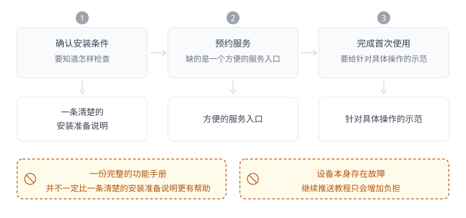
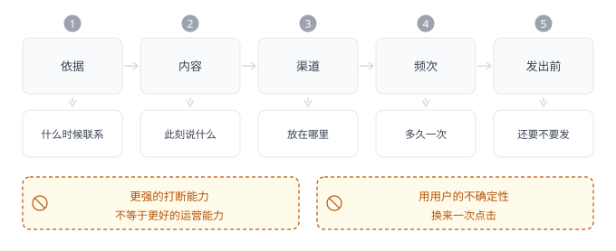

# 第 18 章 · 产品运营——让用户持续用好产品

## 引言

增长走过一次验证、进入日常经营以后，要处理的问题反而更具体了。一款产品运行一段时间以后，用户之间的差异会越来越明显：有人刚进来，还不知道从哪开始；有人已经买过，却没有顺利用上；有人形成了自己的使用方式，只在遇到问题时才需要帮助。从产品内部看，团队面对的是同一组功能、商品和服务；到了用户那里，它们却变成不同的事，一次新人活动、一份教程或者一张优惠券，能帮到其中一部分人，也可能和另一部分人完全无关。

产品运营的工作，就落在这些差异里：它得把已有能力带到具体的使用场景里，判断谁需要什么支持、什么时候提供，以及用户往前走了以后，原来的安排是否还合适。那么产品经理为什么得懂运营？只有看见用户是怎么一步步用上产品的，才知道哪些问题该改功能，哪些该补信息和服务，哪些只是时机还没到。否则一项能力用得不好，很容易被简化成增加入口、发个提醒或者再做一次活动，而用户真正缺的那部分帮助，仍然没有出现。

## 18.1 区分状态——不同用户需要不同的运营方式

一批没有复购的用户，放进同一个名单里，状态却完全不同：有人买的日用品还没用完、有人买的是耐用品、有人在首单以后经历过退货、还有人每周都有同类需求，只是后来去了别处。平台把他们归到一组，在统计上看没有问题，可接下来要是统一发券，运营就等于替所有人下了一个同样的判断：他们还想买，只是缺少一点优惠。这个行为只对其中一部分人成立，却无法促进潜在的购买需求，也安抚不了已经发生的不满。原因不同，接下来要改变的事也不同：

**表 18-1　五类未复购情形与处理方向**

| 没能再次购买的原因 | 先要改变什么 | 此时不该做什么 |
| :----------------------------- | :----------------------- | :------------------------- |
| 还没到正常的使用周期 | 等到需求临近再联系 | 高频发券催购 |
| 首单出现过退货、差评或服务问题 | 先把体验缺陷补上 | 用优惠盖过问题 |
| 需求稳定，却换了地方买 | 查价格、便利与供给 | 只提高联系频率 |
| 某些商品的二次购买明显更高 | 分别比较商品、人群与场景 | 把全部用户按一套方式运营 |
| 业务本身低频 | 延伸到相邻场景与关系价值 | 强行提高同类商品的购买频率 |

做用户分层之前，得先想清楚准备改变什么，因为这决定了哪些差异值得被看见。选商品时，看的是需求、偏好和使用场景；安排首次使用支持时，看的是用户已经完成了什么、还差什么；分配有限的人工服务时，就得同时看问题有多复杂、服务承诺和投入条件。年龄、城市、消费金额都有参考价值，但分类本身不会告诉我们该做什么，一个人所在的城市如果和当前服务没关系，也没理由只为了让标签更细就单独拆出一层。**用户分层有没有用，可以看一个很具体的结果：分开以后，我们是否会做不同的运营选择**。

容易被混在一起的，还有需求和使用阶段：需求回答的是用户想完成什么，使用阶段回答的是他对这项产品能力已经走到哪里。一个老客户第一次使用新的预约服务，照样可能需要引导；一个刚注册的人，如果已经熟悉同类工具，未必得从最基础的介绍开始。账号的新旧代替不了他对这项能力的熟悉程度；购买次数也包办不了对他需求的理解。实际工作中，可以先把当前要服务的任务定下来，再看用户是还没开始、正在尝试、能独立完成，还是中途卡住了，这样划出来的阶段，才对应得上支持上的差异。生命周期在这里是一种看清关系变化的方式，不是给所有产品套上同一组天数和名称。

再看贡献分层，要解决的则是另一件事：运营常用 RFM 观察最近一次购买、购买频次和购买金额，这些信息能帮我们识别交易关系的变化，也能给服务投入提供线索。但这三个维度得放回业务里解释：耐用品购买间隔长，不应直接与高频消耗品比较；一次高金额礼赠，未必说明以后会频繁购买；一位新用户当前贡献低，也可能只是还没有经历完整的使用周期。过去买了多少与眼下需要什么帮助，是两个有关联但不同的问题。若把高贡献用户自动等同于值得运营、低贡献用户自动等同于可以忽略，就会把关系未来的变化排除在判断之外。

分配资源时，差异化投入也有实际边界：复杂服务可以安排专人，高频重复问题可以备好清楚的自助说明，愿意为额外服务付费的用户可以获得相应权益。这里要比较的，是怎样用可承担的成本满足不同的需要，而已经承诺的交付、售后和基本服务仍然得兑现。一个交易金额不大的用户遇到错误扣款，不能因为价值分层靠后就长期得不到处理；相反，一位贡献很高的用户已经能够独立完成任务，也不必每天有人问候。**资源应当落在需要它的地方，单看用户贡献，既可能低估应当承担的责任，也可能增加没有必要的服务**。

这种边界在真实业务里看得比较清楚：屈臣氏门店里的美容顾问，本来就在做选品、肤质判断、搭配建议和使用答疑这些事，把服务延伸到企业微信和小程序以后，做的还是同一件事，只是不再受营业时间和是否到店的限制。这条服务通道连接了 4300 万以上的消费者，背后是 4 万多名门店顾问[^1]，这类业务值得投入人工，跟美妆行业适不适合做私域没有关系。交易之外本来就有问题要持续解答：肤质、搭配、用法和补货，用户会反复来问。换成一个买完以后不需要再咨询的业务，把人全交给人工跟进，这些投入马上就会变成浪费。

做状态判断时，区分事实与推断特别重要：用户主动来问安装方法，是比较明确的一条支持线索；多次翻看说明页，可能说明他有困难，也可能只是认真确认。没有登录记录，更不能直接认定他没在用，工具可能在线下发挥作用，商品用没用未必会留下平台看得到的数据。证据不足时，可以保留尚未明确的状态，用更轻量的支持方式，或者通过必要的询问补信息。为了给每个人都填满标签，作出过于肯定的解释，后面每个自动动作都会继续放大这个误判。

分层很容易越做越细，细到最后没人维护得动：属性交叉几轮，就会跑出一批人数很少、策略却相近的小群体。团队要为每一组准备内容、配置条件、处理例外，维护成本上去了，用户得到的帮助却未必更合适。如果两类人的障碍和支持方式基本一致，可以先合在一起；等新的差异真的改变了动作，再继续拆开。**对产品经理来说，真正要说清的，是分类依据从哪来、它准备支持什么选择、依据变了能不能被识别，分层做到这一步，才从一份用户描述，真正进了日常运营**。

## 18.2 推进使用——围绕关键行为安排运营动作

知道用户处在哪个阶段，还不足据此安排工作：「新用户需要激活」可以落到欢迎消息、新人券、课程、任务和人工回访，每一样看起来都是在帮用户开始。问题是，这些动作做完以后，用户到底多得到了什么。领过券不等于找到了合适的商品，看完课程不等于能处理真实的任务，加入社群也不等于建立了使用关系。运营得先确定一个对用户有意义的进展，再围绕它去组织支持。否则，任务完成率很好看，用户也只是熟悉了平台希望他做哪些事，却没有更接近自己来这里的目的。

这个进展不必很大，但得能让人感受到实际用处：一款协作工具，可以先帮团队做成一次真实的共同工作；一项预约服务，可以让用户顺当地约好并接受一次他需要的服务；一件要安装的商品，则得让用户真正用起来。确定下一步时，要同时考虑任务价值与完成条件：目标过小，只让用户点几个按钮，很难留下使用经验；目标过大，一开始就要求配置所有功能、补齐全部资料，又容易让准备工作超过用户能够承担的范围。我们需要在意的，是能不能先让他完成一件有意义、条件也基本具备的事，再让这次经验带出后面的使用。

拿一件需要安装的家用设备来说，用户收到货以后，下一步可能是确认安装条件、预约服务，再完成首次使用。这时候发一份完整的功能手册，未必比一条清楚的安装准备说明更有用。如果适配条件还没确认，用户要知道怎么检查；已经确认却不知道怎么预约，缺的只是一个方便的服务入口；装好了却不会用，得给针对具体操作的示范。同样是帮用户用好商品，支持得跟着任务往前走，要是设备本身出了故障，还一直推教程，只会添负担，因为问题已经不是用户靠学习能解决的了。

**图 18-1　支持随任务推进的三个时点**　支持要跟着任务走到当前这一步；一份完整的功能手册，哪一步都用不上。

在大家电上，这条判断表现得更直接：一台空调送到楼下，需求并没有完成，用户在意的，是还要多久能装上、什么时候能正常使用。美的和美团在空调这类商品上推进送装一体，把送达和安装预约合成一次上门交付，后来又联合多个品牌在更多地区做半日送装。同样是履约动作，往哪个方向加码，取决于用户什么时候真正用得上：生鲜看的是新鲜和准时，应急商品看的是立刻送到，大家电看的则是送到之后能不能马上用起来。

缺什么补什么，这一点在履约上看得最清楚；内容上也是同一个道理：有些商品的问题不在说明写得够不够，而在支持的形式。京东在手机、家电这类商品上试过用 3D 建模还原外观和包装细节，让用户在屏幕上就能看清实物，据其披露，部分场景里的订单增长最高到过 30%[^2]。这个数字能外推的范围有限，但方向值得记住：用户卡在「看不清」这一步时，再补几段文字帮助不大，该换的是支持的形式，而不是继续追加同一种内容。

由此安排运营动作，重点就从「还能给什么」变成了「当前缺什么」。缺少理解，可以解释用途和适用条件；缺少方法，可以用示范、模板或陪伴降低起步难度；缺少资料、权限或必要资源，得协助补齐；遇到具体服务问题，则得有人接住。换一种支持之前，先看它接不接得上用户当前缺的那一环。优惠补不上安装条件，教程替不了用户拿授权，更多提醒也没法让还没准备好的材料自动出现。产品经理熟悉页面和交互，运营熟悉用户联系和日常服务，两边得围绕同一个任务判断，才不至于各自加了动作，却没减少用户真正在承担的困难。几种缺口，对应不同的支持方式：

**表 18-2　四类缺口与对应的支持方式**

| 用户当前缺什么 | 判断依据 | 过度支持的代价 |
| :--------------------- | :------------- | :------------------------------- |
| 不清楚用途和适用条件 | 反复查看说明 | 讲得再全，也对不上当前这一步 |
| 不知道具体怎么做 | 装好后仍不会用 | 一开始就要备齐全部资料，反而卡住 |
| 缺资料、权限或必要资源 | 前置条件未确认 | 提醒再多，材料也不会出现 |
| 遇到具体的服务问题 | 明确提出问题 | 人工一直兜底，问题还在 |

支持到什么程度，得看任务本身和出错的代价：简单、重复的问题，靠清楚的说明、就近能找到的帮助就能解决；不熟悉且容易出错的任务，先给一次示范；涉及复杂判断的服务，就交给人来做。人工并不一定就比自助差，也不该成为给所有人的默认选择。判断投入时，看的是任务本身有多复杂、出错代价多大、有没有服务承诺，以及这类问题出现的范围。少量高复杂度问题交人处理，比建设一套庞大的自动流程更合适；大量用户每天都在同一个位置求助，就该回到产品或说明本身，不能一直用人工重复解释来撑住表面顺畅。

如果帮助的目标是让用户学会使用，支持还应当逐步减少：开始时提供示例，随后让用户尝试，再在必要位置给反馈，比始终由运营代为完成，更容易留下可独立使用的经验。但也不必一律让用户自己动手：有些产品出售的本来就是代办、咨询或托管服务，持续由专业人员完成工作正是其价值。要先辨认服务承诺：用户购买的是能够自己使用的能力，还是由他人替自己完成的结果。前者关注支持是否帮助形成独立使用，后者关注服务是否稳定、信息是否清楚，不应为了减少人工而把原本承诺的工作重新交还用户。

还要看几个支持动作之间能不能接上：用户已经提交过资料，下一位服务人员能否知道；客服确认了问题，后续内容能否回应这个问题；教程说可以完成的操作，当前产品是否真的提供。用户经历的是同一件事，内部却可能由内容、客服、运营和产品分别接手，各环节各自做完了活，不代表用户已经往前走了。安排支持时，从用户已经完成了什么、还缺什么继续，而不是每换一个渠道就让他重新说一遍。这种衔接先用简单的记录和约定就能做，不一定非得马上建一套完整的平台。

**运营支持最终要留下的是用户能够获得的结果，而不是一串被完成的运营任务**。用户开始使用以后，可以继续了解哪些能力对他有帮助，但没有必要把所有功能都推给他，一个人稳定使用产品的一小部分，也已经很好地解决了他的问题。判断下一步是否值得安排，要看新的需求有没有出现，增加的支持能否带来实际改善。用户用得越来越顺，运营动作就可以变少；任务本身一直复杂，服务也可以长期在，两种情形都要回到用户买下和使用这项产品的理由。

## 18.3 安排触达——在合适的时候提供有用的信息

同一位用户在同一天收到新人优惠、会员活动和品类推荐，每个团队都有充分理由：新人活动还没结束、会员日按计划进行、用户最近也看过相关商品。从活动出发，发送对象没有选错，时间没有配错，内容也与业务有关，但从用户出发，却是同一个品牌、平台反复出现。这种冲突提醒我们，触达不能只以平台活动节奏安排，还得看一个用户已经接收了什么，企业把工作分给不同团队，用户不会因此把自己的注意力也分成几份。

什么时候联系用户，先得有个依据：节日、开学、预约日期、明确的活动截止时间，这些本身就能构成联系理由，固定日程并非没有价值；用户刚完成购买、主动来问问题，或者接近已知的使用周期，也可能形成更贴近个人处境的时机。两者的区别，在于判断是从哪来的：**企业日历方便组织统一动作，用户行为才提供个体线索**。选触发点时，还得给用户留下调整空间。补货时间可以按使用情况改，预约提醒要跟着新的预约时间走，公共活动则得说清跟用户有什么关系。这样触达才回应得了具体处境，而不只是把固定日程换成自动条件。

有些做法把依据交给了需求本身，亚马逊的订阅补货就是如此：纸巾、宠物用品、洗护这类消耗品，用户可以自己设定配送周期，也能在下一单到来之前改数量、跳过，或者直接取消。它省掉的是反复记住、重新搜索、再次下单这些麻烦，而不是用更多消息把用户拉回来。这套机制能成立，前提是周期接近真实的使用节奏：一次用不完的份量却按月准时送到，省事很快就会变成占地方；想取消却找不到入口，自动配送就会从省事变成麻烦。

**图 18-2　一次触达从依据到发出的判断链**　一条触达要依次经过依据、内容、渠道、频次和发出前的判断，缺了哪一步都是打扰。

时机明确以后，还得挑此刻该说的内容：补货提醒的价值，在于减少用户记忆和寻找的麻烦；服务提醒的价值，在于让他提前准备、别错过；使用建议则应该接住正在发生的任务。如果联系的理由明明是预约确认，点进去却先看到一屏促销，用户还得回头去找原来那件事，这次触达就没有兑现自己的承诺。内容和落地后的动作得接上：告诉他为什么此刻收到、有什么要注意、下一步去哪完成。用户不用搞清楚这条消息对应哪个内部活动，只要能很快判断它跟自己有没有关系。

渠道怎么选，先分清信息的紧急程度和复杂程度。紧急程度、信息复杂程度、是否需要往返沟通，以及用户愿意怎样接收，都影响选择。简单状态可以在合适入口清楚展示，复杂问题可能需要保留对话和资料，涉及明确时间的服务可以采用用户已经约定的提醒方式。电话能够引起注意，也可能打断工作；群消息方便统一说明，却未必适合个体问题；站内内容打扰较少，但用户暂时不会进入时，也可能错过必要信息。**比较渠道，是为了把信息放在用户能够处理的位置，不能把更强的打断能力直接当成更好的运营能力**。

频次得放在一起看：一个部门每周联系两次，另一个部门也每周两次，合起来早已不是任何一方单独评估的节奏。运营得能认出同一时期里重复的目的、相近的内容、互相冲突的要求，决定合并、延后，还是不发送。服务问题还没解决时，营销信息通常该让出位置；同一优惠已经领过，后续通知就该反映这个事实；用户已经通过一个渠道得到清楚答复，其他渠道就不必重复发同样的解释。具体频次没有一套适合所有业务的固定数字，关键是它同时受用户偏好、近期联系和实际需要的约束，而不是让每场活动各自把额度用满。

所以，一条消息准备好了，也不代表就得发出去：发送前仍需检查内容是否有效、用户是否已完成对应事项、当前是否有更重要的联系，以及用户是否明确拒绝这类信息。停止某条提醒，是触达安排的一部分，不应只在投诉以后补上。渠道退出也有具体含义：用户不愿接收促销，不代表不需要订单进度；愿意接受服务消息，也不代表接受所有营销。产品在这里得帮团队说清联系的目的和用户的偏好，避免不同信息借同一个入口发出，最后让用户只能在「全部接受」和「全部关闭」之间选。

观察触达效果时，打开与点击只是中间反馈：预约提醒有没有让用户顺利安排时间，指导消息有没有减少后续求助，补货入口有没有帮助完成适合的购买，这些都比消息被看见更接近目的。退订、反复询问和错误进入，也会暴露内容或时机的问题。运营当然希望有用的信息被看见，但如果不断提高打开率的办法，是把标题写得更紧张、把内容说得更含糊，就等于用用户的不确定性换来一次点击。**一次好的触达，应当在用户打开以后，兑现联系他的理由**。

## 18.4 设计激励——奖励怎样帮助形成有效行为

信息和时机都安排妥当，用户愿不愿意照着做，还要看激励。奖励很容易让行动变得明显：原来很少有人参加的任务，增加积分以后开始有人完成；邀请附带权益，链接也更容易被转发出去。但动作增加以后，还要继续看用户为什么参与，这些动作又留下了什么。一个注册就给奖励的活动，参与者注册完就离开，不一定是没理解规则，反而说明规则被完整执行了一遍，平台期待的是后续使用，实际奖励的却只是建立账号，两者之间的距离，不能全靠用户自行补上。

设计激励时，得先想清奖励要起什么作用：有些用户确实需要产品，却不愿为第一次尝试承担全部成本，试用或适当优惠可以降低门槛；有些行为是替别人或平台提供了价值，比如贡献真实资料、给出有效服务，奖励是在补偿这份投入；还有一些优惠只是改变了成交价格，它可以是正常的商业安排，但不能因此就说使用问题已经解决。目的不清楚时，团队往往直接讨论奖品够不够大，随后把不理想的结果解释成力度不足。若用户缺的是信任、使用条件或者合适供给，继续加大奖励力度也只是让更多人短暂跨过门槛。

奖励谁得和奖励什么要一起考虑：邀请场景里，邀请人承担推荐与解释的成本，被邀请人承担尝试的成本，真正阻碍行为的可能集中在其中一侧，给双方同样的奖励，未必比针对主要障碍给支持更有效。奖励形式也应符合参与者的需要：产品内权益对正在使用的人可能很有价值，现金用途更广，却也可能吸引只关心奖励的人；服务便利能够减少长期负担，但对于暂时没有服务需求的人，吸引力又可能有限。**没有一种奖励天然优于其他形式，关键在于它与目标行为、参与成本和实际需要之间的关系**。

把奖励条件定在哪里，会影响参与者怎么选：奖励发布数量，容易使人优先完成更多发布；奖励符合要求的内容，才有机会让注意力转向内容本身；奖励发出邀请，还是奖励被邀请人完成一次有效使用，参与者去找的人也不一样。设置条件时，得先说清楚什么行为值得获得回报，也得让参与者能够理解并控制自己的投入。若一项奖励依赖许多与他无关的后续条件，等待又很长，即使最终结果更接近经营目标，也会让人无法判断这件事是否值得做。

奖励发得早还是晚，各有各的代价：发得早，反馈明确，却可能来不及识别那些浅层或无效行为；发得晚，能看到更多后续事实，却也增加了等待和信任成本。一种可行的做法是：先清楚展示资格、完成进度和预计兑现时间，等约定条件满足再发，让用户知道自己的投入有没有被记录下来。这里的关键是条件要稳、解释要清：不该等用户做完动作再临时加条件，也别把处理不过来的审核长期留给用户等待。奖励规则本身就是一项承诺，它的兑现体验也会进到用户对产品的判断里。

奖励放在哪一步发放，结果会很不一样：注册成功就发，优化出来的是更多注册；等一次核心行为完成再发，邀请人才会去找那些更可能真正用起来的人。Airbnb 把奖励压到了很靠后的一步：愿意推荐的人本身要有真实的使用记录，被邀请的一方也要完成一次符合条件的住宿，奖励才成立。它想推动的是一笔真正发生的消费，而不是一个账号。设计一次奖励，有几件事要先定下来：

**表 18-3　制定奖励要先确定的五件事**

| 设计维度 | 要回答的问题 | 依据 |
| :------- | :------------- | :------------------------------- |
| 明确目的 | 奖励为什么发 | 缺信任或条件时，加奖只是短暂跨过 |
| 选择对象 | 阻碍在哪一侧 | 两侧承担的成本并不相同 |
| 选择形式 | 参与者需要什么 | 与目标行为和实际需要相配 |
| 设置条件 | 奖励什么行为 | 参与者能否理解并控制投入 |
| 决定时点 | 在哪个环节发 | 规则稳定、说得清楚 |

当参与者开始凑数、拆分任务或者反复领取时，除了识别异常，还要回看规则怎样引导了这些动作。按提交次数奖励，会使一份完整贡献被拆成多次；只奖励新增，会让维护既有用户的人失去动力；门槛设置在某个数量附近，又可能让人把精力集中在达到门槛后立即停止。这些不是每次都会发生的必然结果，却是设计时值得先想一遍的反应。控制办法也不只是不断增加限制，也可以调整奖励对象、质量要求、领取范围或验证方式，同时观察新规则是否让正常参与者多出麻烦，规则越复杂，用户越难理解，运营也越难解释一致。

还得把临时激励和持续权益分开：首次试用的支持，可以在用户已经能判断产品价值以后结束，再看他是不是还有继续用的理由；会员配送、专业服务或长期贡献回报，本来就是持续交换里的一部分，不该为了证明用户不靠奖励也能活，就一律拿掉。要判断的是这份回报对不对得上持续价值、成本扛不扛得住、用户清不清楚拿它的条件。已经给出的承诺要调整，也得顾及原来的预期，不能把结束一场活动和取消长期权益当成一回事。

对激励的评价，最终应回到它准备促成的事情：一次参与增加了多少真实使用，贡献是否能够被采用，交易是否正常完成，得到这些结果需要付出多少奖励与服务，才能说明继续投入的理由。必要时可以通过合适的比较判断哪些行为本来就会发生，但无需把所有结论压缩成一个看起来漂亮的活动产出。**奖励可以帮助用户跨过一道门槛，门槛之后仍然需要有值得继续的事情**。如果运营长期只能通过增加奖励维持同一动作，就要重新检查产品价值、参与条件和目标人群，而不只是设计下一档奖品。

## 18.5 调整策略——用户变化以后，运营也要跟着变化

前面这些安排，都默认用户的情况停留在进入名单的那天，但一套运营设计在开始时可能完全合理，跑了一阵却已经不合时宜。用户已经完成了首次使用，仍然收到入门任务；正处理着退货，另一条流程又把他塞进了复购活动；某项权益早就没了适用条件，页面却还在引导他领取。这些问题不一定是最初判断错了，也可能是后来的事实没能进入原有安排，用户已经往前走了，策略还停在他进名单的那一天。

所以一项策略，除了明确面向谁、希望帮他完成什么，还得说明在什么条件下继续。刚进名单时符合，不代表后面每一步还符合。在安排关键支持、投入较高成本或发出新承诺之前，得先确认原来的需求还在、前置条件没变，并检查是否已有更直接的信息。策略可以按相对稳定的规则运行，但规则要能吸收新的事实，而不是把预先排好的动作逐项执行完。对产品经理来说，退出和转交条件与进入条件同样重要，它们决定了流程能否跟着实际使用变化。

目标已经达成，当前策略就可以结束：结束新人引导，不意味着与用户失去关系，后续可能进入正常服务，也可能暂时无需任何额外动作。若一位用户已经独立完成了原定任务，剩余课程、回访和试用支持就要重新判断，不能只因为计划尚未执行完而照常推进。结束之前，也应留下已经完成什么、还有哪些承诺需要兑现，让后续服务不必重新从头判断，支持计划应该服从实际进展，下一项安排则要有自己的理由。

没完成的，得拆开看：有意愿但卡住的人，可能还在找帮助；没回应的人，可能没看到，也可能这会儿根本不需要。这两种人不能都推进「再提醒一次」那个分支，前者该换支持方式，给更具体的材料、人工解释或实际条件；后者可以先看看信息还有没有关、联系还有没有必要，再决定等还是停。用户已经明确说不需要某种联系时，也不能因为模型还把他判成高潜人群就继续推。**行为推断是为了帮助判断，不能覆盖用户已经说清楚的选择**。

还有一种变化来自服务失败，得优先处理：用户投诉、申请退款或把问题摆到明面上之后，营销侧得意识到这段关系里还有没解决的事。切换到服务处理，得保留必要的进度告知和解决入口，而不是简单地把所有消息停掉。这时候还接着推复购优惠，用户只会觉得平台只关心下一笔订单，问题解决以后，也不必立即恢复原来的营销节奏。用户是否还有相同需求、是否愿意继续被联系，得根据实际情况判断，不能把客服关闭工单当成关系已经恢复的证明。目标完成、受阻、没有响应、服务失败，对应的处理并不相同：

**表 18-4　策略切换的四种触发与处理**

| 用户的情况 | 策略该怎样 | 不该做什么 |
| :--------------- | :----------------- | :------------------------- |
| 原定任务已经完成 | 结束当前策略 | 只因为计划没跑完就照常推进 |
| 有意愿但受阻 | 换一种支持方式 | 再提醒一次 |
| 没有响应 | 先判断是否需要联系 | 与受阻的人同样处理 |
| 服务失败尚未解决 | 转为服务处理 | 继续推复购优惠 |

暂停尤其要有自己的含义：如果只是把下一次发送延后几天，随后继续相同内容，这并没有改变原来的判断。合理的重新进入依据，可以是用户主动提出新问题、出现了相关需求、条件已经补齐，或者到了双方约定的时间。对于低频商品和服务，一段没有交易的时间本来就是正常关系的一部分，用户不必每天证明自己仍然喜欢品牌，平台也不必通过不断联系来证明自己没有忘记他。**保持清楚可用的服务入口，有时比持续制造访问理由更重要**。

时间一长，策略本身也会过期：商品更换后，原来的说明不再适用；服务范围变化后，旧提醒承诺了无法提供的能力；优惠结束后，仍然运行的流程会继续引导用户寻找已不存在的权益。运营得定期检查正在执行什么、依据是否仍然有效、不同安排是否冲突，并为不再适用的策略留下退出方式。每增加一项自动安排，实际上也增加了一份待维护的承诺，自动化减少的是重复执行，不会自动保证内容始终正确、对象始终合适。若没有人负责这些条件，旧策略会在业务变化以后继续运行，连带着把错误也一遍遍重复下去。

规模上来以后，要维护的东西也跟着变了：一个栏目里先跑通的机制，验证之后铺到更多商品和入口上，流量盘子从日均 8.7 万涨到 21 万[^3]，看起来只是把效果放大了。但问题出在另一个地方，原来这件事由一两个人做，标准是「做得好不好」，等二十个人照同一套模板同时做，标准立刻变成「会不会出错」。排版错误、标题错别字、标签不统一开始集中出现，用户看到的每个页面都代表同一个品牌，粗糙和精致在他那里没有区别，这一层没有处理好，前面验证过的东西就会被规模本身抵消。规模带来的考验，在公开案例里也能看到：美团做即时零售，单量继续往上加，全量订单的平均送达时间仍然保持在 34 分钟[^4]。规模越大，当初让用户选择它的那个理由，反而越容易被增长本身冲淡，而它恰恰是最不能丢的东西。对内得把流程重新定成规矩，对外得把已经许下的承诺继续兑现，这两件事，都不会因为订单变多而自动完成。

验证一个判断和维持一个判断，需要的是不同的能力，前者靠实验和证据，后者靠模板、复核和责任分工。谁来复核、什么条件下停下、规则改了以后旧流程怎么办，运营这部分工作决定了一次成功能不能留在原地，而**让用户持续用好产品，需要持续判断，不一定需要持续增加动作**。有些阶段需要主动引导，有些需要耐心服务，有些则应该把空间交还用户。一次运营调整是否有价值，可以看用户面对的事情有没有更容易完成，遇到问题时能否得到合适支持，关系变化以后产品是否仍然理解他的处境。用户能够自己使用的能力逐渐形成，承诺提供的服务稳定兑现，已经不需要的干预及时退出，运营才有机会从不断制造动作，走向维持一段有用、可持续的关系。

## 闲言碎语

运营的许多工作会被记进成绩：发送量、活动数、参与人数。那些没有继续发生的动作，则不太容易留下痕迹：一条已经没有必要的提醒被取消、一位用户的问题先于营销被处理、一次没有新需要的沉默被允许保留。它们未必能够单独变成一项醒目的成绩，却会影响用户怎样理解这个产品，是在需要的时候能得到帮助，还是只要留下联系方式，就会不断被要求做些什么。

我希望产品经理能够看见这部分工作，产品提供了能力，运营让能力进入具体的使用过程，两者要共同理解用户正在做什么。一件被取消的提醒、一次被压住的推送，看上去是「少做了什么」，其实恰恰是运营在替用户守边界。**一个人愿意继续使用，可能因为我们在某个时刻多做了一点，也可能因为我们终于没有再增加负担**。能够分清这两种情况，再决定下一次怎样出现，是我理解的产品运营中值得反复练习的判断。加一个动作很容易，难的是想清楚它到底是在帮忙，还是在添重量。

[^1]: 屈臣氏的门店顾问与消费者规模，来自腾讯云公开的案例信息，按转述口径处理，未经逐项核验。

[^2]: 京东 3D 建模相关场景的订单增长数据，来自其公开披露，按转述口径处理，未经逐项核验。

[^3]: 文中所涉运营数据均为真实项目数据，已做脱敏处理。

[^4]: 美团即时零售的全量订单平均送达时长，来自其公开披露，按转述口径处理，未经逐项核验。
